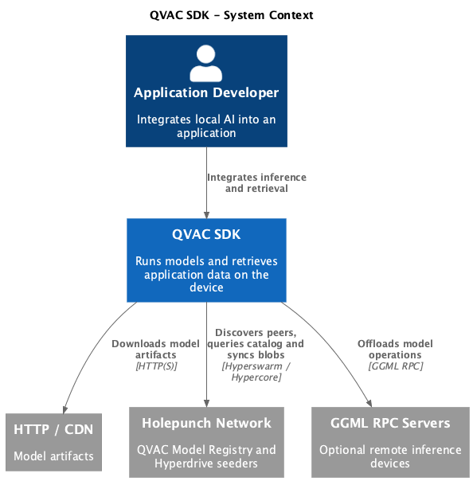
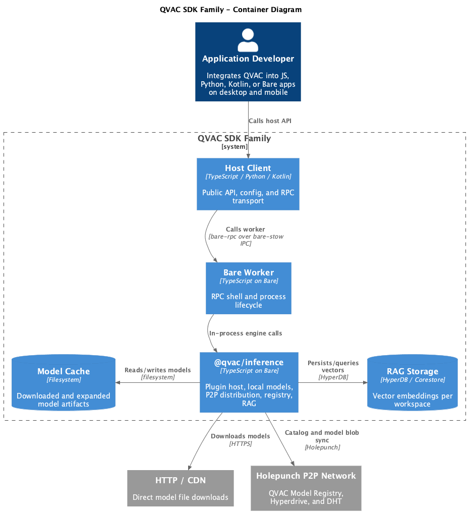
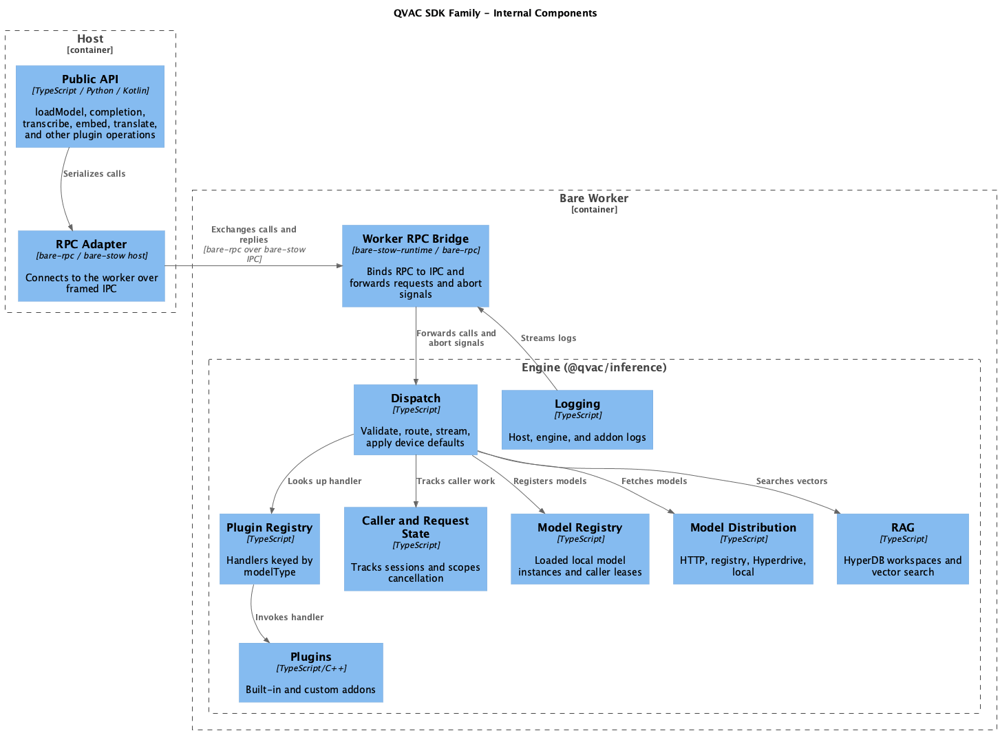
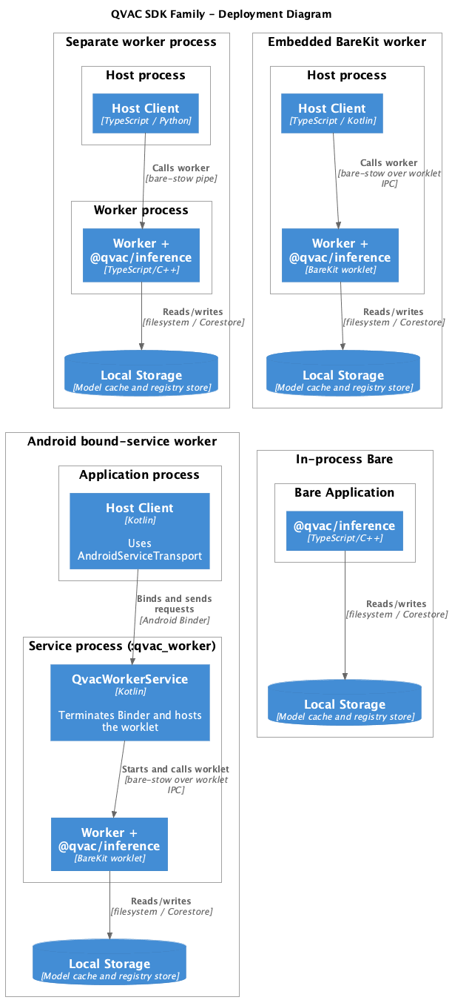
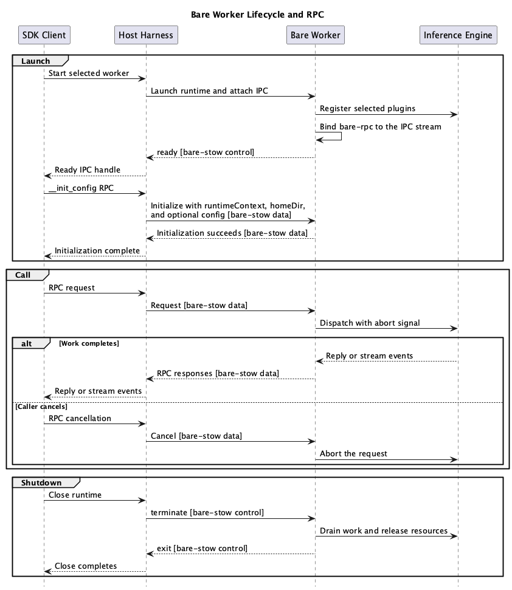
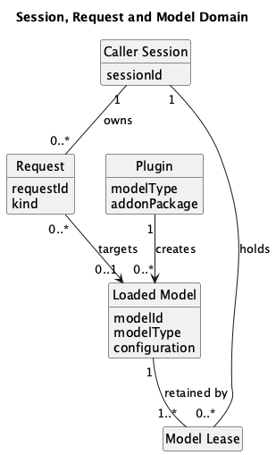
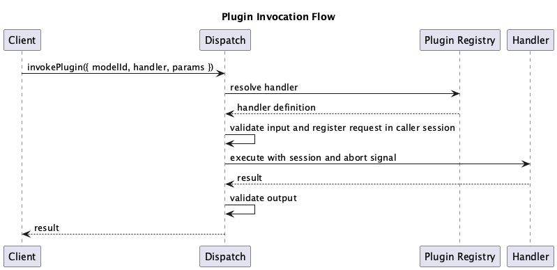
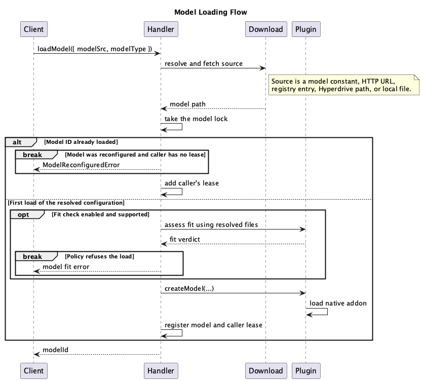

# QVAC SDK Architecture

[Yuri Samarin](https://github.com/yuranich) · QVAC Team

Last updated November 27, 2026

- [C4 Model Reference](https://c4model.com/)
- [Agent Integrations](./AGENT-INTEGRATIONS.md)
- [Architecture Principles](./PRINCIPLES.md)

## Product Executive Summary

QVAC SDK runs models and works with vector indexes on the device. The same inference engine serves two entry points.

- **Worker-backed.** `@qvac/sdk` hosts the worker for TypeScript applications. `tetherto-qvac-sdk` and the Kotlin SDK provide typed clients for the same worker contract. A bare-stow harness starts the Bare worker and gives the client an IPC stream. The worker owns the engine and its native addons.
- **Direct Bare.** A Bare application imports `@qvac/inference`, registers its plugins, and calls the engine in its own process.

The engine owns request dispatch, caller sessions, loaded models, artifact resolution, and vector indexes. It loads model files from a local path or a cache populated through HTTP, the QVAC Model Registry, or Hyperdrive. An application can also opt in to GGML RPC devices for supported model loads.

## System Context Diagram

[PlantUML source](puml/01-system-context.puml)

*Blue identifies the SDK. Grey boxes identify external systems. Arrows show the direction of the dependency.*

The registry supplies catalog data and model blobs through Holepunch. Direct HTTP downloads and native GGML RPC use their own network paths.

## Container Diagram

[PlantUML source](puml/02-container.puml)

*Boxes show the host, worker, and engine roles. Cylinders show persistent stores. Grey boxes show model sources.*

The host client owns the application-facing API and its connection to the worker. The worker owns the inference engine and performs model I/O. The [deployment diagram](#deployment-diagram) shows which boundaries cross an OS process.

## Component Overview

[PlantUML source](puml/03-component-overview.puml)

*The host connects to the worker over IPC. Calls from the worker bridge into the inference engine stay in process.*

The worker bridge adapts the language-neutral RPC contract to the engine's `send`, `stream`, and `duplex` entry points. Dispatch validates the caller and routes each operation to the engine subsystem that owns it.

## Worker Generation & Bundle System

The SDK's `bundleSdk` function reads the plugin list and optional RPC server provider from `qvac.config.{json,js,ts}`. It writes `qvac/worker.entry.mjs`, which imports the selected plugins and calls `startWorker` from `@qvac/sdk/worker`. Bare-stow packages the entry with a launcher and harness for the selected target and host language.

`qvac bundle sdk` accepts `bare-sidecar`, `react-native`, and `pear-runtime` for `--target`, and `javascript` and `python` for `--language`. The Kotlin runtime build scripts call `bundleSdk` directly with `target: 'bare-kit'` and `language: 'kotlin'`.

| Target | Host and launcher | Native addon packaging |
|---|---|---|
| `bare-sidecar` | JavaScript desktop or Python starts a Bare subprocess | Prebuilds accompany the bundle |
| `pear-runtime` | The JavaScript harness launches the bundle through the registered Pear runtime | Prebuilds accompany the bundle |
| `react-native` | Expo starts a BareKit worklet through the generated JavaScript harness | Expo prebuild links the selected addons into BareKit |
| `bare-kit` (Kotlin build scripts) | The Kotlin harness starts a BareKit worklet on Android or desktop JVM | Android links addons into the selected profile's AAR. The experimental JVM host embeds the bundle and desktop native resources |

The JavaScript harness is written under `qvac/worker/` by default, with its entry module, manifest, and bundle. Python can use a generated harness for a custom bundle or the worker shipped in the release wheel. Kotlin profile builds generate the Kotlin harness and package it with their worker and selected addons. The bundle verifier checks native prebuilds for the selected targets before replacing an existing bundle. Split addon packages resolve their platform-specific prebuilds through `#host-addon`.

**TypeScript desktop worker resolution**

1. `QVAC_WORKER_PATH`, pointing to a bundled worker directory or an unbundled worker entry.
2. The worker bundled with Electron under its resources directory.
3. `qvac/worker/` in the project.
4. `qvac/worker.entry.mjs` in the project, launched unbundled.
5. The SDK's unbundled default entry, with all built-in plugins.

The Pear client selects a `pear-runtime` bundle from the applicable directory locations. On a sidecar host an unbundled entry uses the SDK's shim and the installed native prebuilds. It connects through the same bare-stow IPC interface as a bundle. See [Python worker resolution](../../packages/sdk-python/README.md#worker-resolution) and [Kotlin packaging](../../packages/sdk-kotlin/README.md#package-naming).

## Deployment Diagram

[PlantUML source](puml/04-deployment.puml)

*Process boundaries show where the host, Android service, and worker run. Arrows identify the IPC path for each deployment.*

| Platform | Worker placement | Client-to-worker path |
|---|---|---|
| Node.js, Bun, Electron | Separate Bare subprocess | bare-stow over the `bare-sidecar` IPC pipe |
| Python | Separate Bare subprocess | bare-stow over the `bare-sidecar` wheel's IPC pipe |
| Pear with `@qvac/sdk/pear` | Worker launched by the registered Pear runtime | bare-stow over the Pear worker pipe |
| Expo / React Native | BareKit worklet in the app process | bare-stow over worklet IPC |
| Kotlin Android (embedded) | BareKit worklet in the app process | bare-stow over worklet IPC |
| Kotlin Android (bound service) | BareKit worklet in the app-private `:qvac_worker` process | Android Binder to `QvacWorkerService`, then bare-stow over worklet IPC |
| Kotlin desktop JVM (experimental) | BareKit worklet inside the JVM process | bare-stow over worklet IPC |
| Direct Bare | Engine inside the Bare application | In-process calls |

TypeScript, Python, and Kotlin use their language's bare-rpc implementation for the worker connection. See the [Android service transport](../../packages/sdk-kotlin/README.md#android) and [desktop JVM host](../../packages/sdk-kotlin/README.md#desktop-jvm).

## RPC Communication Flow

[PlantUML source](puml/05-rpc-communication-flow.puml)

*The harness owns launch and channel lifetime. Control frames carry worker state. Data frames carry bare-rpc calls and replies.*

The worker registers its plugins and binds the RPC endpoint before the harness reports `ready`. The host then sends `__init_config` with its runtime context and home directory, along with any custom configuration. Application calls start after the worker acknowledges initialization. Bare-stow frames both the RPC byte stream and the lifecycle signals, including `ready`, `error`, `exit`, and `terminate`. The SDK contract supports request/reply, server streaming, and duplex calls.

A client timeout, cancellation, or early stream close can abort the corresponding request in the engine. `deadlines.capabilities` configures opt-in queue, idle, and run deadlines by capability ID. The separate `deadlines.load.loadMs` limit starts after the download. A call can supply an unset limit or shorten a configured one.

During an orderly shutdown the harness sends `terminate`, and the worker closes the engine, draining work and releasing models, registry leases, and vector indexes. Host adapters supervise shutdown and stop an unresponsive worker.

## Domain Model Diagram

[PlantUML source](puml/06-domain-model.puml)

*The relationships show model sources and plugins, inference inputs and outputs, and how sessions own requests and keep models loaded.*

Calls without an explicit session run as the runtime owner. A caller session scopes requests by `(sessionId, requestId)`. `openSession({ grant })` can restrict calls through that handle to permissions such as `transcription/transcribe` or `runtime/loadModel`. An operation that requires a permission outside the grant fails with `CapabilityNotGrantedError`.

Sessions loading the same configuration share one native model instance through leases. Releasing the last lease unloads the model. A reload requires sole ownership of the model's leases.

Closing a session cancels and drains its requests, disposes its vector indexes, and releases its model leases. The owner controls runtime-wide operations such as shutdown, suspend, cache deletion, and starting or stopping native RPC servers. The owner's model-wide cancel can reach work from all caller sessions. Session handles coordinate callers inside a trusted runtime.

## Plugin Architecture

A `QvacPlugin` defines a canonical model type, addon metadata, a load-config schema, a model factory, and handlers. Plugins can also provide artifact resolution and memory-fit hooks. Handlers declare Zod request and response schemas for unary, streaming, and duplex operations. Direct Bare consumers register the plugins they need. The SDK default entry registers the built-in set, and a custom bundle registers its configured subset.

The optional `provides` field declares the capability contracts a plugin implements. Built-in plugins declare their contracts through this field. `registerPlugin` rejects invalid declarations, including mismatched handler call shapes. `getRuntimeCapabilities()` reports the contracts and major versions available from registered plugins.

| Plugin | Model type | Native addon |
|---|---|---|
| LLM completion | `llamacpp-completion` | `@qvac/llm-llamacpp` |
| Text embeddings | `llamacpp-embedding` | `@qvac/embed-llamacpp` |
| Decision | `llamacpp-decision` | `@qvac/embed-llamacpp` |
| Reranking | `llamacpp-rerank` | `@qvac/embed-llamacpp` |
| Image embeddings | `ggml-image-embedding` | `@qvac/classification-ggml` |
| Stereo depth | `ggml-stereo-depth` | `@qvac/classification-ggml` |
| Whisper | `whispercpp-transcription` | `@qvac/asr-ggml` |
| Parakeet | `parakeet-transcription` | `@qvac/asr-ggml` |
| MOSS transcription | `moss-transcribe` | `@qvac/asr-ggml` |
| BCI Whisper | `bci-whispercpp-transcription` | `@qvac/bci-whispercpp` |
| Translation | `nmtcpp-translation` | `@qvac/translation-nmtcpp` |
| TTS | `tts-ggml` | `@qvac/tts-ggml` |
| OCR | `ggml-ocr` | `@qvac/ocr-ggml` |
| Diffusion, video, upscale | `sdcpp-generation` | `@qvac/diffusion-cpp` |
| Audio generation | `audiogen-ggml` | `@qvac/audiogen-ggml` |
| Vision-language-action | `ggml-vla` | `@qvac/vla-ggml` |
| Classification | `ggml-classification` | `@qvac/classification-ggml` |

Custom plugin packages expose their manifest through a `/plugin` subpath. Built-in model-type aliases normalize to the canonical types before dispatch.

[PlantUML source](puml/07-plugin-invocation-flow.puml)

*The sequence follows one plugin invocation after dispatch receives it.*

A plugin operation inherits the calling session and abort signal. The plugin can pass that context to nested engine operations so cancellation follows the whole request.

`qvac serve` can also invoke registered custom handlers over HTTP through `/qvac/v1/plugins/:name/invoke`. The route requires `--enable-admin` and uses the worker's plugin invocation API. See the [plugin invocation route](../../packages/cli/src/serve/extensions/default/routes/plugins.ts).

## Model Loading Flow

[PlantUML source](puml/08-model-loading-flow.puml)

*The flow shows how the engine resolves artifacts and either reuses a loaded model or loads a new one.*

The loader accepts local paths, source URIs, descriptors, and generated model constants shared across TypeScript, Python, and Kotlin. Downloads write to partial files and move them into place after verification. Per-resource file locks let processes sharing the models directory coordinate downloads and deletion. The runtime serializes loads by model ID. Reloading can change the loaded configuration while preserving the ID. If the loaded configuration differs from the original, a caller without a lease who requests the original configuration receives `ModelReconfiguredError`.

`assessModelFit` runs each supported addon's fitter in the engine process using a local file or a weightless registry description. It sums estimated allocations by memory pool, accounts for devices sharing memory even for a single model, and reports why a result is unknown. `qvac fit` and the HTTP model-fit endpoint use the same assessment. At load time the fitter uses the resolved files. `modelFitPolicy` can log the verdict, refuse an oversized load, or skip the check. See [Model Fit Assessment](../../packages/sdk/docs/assess-model-fit.md) and [Model Cache](../../packages/inference/docs/model-cache.md).

## Vector Indexes and Retrieval

The SDK provides embeddings and a session-owned vector index API. TurboVec runs index operations asynchronously on addon-owned threads. The engine serializes operations on each index and disposes that session's indexes when it closes.

Applications that need document ingestion, chunking, and scoped search use the standalone [`@qvac/rag`](../../packages/rag/README.md) library with a caller-owned Corestore and an embeddings port. `qvac serve --openai` uses that library directly for `/v1/vector_stores`. The CLI owns the vector stores and calls the SDK for embeddings. See [Migrate from the SDK RAG API](../website/content/docs/resources/rag-migration.mdx).

## Model Registry (Online Catalog)

The engine owns the `@qvac/registry-client` integration. The SDK exposes catalog listing, search, and lookup, and returned descriptors can be passed to `loadModel()` or `downloadAsset()`. Multiple processes can take turns using the same registry Corestore. The engine holds the store while it has operation leases and hands it over between operations when another process is waiting.

## Native GGML RPC

The engine can register an optional RPC server provider. In a worker bundle, select it through `rpcServerProvider`. The provider starts and stops native servers, and discovery uses a shared Hyperswarm topic to advertise and find candidate endpoints. The application passes selected endpoints and their device aliases to a supported model load. Native GGML RPC carries inference traffic over TCP or RDMA where supported. See the [SDK RPC server example](../../packages/sdk/examples/rpc-server.ts).

## Language Contract

The SDK exports the language-neutral worker contract on demand from its schemas and method registry with `npm run contract:export`. The JSON artifacts are written under [`packages/sdk/contract`](../../packages/sdk/contract/README.md).

| Artifact | Role |
|---|---|
| `schema.json` | Request and response JSON Schema and registered public constants |
| `manifest.json` | RPC methods, call shapes, and owner-only operations |
| `models.json` | Model constants and artifact metadata |

The contract JSON and generated client sources are build outputs. The Python and Kotlin build, test, and packaging workflows export the contract and then generate typed calls, models, and constants. Each client supplies its own transport and lifecycle. The [SDK e2e catalog](../../packages/sdk-e2e/README.md) drives JavaScript, Python, and Kotlin runners, including the built Python wheel and the Kotlin Maven package. The [SDK release train](../ci/RELEASE-TRAIN.md) checks and publishes the packages in dependency order.

## Security Model

| Boundary | Mechanism |
|---|---|
| P2P model distribution | Hyperswarm encrypts connections with Noise |
| Model integrity | SHA-256 verification when the source supplies a checksum |
| Model cache | Paths are constrained to the cache layout. OS permissions govern on-disk access |
| Local worker IPC | The process pipe or worklet channel stays local to the trusted host |
| Android service | A non-exported Binder service restricts binding to components under the owning application's UID |
| Native GGML RPC | Trusted private network. Native inference traffic is unauthenticated and unencrypted, and a discovery topic supplies no peer identity |

## Failure Modes

| Failure | Behavior |
|---|---|
| Download interrupted | Partial data remains available for HTTP range resumption or reuse of previously fetched P2P blocks |
| Model fails to load | The engine preserves the cause and leaves the model unregistered |
| Fit policy refuses the load | The engine rejects the load before the plugin allocates the model |
| Worker deadline expires | The caller receives `DeadlineExceededError`. The engine aborts the request and holds any occupied slot until teardown finishes |
| Worker crashes or is killed | The client rejects in-flight calls and invalidates runtime handles. A native fault in an embedded worker can terminate the app process |
| Plugin absent from the worker | Dispatch reports a missing plugin or handler |
| Reload attempted while another caller holds a lease | The engine rejects the reload and preserves the existing model |

## Native Addons Architecture

Fabric provides a shared GGML runtime with platform-specific prebuilds. Compatible addons load the platform runtime in the worker. Speech and audio generation addons use the same shared runtime. The plugin layer owns model-specific configuration and capability routing.

On Linux x64, the Fabric platform package brings in a separate, version-matched CUDA carrier. The llama.cpp addon also has an experimental WebAssembly and WebGPU build for direct browser use. See [Fabric packaging](../../packages/fabric/README.md#platform-packages) and the [llama.cpp browser guide](../../packages/llm-llamacpp/docs/browser.md).

- [Fabric platform packages](qips/fabric-platform-packages.md)
- [Addon C++ framework](../../packages/inference-addon-cpp/docs/architecture.md)
- [LLM completion](../../packages/llm-llamacpp/docs/architecture.md)
- [Embeddings](../../packages/embed-llamacpp/docs/architecture.md)
- [Speech-to-text](../../packages/asr-ggml/docs/architecture.md)
- [Translation](../../packages/translation-nmtcpp/docs/architecture.md)
- [Diffusion](../../packages/diffusion-cpp/docs/architecture.md)
- [Classification](../../packages/classification-ggml/docs/architecture.md)

## Cross-Cutting Concerns

- **Logging.** Addons forward logs to the worker. Clients can subscribe to a live log stream and configure level and console output.
- **Errors.** Structured errors carry numeric codes. Client, engine, and addon layers preserve the original cause when translating failures. See [Error Handling](../../packages/sdk/docs/error-handling.md).
- **Request cleanup.** The engine uses request contexts and disposable scopes for cancellation, concurrency admission, and cleanup. See [Request Lifecycle](../../packages/inference/docs/request-lifecycle.md).
- **Completion state.** The SDK sends full history and tool definitions on each cached turn. The llama.cpp addon matches the rendered token prefix against its cache. Supported parallel configurations share one KV buffer with per-slot limits. See [LLM KV Cache](../../packages/inference/docs/kv-cache.md) and [Continuous Batching](../../packages/llm-llamacpp/docs/continuous-batching.md).
- **Audio frames.** TTS encodes little-endian PCM as base64 inside the JSON response. Host clients decode the audio at the transport boundary.

## Repositories

| Directory | Role |
|---|---|
| [`packages/sdk`](../../packages/sdk) | TypeScript client, worker, bundling, contract generation, and default distribution |
| [`packages/inference`](../../packages/inference) | In-process inference engine and plugin contract |
| [`packages/sdk-python`](../../packages/sdk-python) | Python client and worker distribution |
| [`packages/sdk-kotlin`](../../packages/sdk-kotlin) | Kotlin client and BareKit hosts |
| [`packages/sdk-e2e`](../../packages/sdk-e2e) | Client-neutral end-to-end catalog and JavaScript, Python, and Kotlin runners |
| [`packages/cli`](../../packages/cli) | CLI, HTTP server, and worker build tooling |
| [`packages/registry-server`](../../packages/registry-server) | Model catalog, distribution service, and client |
| [`packages/rag`](../../packages/rag) | Standalone document ingestion and retrieval |
| [`packages/turbovec-ggml`](../../packages/turbovec-ggml) | Native vector index |
| [`packages/fabric`](../../packages/fabric) | Shared native GGML runtime |
