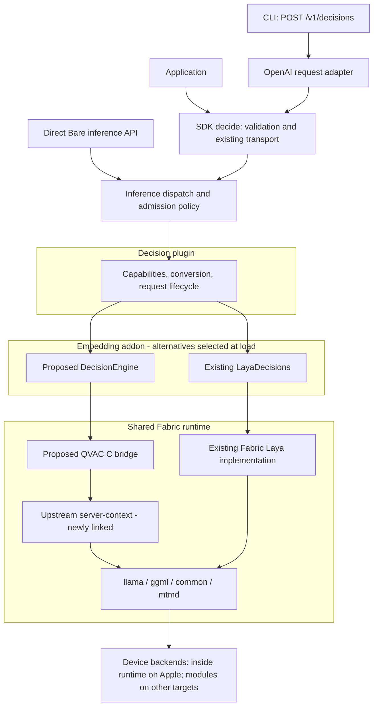
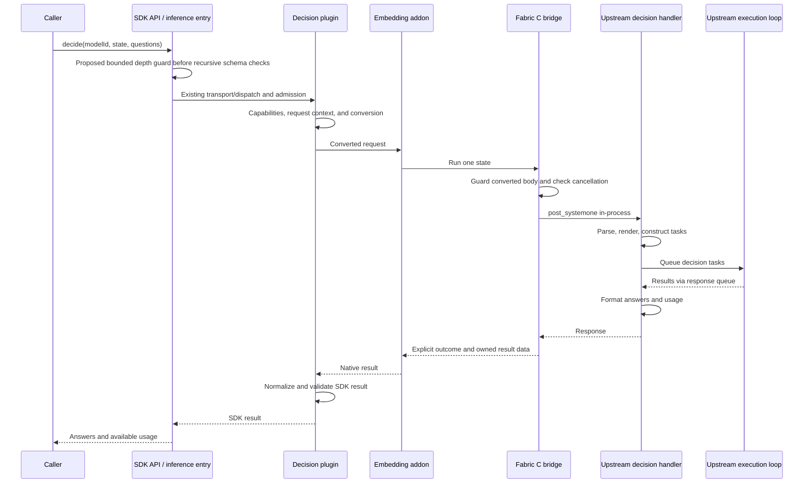

# Decision Models in QVAC

How applications would run upstream llama.cpp decision models through QVAC's
SDK, inference plugin, and embedding addon, with upstream execution hosted
inside the shared Fabric runtime.

**Status:** proposed architecture, 2026-11-06. A prototype is in progress in
draft pull requests (QVAC-26667); production rollout remains conditional on
its results, recorded as section 11 describes.

## At a glance

| Concern | Design |
| --- | --- |
| Application API | Existing SDK `decide()` and CLI `POST /v1/decisions`. |
| Inference routing | Existing `llamacpp-decision` plugin. |
| Native adapter | `DecisionEngine` in `@qvac/embed-llamacpp`, alongside legacy `LayaDecisions`. |
| Execution | Upstream `server-context`, called in-process through a QVAC-owned C bridge. |
| Bridge owner | QVAC, in `packages/fabric`; exported as `qvac_fabric_decision_*`. |
| Fork changes | A build/install option and vcpkg feature maintained by the rebase team. |
| Initial compatibility | Legacy Laya remains available; new engines require explicit request and response adaptation. |
| Main unknowns | Shipped size, in-process memory and lifecycle behavior, and legacy/upstream Laya parity. |

### Why it is designed this way

Decision models answer structured questions about a state: choose an option,
score against a scale, or produce a yes/no-related value. Different models
obtain those answers from different outputs, including label logits, embeddings,
and joint decision heads. Sharing a GGUF container does not make their execution
interchangeable.

Upstream already owns these execution paths in its server code. Reusing them
avoids copying each model's prompt construction, batching, and answer
calculation into QVAC. QVAC owns the integration boundary: lifecycle,
validation, cancellation, errors, and conversion to its public API.

### Alternatives considered

- Porting to `common/decision` creates a permanent fork diff to maintain.
- Rewriting execution in QVAC means tracking every upstream model by hand.
- Linking `server-context` into the addon couples it to upstream internals
  across the shared-runtime boundary; revisit this if runtime size is excessive.
- Keeping legacy Laya alone does not meet the model-expansion goal.

### Validation boundary

Source inspection establishes a plausible integration path, not a working
product. This document was written against QVAC snapshot `30a33a2ed` and
Fabric `v11739.0.0` (`c1ef8d473`); the prototype builds on the Fabric
`temp-11739` line (`420c6b9b3`), which carries the same decision code. No
package-size measurements, mobile runs, or parity results have been established
for this design yet.

This document owns the design, conversion rules, and rollout gates. Section 11
defines the proposed decision owners and where the go/no-go will be recorded; no
implementation PR or release approval is implied.

## 1. Building blocks, in plain words

| Component | What it is | Role here |
| --- | --- | --- |
| Decision model | A model trained to evaluate explicit questions and options. | Produces structured decision outputs rather than an ordinary chat completion. |
| GGUF | The model file format loaded by llama.cpp. | Holds weights and metadata used to identify supported decision behavior. |
| Fabric fork | QVAC's llama.cpp/ggml fork. | Supplies upstream decision execution and device backends. |
| `@qvac/fabric` | QVAC's shared native runtime package. | Hosts the compiled engine code once for its consumer addons. |
| `server-context` | Upstream's library of server execution logic. | Owns model contexts, slots, task execution, and decision handlers. |
| C bridge | A small interface with opaque native handles. | Lets the addon use decision execution without depending on exported server C++ classes. |
| Inference plugin | QVAC's integration for a model capability. | Validates requests, manages request context, and translates results. |
| mmproj / mtmd | A model's media projector and upstream multimodal processing library. | Used when a supported decision model receives media. |

### One distinction matters

Using server execution code does not require starting an HTTP server.
`server-context` is a separate static library; the HTTP listener is in another
target. The bridge calls its handler directly. The public endpoint remains
`/v1/decisions`; upstream's `/v1/systemone` request shape stays internal.

## 2. The big picture



The two native paths coexist during migration. Existing Fabric-format Laya
artifacts use the legacy implementation. Supported upstream-format models use
the bridge. Model metadata and upstream initialization must establish that an
artifact is supported; an arbitrary GGUF is not automatically a decision model.

Arrows show call/dependency direction; replies return along the same integration
path. The native branches are alternatives, not two executions of one request.
The dispatch box denotes inference infrastructure, not a new plugin API.

This diagram shows logical layers, not a new process topology. Desktop SDK hosts
that already use a Bare subprocess retain it. Direct Bare runs in-process, and
Pear/mobile placement follows the existing [deployment
architecture](ARCHITECTURE.md). The bridge adds no crash isolation.

## 3. Layer 1: Fabric build support and the bridge

### 3.1 What gets built

The rebase team adds a fork-owned build/install option and vcpkg feature for
`server-context`. Simply enabling `LLAMA_BUILD_SERVER` is insufficient because
it also enables unrelated server build targets and dependencies. The isolated
path must exclude the web UI, CLI, HTTP implementation, and server executable.
`LLAMA_TOOLS_INSTALL` defaults off on iOS, and upstream does not install
`server-context` itself in this baseline: the new path must install its archive
and required headers explicitly on every target. The archive also needs
position-independent code where required when linked into the shared runtime.

This is a carried build patch. Upstream changes to server targets or source
lists can require reconciliation during a rebase. There is no promise of zero
maintenance merely because the executor itself is reused.

QVAC then links the library into `@qvac/fabric` and implements the bridge beside
the existing backend API in `packages/fabric/addon/decision.cpp`. The
`qvac_fabric_*` allow-lists cover ELF/Mach-O; Windows uses the existing
`QVAC_FABRIC_API` export annotation. The prototype must verify visibility,
transitive dependencies, and linking on each platform.

### 3.2 What crosses the native boundary

| Operation | Responsibility |
| --- | --- |
| Create | Validate load parameters, load a supported model, and start its execution loop. |
| Inspect capabilities | Report relevant question, option, and media constraints. |
| Run | Execute one state and return structured output or an explicit failure. |
| Cancel | Propagate cancellation using synchronized state with a defined lifetime. |
| Destroy | Reject new work, drain active calls, stop the loop, join its thread, and release resources. |
| Free returned data | Release bridge-owned result/error buffers using the bridge's matching allocator. |

The exact ABI is prototype work. C++ exceptions, standard-library objects, and
upstream server classes must not become the addon's cross-library contract.
Cancellation must be thread-safe; `volatile` alone would not establish that
property for a flag shared across threads. A bridge-owned cancellation token
with explicit retain/release or equivalent lifetime rules is a suitable
prototype direction; do not pass an unsynchronized pointer to caller-owned
storage.

### 3.3 Initialization and ownership

The pinned upstream code requires this order:

1. Create `server_context`.
2. Create `server_routes`, registering its sleep callback before loading.
3. Load the model and check success.
4. Start the execution loop on a bridge-owned thread.

Parameters, routes, callbacks, and request data must outlive their uses. Failed
loads must clean up without leaving a thread or partially initialized handle.
Prototype tests must cover model auto-fitting, slot memory reservation,
sleeping, and shutdown, rather than assuming server defaults suit an embedded
runtime.

## 4. Layer 2: the embedding addon

`DecisionEngine` belongs beside `LayaDecisions` in `@qvac/embed-llamacpp`. This
preserves the existing decision plugin's addon route and uses the addon already
associated with the capability.

The addon translates its native job lifecycle to bridge operations. It does not
reimplement model-specific decoding. Loading chooses the legacy or upstream
engine, running submits a state, and cancellation/disposal participates in the
existing QVAC request lifecycle.

Initially, retain one admitted request per model and the existing bounded queue.
Upstream `n_parallel` slots may help evaluate questions or variants within that
request; they do not imply that QVAC should admit multiple concurrent requests.
Their memory cost is part of the prototype measurements.

## 5. Layer 3: inference and contract conversion

The SDK shape remains independent of a model family or external wire format.
Conversion is more than renaming camelCase fields: the current SDK accepts
values upstream does not accept directly, and upstream omits some current result
fields.

| Boundary | Required behavior |
| --- | --- |
| Choice input | Convert arrays to upstream option objects and restore the selected option's original type. Reject duplicates and values whose string representations collide. |
| Model limits | Reject unsupported controls, payloads, option counts, and score scales with structured validation errors. |
| Choice/score output | Preserve supported confidence and probabilities; normalize score legends to the SDK string contract. |
| `noul` output | Omit unavailable confidence. Document model-specific meaning, including lev's expected rating. |
| Legacy diagnostics | Preserve them on legacy results; allow absence where upstream does not provide them. |
| Batch states | Execute in input order; return ordered results or fail the aggregate call. Cancellation stops remaining work. |

For the prototype, reject duplicate or string-colliding choice-array values
before native execution. For example, `[true, "true"]` and `[1, "1"]` fail
validation because their probabilities cannot be represented distinctly under
`String(value)`. Accepted arrays retain their original selected-value type and
all probabilities without changing the result schema. This rule applies to the
new upstream engine; legacy requests retain their existing behavior. Appendix A
defines the conversion rules.

### Input and error boundaries

The proposed guard rejects nesting deeper than 128 levels using bounded
traversal. Run it before the SDK's recursive JSON refinement and before direct
inference validation; checking only inside the plugin is too late. HTTP inputs
need the same early guard before recursive transformations. Recheck the
converted upstream request body at the native boundary, since conversion can add
nesting.

Align depth counting with [upstream
#30242](https://github.com/ggml-org/llama.cpp/pull/30242), which checks the
whole decision request body. The pinned Fabric baseline lacks that fix. Its
arrival does not replace the earlier JavaScript guard. A nesting cap addresses
this failure mode, not every possible native stack exhaustion; payload-size and
model/template-specific limits still require validation.

Catch exceptions at the bridge boundary and distinguish invalid requests,
cancelled work, and execution failures. A direct upstream handler call does not
receive the exception translation supplied by llama-server's HTTP wrapper.

## 6. Layer 4: the SDK and HTTP API

Applications continue to use `decide()` with a loaded decision model ID. This
illustrative request uses the existing public shape; availability of an upstream
model depends on the proposed implementation and registry artifacts:

```ts
import { decide } from '@qvac/sdk'

// modelId comes from an already loaded decision model.
const result = await decide({
  modelId,
  state: 'The customer asks how to change their delivery address.',
  questions: {
    route: {
      type: 'choice',
      instructions: 'Choose the team that should handle this request.',
      criteria: {
        support: 'Account, order, and delivery questions',
        billing: 'Payments, invoices, and refunds'
      }
    }
  }
})
```

The CLI adapter continues mapping OpenAI-shaped questions to SDK questions. For
`predicate`, it will set a proposed optional boolean `requireProbability` on the
generated `noul` question. The inference plugin checks this requirement against
the loaded model's capabilities before native execution. It rejects lev's
expected rating, or unknown semantics, with `RequestValidationFailedError`.
The adapter needs no model-family knowledge or capability-query endpoint.

The decisions route must gain explicit conversion of
`RequestValidationFailedError` to an HTTP 400 invalid-request response. At the
recorded baseline it passes SDK errors through, and the global handler does not
map this error, so these failures currently become HTTP 500. Cover every
decision
validation rejection: probability requirements, score/option limits, unsupported
controls, and payload limits. Preserve actionable validation messages and keep
execution failures distinct; do not turn every SDK error into HTTP 400.

An omitted or false flag preserves ordinary SDK `noul` behavior, including lev's
documented expected rating. The plugin consumes the flag rather than forwarding
it to upstream. Capability information must come from the selected engine's
validated model metadata/initialization, with legacy Laya described explicitly
during coexistence; unknown semantics must not default to probability.

This adds a request field to the public SDK/RPC schema, though no new API call
or HTTP field is needed. Add it only to `noul` questions and regenerate client
contracts. Never silently drop it when communicating with an older engine; test
explicit rejection of an unsupported flag as part of version compatibility.

Required response fields becoming optional is a compatibility change even if
legacy Laya continues returning them. The first upstream-engine release needs
migration guidance and regenerated Python and Kotlin contracts. Later removal of
legacy APIs and artifacts is a separate compatibility event.

## 7. Walkthroughs: load, decide, cancel, unload

### 7.1 Loading an upstream model

1. QVAC resolves and obtains the model using its existing model-source path.
2. The decision plugin passes the artifact and validated load settings to the
   addon.
3. The addon selects `DecisionEngine` for a supported upstream artifact.
4. The bridge creates the context, then routes, loads the model, and starts the
   loop.
5. Capabilities become available for request validation; loading resolves only
   after the engine is usable.

### 7.2 Answering questions



This is the proposed successful upstream-engine path. The handler runs on the
caller's native execution thread and waits for tasks serviced by the separate
loop thread. The SDK's client-side response validation and HTTP response adapter
are omitted for readability. Errors and cancellation follow section 7.3 rather
than producing a successful answer.

For batches, repeat the state execution in order. An individual state's usage
belongs to that state's result; an aggregate total, if exposed, must be
explicitly defined rather than substituted into every result.

### 7.3 Cancellation and unloading

Cancellation flows from QVAC's request context through the addon to the bridge
and upstream's stop callback. The response reader checks that callback after
timed waits without a result; it is not a universal interruption hook for model
loading, prompt construction, media decoding, or a running backend operation.
The bridge must check cancellation before and after the handler too. In the
pinned handler, cancellation may return an empty response whose status is still
200. The bridge therefore requires a valid result and a non-cancelled outcome
before reporting success.

Unloading rejects new runs, requests cancellation, waits for outstanding calls,
terminates the loop, and joins its thread before freeing resources. The next
request after cancellation must succeed without inheriting a stale stop signal.
Cancellation latency, including wake-from-sleep and model loading, remains to be
measured. Waiting for the handler to return must not be mistaken for proof that
all backend work has stopped; teardown tests must establish safe cleanup.

## 8. Where models come from

| Artifact | Proposed handling |
| --- | --- |
| Existing Fabric-format Laya | Keep current identifiers and legacy execution during coexistence. |
| Upstream-format decision GGUF | Add distinct registry identities and validate required metadata and templates. |
| Model requiring an adapter | Resolve and validate all required artifacts before claiming support. |
| Media-capable model | Pair with its required projector and validate capabilities independently. |

Do not replace cached legacy files beneath existing identifiers. Keeping both
identities gives callers a rollback path while the old engine remains shipped.
Retirement depends on accepted parity evidence and a migration release.

The prototype includes one image case to exercise mtmd and measure resource
cost. It does not establish SDK or HTTP media support. Public images, audio, and
video require follow-up transport, limits, projector, and platform validation.
In particular, Fabric `v11739.0.0` rejects nonempty video input.

## 9. What stays shared, and what changes

| Reused | Added or adapted |
| --- | --- |
| SDK transport and request lifecycle | Optional response fields and generated-client migration. |
| Decision plugin identity and addon route | Per-model capabilities and request/result conversion. |
| Fabric runtime and device backends | Isolated server-context build and QVAC C bridge. |
| Upstream model execution | Lifecycle, cancellation, and error translation at the bridge. |
| Model-source and cache ownership | New artifact identities and compatibility requirements. |

Upstream rebases can change behavior without changing C++ signatures. Rebuilds
must therefore run representative contract and parity tests, not just compile
the wrapper. New upstream models still require artifacts and validation before
they become supported QVAC models.

## 10. Prototype evidence and platform status

| Question | Evidence needed | Current status |
| --- | --- | --- |
| Is the library separable? | Source-level target/dependency inspection. | Supported by inspected baseline; packaged build not demonstrated. |
| Does the installed addon reach the bridge? | Exports, ABI, loading, and end-to-end calls. | Not run. |
| Is the footprint acceptable? | Final package/application growth, including consumers that do not use decisions. | No measurements; limits to agree before evaluation. |
| Does embedded lifecycle behave correctly? | Memory fitting, slot reservation, sleep, cancellation, teardown, and recovery. | Not run. |
| Does the wrapper match upstream? | Same artifacts, requests, backend, and declared numeric tolerances. | Not run. |
| Can legacy Laya migrate? | Fixed evaluation set comparing both formats. | Not run. |

| Target | Validation required before claiming support |
| --- | --- |
| macOS, Linux, Windows | Installed package linking, request contracts, lifecycle, and parity. |
| Android | Packaged loading, constrained-device memory and latency, cancellation and recovery. |
| iOS | Explicit library installation, final application linking, size, memory, and lifecycle. |
| Electron | SDK consumer execution and packaging in addition to native checks. |
| Browser | Outside this proposal; the referenced browser PoC validates LLM completion, not decision execution. |

The largest shared-runtime concern is that server-context also contains chat,
tools, MCP, and schema code. Upstream's mobile subprocess defaults reduce one
portability concern, but do not establish final size or runtime behavior.
Initialization must not activate unrelated tools or outbound services.

## 11. How it is intended to ship

### Go/no-go ownership and record

The proposed decision owners are the Fabric/addon lead and SDK/mobile lead, with
Lead/Architect review of the direction. They agree numerical resource budgets
and parity tolerances before prototype evaluation and decide whether the
evidence satisfies the following gates. These roles are proposed ownership, not
a claim of assigned reviewers or approval.

When implementation PRs exist, record the go/no-go in the top draft PR's
description, with tested commits, devices, measurements, test results, reviewer
decisions, and remaining limitations. Until then, the status here remains
proposed. The decision record must distinguish permission to prototype from
permission to roll out or retire legacy Laya.

| Gate | Required evidence |
| --- | --- |
| Packaged integration | Installed addon reaches the installed bridge; exports, ABI compatibility, and one shared runtime verified on desktop and mobile. |
| Resource cost | Final package/application growth, load latency, request latency, and peak memory within agreed budgets, including Android, iOS, and consumers without decisions. |
| Contract fidelity | All question types, accepted typed choices, rejected collisions, score legends, optional fields, generated clients, and per-state batch usage. Every decision validation rejection returns HTTP 400 through the new decisions-route mapping; genuine execution failures retain their appropriate status. |
| Predicate semantics | CLI sets `requireProbability`; probability-capable models succeed; the plugin rejects lev and unknown semantics, and the decisions route maps that validation error to HTTP 400; ordinary SDK lev `noul` remains available. |
| Lifecycle | Failed load, queued/running cancellation, unload during work, sleep/wake, cleanup, and a successful request after cancellation. |
| Depth validation | Guard before recursive processing on each entry path and after conversion; boundary-depth tests use the full request body. |
| Execution parity | Same model, input, backend, and agreed tolerances against upstream; cover each execution family before claiming its support. One image case exercises mtmd without establishing public media support. |
| Upgrade compatibility | Old caches, interrupted upgrades/downloads, rollback, and mismatched SDK/addon/Fabric versions produce defined outcomes without corrupted artifacts or ignored requirements. |

### Release sequence and migration

The dependency order is fork build support → QVAC Fabric bridge/package →
embedding addon → inference/SDK compatibility release and CLI exposure. Fabric
changes ship independently of addon or SDK feature PRs.

1. Build the layers locally and evaluate the gates above. Compare legacy and
   upstream Laya early enough to inform the migration decision.
2. Publish fork build support and the QVAC Fabric package separately, then the
   consuming addon. Preserve the legacy engine during upstream enablement.
3. Release inference/SDK contract changes and matching CLI support together
   with generated clients and migration guidance. Required-to-optional result
   changes need an explicitly announced compatibility release.
4. Add distinct upstream artifact identities. Verify existing caches remain
   usable, interrupted downloads resume or clean up, interrupted package
   upgrades fail clearly, and rollback can still select legacy artifacts.
5. Test a new SDK against an old addon: bridge-dependent models must fail with
   an actionable compatibility error before execution. If legacy use is
   supported, test it explicitly; do not assume matching package names imply
   compatible capabilities. Also test an older inference runtime rejecting the
   new `requireProbability` field rather than ignoring it.
6. Enable media only after transport, limits, projector matching, and platform
   tests pass. Retire legacy Laya only after accepted format-parity results,
   consumer migration, cache/rollback evidence, and a separate announced
   compatibility change.

The prototype may assemble these layers locally. A successful prototype does not
itself publish packages, retire Laya, or establish every upstream model's
support. Resource budgets and parity tolerances must be recorded before judging
its results. If footprint forces an alternative placement or a custom executor,
revisit this design. Representative contract, lifecycle, and parity tests must
run again on Fabric updates; compilation alone is not the regression gate.

## 12. Where the work belongs

| Location | Responsibility |
| --- | --- |
| Fabric fork / vcpkg port | Build and install server-context independently; maintain build patch on rebase. |
| `packages/fabric/addon/decision.cpp` (proposed) | C bridge and upstream engine ownership. |
| `packages/fabric/include/qvac-fabric.h` | Bridge declarations and buffer ownership contract. |
| `packages/embed-llamacpp` | DecisionEngine adapter and legacy engine coexistence. |
| `packages/inference/src/plugins/builtin/llamacpp-decision` | Capabilities, conversion, batching, and request lifecycle. |
| `packages/inference/src/schemas/decision.ts` | Public request/result contract. |
| `packages/sdk` and generated clients | API exposure, contract generation, and consumer coverage. |
| `packages/cli/src/serve/extensions/openai` | HTTP validation and decision adapter. |

Paths for existing decision code refer to the recorded main snapshot; they may
not exist in an older working branch. Proposed paths are not claims that code
has been implemented.

## 13. Glossary

| Term | Meaning |
| --- | --- |
| State | The input being evaluated against the supplied questions. |
| Choice | Selection among explicit options, with option probabilities where supplied. |
| Score | Evaluation on an ordered set of levels. |
| `noul` | The existing SDK question type used for yes/no-related outputs; its meaning must be checked per model. |
| Predicate | HTTP question requiring a probability; not interchangeable with every model's `noul`. |
| Slot | Upstream execution capacity with associated runtime memory. |
| Joint head | A model path evaluating multiple questions together. |
| Shared prefix | Common input reused across related tasks within upstream execution. |
| Parity | Agreement under specified model, input, backend, and tolerance conditions. |

## Appendix A. Request and result conversion

These rules define the proposed upstream-engine contract. Keep legacy Laya's
existing behavior during coexistence except where the new explicit probability
requirement must be checked. The controls and response guarantees available from
one engine must not be silently assumed for the other.

### Requests

| SDK input | Conversion or validation |
| --- | --- |
| `choice` criteria array | Reject duplicate values and collisions under `String(value)`. For accepted values, use that string as the upstream option key, `null` description, and retain a key-to-original-value map. |
| `choice` criteria record | Preserve the caller's keys and descriptions, subject to the selected model's payload and option limits. |
| Primitive state, instructions, or descriptions | For a model accepting only text/object/array payloads, convert numbers and booleans to JSON text only after prototype rendering checks establish the intended meaning; otherwise reject with a clear validation error. Never silently discard or reinterpret them. |
| `score` criteria | Enforce the upstream model's limits; the pinned parser accepts 2–10 levels. Preserve level ordering. |
| Choice option count | Enforce model-specific maximum and minimum rules, including `strict_payload` requirements. |
| `noul` criteria | Validate descriptions of `true` and `false` against the selected model's accepted payloads. |
| `noul.requireProbability` | Optional boolean; absent/false imposes no probability requirement. True requires explicit probability semantics, otherwise reject. Consume it in QVAC; do not send it upstream. |
| `labels`, `optionOrder`, `maxLen`, `headMaxLen` | Reject on the upstream engine unless support is explicitly implemented and tested; preserve legacy support. |
| `states` | One run per state in input order; return one result per state or fail the aggregate call. Cancellation stops remaining states. |

The HTTP choice adapter already assigns distinct internal keys when typed values
collide. Those arrive as a criteria record, so the SDK array restriction does
not require rejecting such HTTP choices. Keep the adapter's key-to-value mapping
and test that both choice and probability entries survive the round trip.

Models that set `choice_sorted` (clef at the pinned baseline) sort choice
options
lexicographically by key before rendering: `"10"` precedes `"2"`, and
`option_10`
precedes `option_2`. Answers still map back by key, but caller order is not
guaranteed; parity tests must send identical keys to QVAC and llama-server.

### Answers

| Upstream answer | SDK result |
| --- | --- |
| `choice` key | Restore the original array value's type, or preserve the record key. Reject an unknown key. |
| Choice probabilities | Preserve record keys; use the unique `String(value)` keys for accepted arrays. Never merge distinct options. |
| `score` | Preserve the numeric expected level and probabilities keyed by level index. |
| Score `legend` | Preserve strings; serialize other non-null JSON descriptions as canonical JSON text; omit null descriptions. Validate every resulting value as a string. |
| Choice/score `confidence` | Preserve the upstream value. Do not invent a common calibration guarantee across models. |
| `noul` | Preserve the model's numeric output. For lev, describe it as a normalized expected rating, not a probability. |
| Missing `noul.confidence` | Omit it; do not synthesize a confidence metric. |
| Missing `answerConfidence` or `action` | Omit the fields/container. Legacy results retain the values they actually supply. |

### Usage and schema changes

| Field | Rule |
| --- | --- |
| `inputTokens` | Map upstream `input_tokens` for that state's result. The upstream count includes its evaluated tasks/variants; it is not necessarily the unique state-token count. |
| `outputTokens` | Map upstream `output_tokens`, which is zero on the pinned decision path. |
| `stateTokens`, `stateTokensDropped`, `truncated`, `truncatedQuestions`, `options` | Omit when unavailable; do not replace absence with zero or false. |
| `noul.requireProbability` | New optional request field; update exported schemas, RPC contract, and generated clients. |
| `noul.confidence` | Required → optional; choice/score confidence remains required. |
| `answerConfidence`, `action` | Required → optional and deprecated. |
| Required legacy usage fields | Make optional; `options` is already optional. |

Batch usage stays attached to individual results. No batch sum is substituted
into each result. Missing diagnostics and deprecations require migration
examples for TypeScript, Python, and Kotlin consumers.

## References

- [Fabric integration](../../packages/fabric/INTEGRATION.md): shared-runtime packaging and consumer linking.
- [QVAC architecture](ARCHITECTURE.md): package responsibilities and platform placement.
- [Upstream JSON depth fix #30242](https://github.com/ggml-org/llama.cpp/pull/30242): scope of the 128-level guard and its documented limitations.
- Browser draft [#5410](https://github.com/tetherto/qvac/pull/5410), [#5375](https://github.com/tetherto/qvac/pull/5375), and [#5376](https://github.com/tetherto/qvac/pull/5376): reference examples of addon, runtime/SDK, and consumer-demo separation; these do not implement decision-model support.
