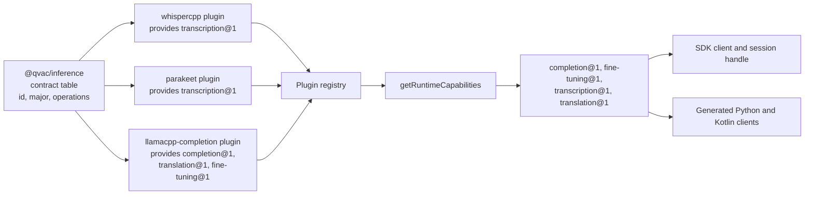

# QIP: Runtime capability report

## Approvers

The following approvers are required in priority order:

| Role | Approver | Status |
| --- | --- | --- |
| Lead / Architect | @Dima / @Yury Samarin | |
| Head of QVAC | @Marco | |
| CTO | @Mathias Buus | |

## :mag: Problem

A started runtime registers its plugins (`startWorker` calls `registerPlugins`)
and dispatches each typed request to the plugin that serves the loaded model's
`modelType`. Nothing tells a caller which operations the runtime can serve.

- **The plugin set varies per bundle.** A bundle contains only the plugins the
  app imports, so two runtimes built from the same SDK version can serve
  different operations. The JS, Python and Kotlin SDK clients ship with their
  worker and know the set at build time. A consumer that is built and released
  separately (an agent skill, an orchestration layer, or a second caller of a
  shared runtime through sessions) does not. Today it finds out at `loadModel`
  or at the first call, after it has downloaded weights.
- **The only vocabulary names implementations.** `modelType` and
  `addonPackage` identify plugins, not what a caller can do. Three plugins serve
  transcription; a check written against `whispercpp-transcription` fails on a
  bundle that ships Parakeet instead.
- **No version describes the contract.** SDK, inference and addon versions
  change for reasons unrelated to whether a request still has the same shape
  and meaning.

The decision is needed now because per-session capability grants are the next
step for shared runtimes, and a grant names capabilities. The report and the
grants must use one vocabulary, so the vocabulary is fixed first.

## :bulb: Solution

**Approval ask:** adopt capability contracts as the runtime's consumer-facing
vocabulary, have plugins declare the contracts they provide, and add a
`getRuntimeCapabilities` runtime request that reports them. Grants are designed
separately; this QIP fixes only the constraints they place on the vocabulary.



1. **Contracts are owned by `@qvac/inference`.** A contract is a semantic ID, a
   major version, and the operations (handler names) it covers. IDs are coarse:
   `completion`, `embedding`, `transcription`, `image-generation`. Tool calling,
   thinking, input types and model modes are features of a contract that depend
   on the loaded model, not separate IDs. Appendix A lists the proposed set.
2. **Plugins declare what they provide.** `QvacPlugin` gains an optional
   `provides` list. Several plugins can provide one contract, and one plugin
   can provide several. Built-in plugins reference the contract table, so a
   plugin cannot choose its own version of a QVAC contract. Third-party
   plugins declare namespaced IDs for their own contracts and may provide a
   QVAC contract by referencing the exported table entry.
3. **The runtime reports the union.** `getRuntimeCapabilities` returns the
   distinct `{ id, version }` pairs that registered plugins provide, sorted.
   The SDK exposes it on the client and on session handles. The Python and
   Kotlin clients get it from the regenerated wire contract.
4. **Versions are majors only.** A version is an integer that starts at 1 and
   increases only when the contract changes incompatibly. Additive changes, SDK
   releases and addon releases leave it unchanged. A consumer that requires
   `transcription@1` is satisfied only by a report entry with the same ID and
   the same version.

### Boundaries

- **Registration only.** An entry means a registered plugin declared the
  contract. It does not mean the native addon loads (addons are optional peer
  dependencies loaded on first model load, so a host missing an addon's
  platform package fails at `loadModel`), that model assets exist, that resources suffice
  (`assessModelFit` answers that), or that the caller may call it (grants).
- **No implementation names.** The report is built only from `provides`. It
  never contains `modelType`, `displayName` or `addonPackage`.
- **No model work.** The handler reads the plugin registry and nothing else.
  It answers with an empty list when no plugins are registered, rather than
  failing, so a runtime that only forwards to RPC servers can be asked too.
- **Runtime-wide.** Every session sees the same report. Discovering a
  capability does not grant permission to call it.
- **Stable for a worker's life.** The worker registers all plugins before it
  accepts requests, so the report does not change while the worker runs.

## :twisted_rightwards_arrows: Alternatives considered

1. **Report registered `modelType` values.** No new vocabulary, but it exposes
   implementation names, ties consumers to the bundle's plugin choice, and
   carries no contract version.
2. **A central `modelType`-to-capability map in inference.** Plugins stay
   unchanged, but third-party plugins, which share the built-in plugin
   contract, cannot appear in it, and the map drifts from the plugin set.
3. **A build-time bundle manifest instead of a runtime request.** A consumer of
   a shared runtime has no access to the bundle's files, and the report must be
   reachable through the runtime interface. A manifest can later be generated
   from the same `provides` declarations.

## :scales: Consequences

**Positive**

- A consumer can check compatibility before it downloads or loads any model.
- A breaking contract change is visible from the major version alone,
  independent of SDK, inference and addon release versions.
- A bundle trimmed to fewer plugins reports fewer capabilities with no extra
  configuration.
- Grants reuse the same IDs and the operation lists declared here.

**Trade-offs reviewers must accept**

- **Version upkeep.** Whoever changes an operation's request or response schema
  decides whether the contract's major increases. The change already shows in
  the `packages/sdk/contract/schema.json` diff; the bump goes in the same PR
  with a `[bc]` tag.
- **Coarse answers.** The report does not say which optional operations or
  model features are available. A runtime whose only transcription plugin is
  MOSS reports `transcription@1` but has no `transcribeStream`; a consumer
  still handles `ModelOperationNotSupportedError` at call time.
- **Additive operations do not bump the major.** A consumer that needs an
  operation added within a major cannot detect it from the report.
- **`loadModel` still takes `modelType`.** A consumer that loads models still
  names a plugin. The report serves compatibility checks, not model selection.
- **Declarations are trusted.** A third-party plugin can declare a QVAC
  contract it implements incorrectly. Conformance testing is out of scope.
  Plugins without `provides` stay valid and are absent from the report.

**Security.** The report reveals what a runtime can serve to every session. A
call to a missing operation already reveals the same, so no new information
crosses the boundary. The report never authorizes anything.

**Compatibility and release.** All changes are additive: a new request type, a
new SDK function and an optional plugin field. `@qvac/inference` and
`@qvac/sdk` release together. An older worker rejects the unknown request
type; a separately built consumer treats that rejection as "no report" and
fails closed.

## :no_entry_sign: Out of scope

- Per-model capability reporting (features of a loaded model or model config).
- Consumer-side compatibility checks.
- Session permissions; Appendix F records only the constraints they impose.
- Native-readiness verification.
- Startup argument-schema validation.
- Plugin conformance testing.

## :sparkles: Nice to haves

- A build-time manifest generated from the same declarations, for tools that
  inspect a bundle without starting it.
- A test that fails when a contract operation's schema changes without a
  decision about its major.

## :paperclip: Appendix

### A. Proposed initial contracts

All start at version 1. Operations are handler names and, for typed requests,
also the request type. Optional operations may be missing from a plugin that
provides the contract.

| ID | Operations | Optional operations | Provided by (today) |
| --- | --- | --- | --- |
| `completion` | `completionStream` | `batchCompletionStream`, `calcTokens` | llamacpp-completion |
| `fine-tuning` | `finetune` | | llamacpp-completion |
| `translation` | `translate` | | nmtcpp-translation, llamacpp-completion |
| `embedding` | `embed`, `embedBatch` | | llamacpp-embedding, ggml-image-embedding |
| `reranking` | `rerank` | | llamacpp-rerank |
| `decision` | `decide` | | llamacpp-decision |
| `classification` | `classify` | | ggml-classification |
| `transcription` | `transcribe` | `transcribeStream` | whispercpp-transcription, parakeet-transcription, moss-transcribe |
| `bci-transcription` | `bciTranscribe` | `bciTranscribeStream` | bci-whispercpp-transcription |
| `text-to-speech` | `textToSpeech` | `textToSpeechStream` | tts-ggml |
| `ocr` | `ocrStream` | | ggml-ocr |
| `image-generation` | `diffusionStream` | `videoStream`, `upscaleStream`, `worldStepStream`, `worldSceneStream` | sdcpp-generation |
| `audio-generation` | `audioGenStream` | `audioEditStream`, `audioUnderstand` | audiogen-ggml |
| `vision-language-action` | `vlaRun`, `vlaHparams`, `vlaSetEmbodiment` | | ggml-vla |

`completionOrchestrate` is a runtime operation built on `completionStream` and
belongs to `completion`. Runtime operations that no plugin serves (`loadModel`,
`rag`, `vectorIndex`, `downloadAsset`, registry lookups and the like) are not
capabilities: every runtime of a given wire version has them.

ID format: QVAC IDs match `^[a-z][a-z0-9]*(-[a-z0-9]+)*$`. Third-party IDs
take a namespace prefix, `<namespace>.<id>`, so a later QVAC ID cannot collide
with them.

### B. Declaration sketch

```ts
// @qvac/inference
export interface CapabilityContract {
  readonly id: string
  readonly version: number
  readonly operations: readonly string[]
  readonly optionalOperations?: readonly string[]
}

export const CAPABILITY_CONTRACTS = {
  transcription: {
    id: 'transcription',
    version: 1,
    operations: ['transcribe'],
    optionalOperations: ['transcribeStream']
  }
  // ...
} as const satisfies Record<string, CapabilityContract>

// built-in plugin
definePlugin({
  modelType: 'parakeet-transcription',
  provides: [CAPABILITY_CONTRACTS.transcription],
  handlers: { transcribe, transcribeStream }
  // ...
})
```

The field is `provides` because `QvacPlugin.capabilities` already holds the
TurboVec index provider.

### C. Registration rules

`registerPlugin` rejects a plugin with `PluginDefinitionInvalidError` when:

- an ID does not match the format, or a version is not an integer of at least 1;
- an unnamespaced ID, or its major, is not in `CAPABILITY_CONTRACTS`, or the
  declared operations differ from the table entry;
- a required operation has no handler;
- one handler is listed by two of the plugin's contracts.

The last two rules keep the handler-to-contract mapping exact, which grants
depend on. They check declarations against handler names only; they do not
test behaviour.

### D. Wire and SDK surface

```ts
// request: extends sessionScopedRequestSchema, untracked
{ type: 'getRuntimeCapabilities', sessionId?: string }

// response
{
  type: 'getRuntimeCapabilities',
  capabilities: Array<{ id: string; version: number }> // sorted by id, then version
}
```

- Dispatch allows the request without registered plugins, as it does for the
  RPC server requests.
- SDK: `getRuntimeCapabilities()` exported from `@qvac/sdk` and available on
  session handles.
- `npm run contract:export` adds the method to `packages/sdk/contract/`; the
  Python and Kotlin clients regenerate from it.
- Consumer documentation: a page in the SDK docs runtime section with the ID
  table, the version rule, the compatibility rule and the non-guarantees.

### E. Version rules

Increase a contract's major when a change to one of its operations can break
a caller written against the current major:

- removing or renaming an operation, or making an optional operation required;
- removing a request or response field, or changing its type or meaning;
- making an optional request field required;
- changing an operation between reply, stream and duplex, or changing its
  stream framing;
- changing an error a caller is expected to handle.

Leave it unchanged for new optional request fields, new response fields, new
optional operations, SDK, inference and addon releases, and new plugins
providing the contract. A plugin may provide two majors of one ID during a
migration; the report then lists both.

### F. Constraints for capability grants

The grants design is separate. It inherits these constraints:

- A grant names capability IDs from this vocabulary. The owner sets it when it
  opens a session; `openSession` is already owner-only.
- The check runs in `prepareRequest` in `packages/inference/src/dispatch.ts`,
  next to the existing open-session and owner-only checks. That function runs
  for `send`, `stream` and `duplex` before any handler.
- A typed request maps to a contract through the table's operation names.
  `pluginInvoke` and `pluginInvokeStream` map through the target model's plugin
  and the contract that lists the handler. A handler outside every provided
  contract is refused for a session with a grant.
- `closeSession`, cancelling the session's own requests and
  `getRuntimeCapabilities` never need a grant. Owner-only operations stay
  owner-only whatever the grant says.
- A refused call gets its own error code, distinct from
  `MODEL_OPERATION_NOT_SUPPORTED`, `PLUGIN_NOT_FOUND`, `RPC_NO_HANDLER`, a
  consumer-side version mismatch and inference errors.
- Requests without a `sessionId` run as the owner and are not checked, so
  single-caller code is unchanged.
- The report stays runtime-wide; a grant does not filter it.

The grants design still decides which runtime operations (`loadModel`,
`unloadModel`, `rag`, `vectorIndex`, `downloadAsset`) need a grant and under
which names.

### G. Test plan

`@qvac/inference` unit tests:

- two plugins that provide `transcription@1` produce one entry;
- one ID at two majors produces two entries;
- no registered plugins produces an empty list, not `PluginsNotRegisteredError`;
- a plugin without `provides` contributes nothing;
- the response contains no registered plugin's `modelType`, `displayName` or
  `addonPackage`;
- the request succeeds with no model loaded and calls no load or download path;
- each registration rule in Appendix C rejects a plugin that breaks it;
- every built-in plugin provides at least one contract, and every built-in
  handler belongs to exactly one provided contract;
- each operation name appears in exactly one QVAC contract;
- an open session can call the request, a closed session is refused.

`@qvac/sdk`:

- the client and the session handle return the worker's report;
- an e2e test: a worker with the default plugin set reports the expected IDs,
  and a worker with a reduced plugin set reports only its subset;
- `npm run contract:check` passes, and the generated Python and Kotlin clients
  build with the new method.

### H. Delivery

One implementation PR across `@qvac/inference` and `@qvac/sdk`: contract
table, `provides` on the built-in plugins, registration rules, the request and
handler, the SDK function, regenerated contract and clients, the docs page and
the tests above.

### I. Open questions

1. **Generation IDs.** `image-generation` covers video, upscale and world
   operations, and `audio-generation` covers `audioUnderstand`, because one
   plugin serves each group and the model's mode selects the operation. Video
   and world requests have their own schemas; should they be separate IDs?
   Recommendation: keep one ID per group until a second plugin serves only part
   of one.
2. **Optional operations in the report.** Listing them per ID would answer the
   MOSS case in Consequences. Recommendation: leave them out of the first
   version; add them as an additive response field if consumers need it.
3. **Third-party namespace.** Should the prefix be the npm scope (`acme.speech`
   for `@acme/...`), or any dotted prefix the author picks?
