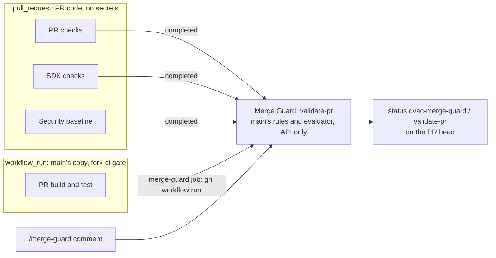

# Merge Guard

`qvac-merge-guard / validate-pr` is the one status the `qvac-merge-guard` ruleset requires on `main`. It passes when every check that [`.github/merge-rules.yml`](../../.github/merge-rules.yml) requires of the PR has passed. Teams add a required check with a line in that file; nobody edits the guard to do it.

## How it decides



`pr-gate-merge.yml` runs from the default branch and checks out only `.github/merge-rules.yml` and `.github/scripts/merge-guard`. For a PR into `main`, `evaluate.mjs`:

1. Lists the PR's changed files, and takes every rule with a pattern matching one of them.
2. Finds each producer's runs for the PR head: `pull_request` runs by head commit, and `workflow_run` runs of the default branch's copy by the head commit in their title (`pr-build-test.yml` sets it in `run-name`). Only runs of the named workflow file count, so a lookalike workflow with the same name is ignored.
3. Reads each required job's result. Per job name, the newest attempt that did not skip counts, so a label run of `PR checks` or an edit run of `SDK checks`, whose jobs skip, never hides the real result.
4. Posts the status: `failure` naming the jobs that failed, `pending` naming the producers still running, or `success`. The run summary has the table: rule, check, result, the jobs with their failing step and links, and the files that brought each rule in.

It never waits. A check whose producer has not finished is pending, and that producer's completion starts the guard again; the producer to finish last triggers the final result. One evaluation runs per head commit at a time (`cancel-in-progress`), and one started for a commit the PR has moved past posts nothing. A member's `/merge-guard` comment on the PR starts an evaluation of its head, for example if GitHub dropped an event.

A fork PR that changes `.github/` fails the guard: its `pull_request` runs use its own workflow files, so it could rewrite the checks it is judged on. A maintainer re-raises it from a branch.

The guard decides on job results, never on commit statuses: a workflow with `statuses: write`, including a same-repo PR's edited `pull_request` workflow, could post any status. `qvac/pr-build-test` links the PR to its build run for people; the guard ignores it.

## The rules

```yaml
- name: Addon packages
  patterns: ["packages/**", "cmake/qvac-addon/**"]
  checks:
    - { workflow: pr-checks.yml, job: "select / *" }
    - { workflow: pr-checks.yml, job: "checks (*)", skipped: pass }
```

- `patterns`: globs on the changed files; `**` spans directories, `*` stays within one, and a leading `-` excludes. Every matching rule adds its checks.
- `workflow`: the producer file.
- `job`: the job's check-run name. `*` matches a matrix leg or a called workflow's job, for example `checks (*)` or `select / *`.
- `skipped: pass`: a job that skips because nothing it covers changed counts as passed. Pair it with a check that fails when the selection itself fails, as `select` and `selected` do, so a broken selection never reads as nothing to check.

Today the file requires the error-code reservations on every PR; the CI policy tests when `.github/` or `scripts/ci/` changes; each package's PR checks, disallowed dependencies, and prebuild and C++ test verdict, for addon packages; and the pod rules, release guard and per-package checks for the SDK pod, the packages tagged `ci:sdk`.

## Producers

| Producer | Runs | Reports |
| --- | --- | --- |
| `PR checks` (`pr-checks.yml`) | `pull_request`: `select`, then `checks (<package>)` (lint, typecheck, unit, generated files, dependencies, bundler requires) for the changed `ci:addons` and `ci:libs` packages; `error-code-ranges` on every PR | jobs on the PR head |
| `SDK checks` (`sdk-checks.yml`) | `pull_request`: `pod-rules`, `release-guard`, `select`, `checks (<package>)` | jobs on the PR head |
| `Security baseline` (`security-baseline.yml`) | `pull_request`: `policy-tests`, the CI policy tests, plus the org's secret scan and CodeQL | jobs on the PR head |
| `PR build and test` (`pr-build-test.yml`) | `workflow_run` from `main`, after the `fork-ci` approval for forks | `selected`, and one `status <package>` job per package |

In `PR build and test`:

- `selected` fails when the run refused the PR (a fork PR that changes `.github/`) or package selection failed.
- `status <package>` fails when the package's prebuild or C++ tests failed. A build or C++ test that routing skipped (no label, and not a baseline package) is a success; any other skip fails closed. `.github/scripts/prebuild-status/lib.mjs` lists the packages it checks (`PREBUILD_KEYS`, `CPP_TEST_KEYS`).
- The `merge-guard` job starts the guard with the PR number once the status jobs are done, so desktop tests and the perf report do not hold it up. This run's own completion event names `main`'s commit, not the PR's.

## Is my check gating?

A PR workflow gates merges when `.github/merge-rules.yml` names it. Every other workflow that runs on PRs is listed in `ADVISORY_WORKFLOWS` in `.github/scripts/test/ci-trust-policy.test.mjs`, with the reason it does not gate. A new PR workflow in neither place fails `policy-tests`, and so the guard, until it is added to one of them.

## Adding a required check

| You want to | Do this |
| --- | --- |
| Require a job that already runs | Add a line under the right rule in `.github/merge-rules.yml` |
| Add a check that runs PR code | Add the job to `pr-checks.yml` or `sdk-checks.yml`, then the line |
| Add a check that needs secrets or a build | Add the job to `pr-build-test.yml` behind its `trust` gate, then the line |
| Require checks only for some paths | Add a rule with its own `patterns` |
| Add a new `pull_request` producer | Give it no workflow-level `paths` or `paths-ignore` (filter in its jobs, so it runs for every commit), and add its `name` to `pr-gate-merge.yml`'s `workflow_run.workflows` |
| Add a new `workflow_run` producer | Set a `run-name` carrying the PR head commit, and end with a job that runs `gh workflow run pr-gate-merge.yml -f pr=<n> -f sha=<head>` |

`ci-trust-policy.test.mjs` fails a PR workflow that is neither required nor advisory, a rule that names a workflow the guard does not listen to, a `pull_request` producer with a `paths` filter, or a job pattern no job matches. `CODEOWNERS` gives `.github/merge-rules.yml` to `@tetherto/qvac-internal-merge`.

## Testing a change

The guard and the rules always run from `main`, so a PR that edits them is evaluated by `main`'s copy. After merge, open a PR that touches the affected paths and read the guard's run summary; to see a check gate, make it fail once.

A PR that changes only shared contract CI (`pr-build-test.yml`, the `_*.yml` templates, `.github/scripts/select-projects.mjs` or an action they call) selects no package. To exercise it on one, dispatch `pr-build-test.yml` on the branch with `packages` set to the package's directory, for example `-f packages=vla-ggml`; a dispatch runs every stage.

## See also

- [`LABELS.md`](LABELS.md): the `fork-ci` environment and the build labels.
- [`TEAMS.md`](TEAMS.md): who can approve `fork-ci`.
- The `qv-merge-guard-wire` skill (`.agents/skills/qv-merge-guard-wire/`).
