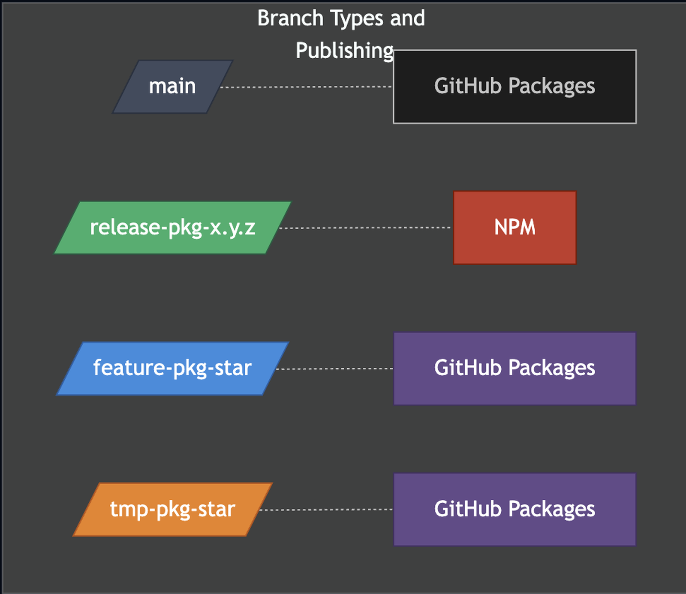
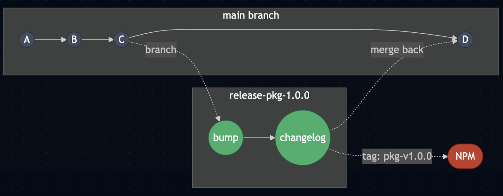
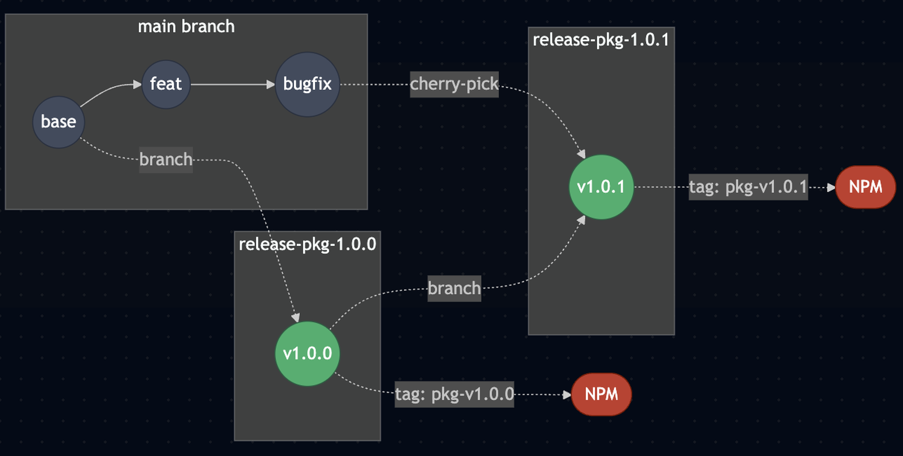
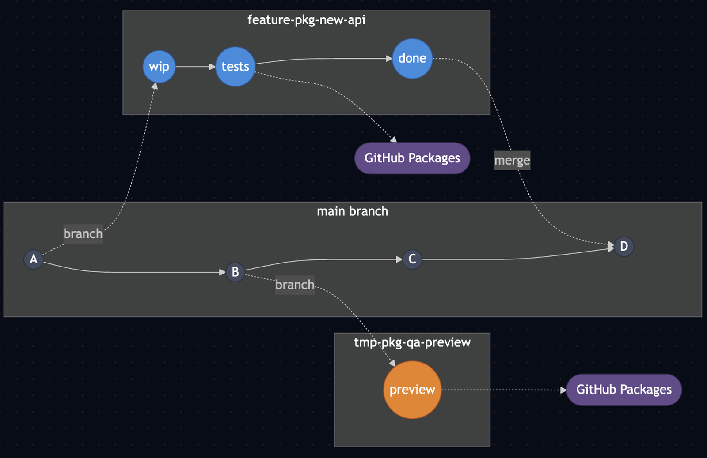

# GitFlow for QVAC Public SDKs & Model Packages

This repository uses a **main-first GitFlow** for **public SDK/model packages**. Internal work prefers org branches and same-repo PRs when write access permits; personal forks are supported when org push is unavailable or the contributor chooses that path.

## The rules that matter (TL;DR)

- **All development merges into `main`.**
- **Prefer org working branches and same-repo PRs when write access permits.** Use a personal fork otherwise, or when explicitly chosen.
- **Releases are published from versioned `release-<package>-<x.y.z>` branches** that exist in the upstream org repo.
- **Release/patch changes land via working-branch PRs into `release-*`**, not direct merges between integration and release branches.
- **Patch fixes use two PRs**: (1) working branch → `main` (dev fix), (2) separate working branch → `release-*` (patch release). Either head may be in the org repo or a personal fork.
- **`feature-*` and `tmp-*` are non-release streams** (GitHub Packages only), used to share dev builds safely.
- CI/CD is **path-scoped** so only the impacted package(s) build/publish.

> **Why this exists:** predictable releases across many packages, fast day-to-day development on `main`, and safe CI/CD for same-repo and external-fork contributions.

---

## Table of contents

- [Repo conventions](#repo-conventions)
- [Choosing the PR source repository](#choosing-the-pr-source-repository)
- [Branch types](#branch-types-naming-purpose-publishing)
- [Branch retention & deletion](#branch-retention--deletion)
- [Release flow](#release-flow-new-version-xyz)
- [Patch flow](#patch-flow-xyz--xyzz1)
- [Feature & temp flows](#feature--temp-branches-non-release-publishing)
- [Release PR enforcement](#release-pr-enforcement-ci-policy)
- [CI/CD routing requirements](#cicd-routing-requirements-high-level)
- [Quick reference](#quick-reference-one-liners)

---

## Repo conventions

- Packages live under: `packages/<package>/`
- Each package owns its own:
  - `packages/<package>/package.json`
  - `packages/<package>/CHANGELOG.md` (or equivalent changelog file)
- CI workflows are:
  - **Scoped** by `paths: packages/<package>/**`
  - Support a `workdir` input (or env var) pointing at the package folder
- Publishing targets:
  - **GitHub Packages (GPR)** for development streams (`dev`, `feature`, `temp`)
  - **NPM** for release streams (`latest`, optionally `next`/`beta` when explicitly needed)

---

## Choosing the PR source repository

The upstream org repo (`tetherto/qvac`) owns `main`, versioned release branches,
and shared `feature-*` / `tmp-*` publishing streams. A PR's working branch may
live in the org repo or a personal fork.

### Check access and resolve remotes

Before pushing a working branch, inspect the authenticated account and its
repository permission:

```bash
gh api user --jq .login
gh repo view tetherto/qvac --json viewerPermission --jq .viewerPermission
git remote -v
```

- `WRITE`, `MAINTAIN`, or `ADMIN`: prefer an org working branch and same-repo PR.
- `READ` or `TRIAGE`: use a personal fork, or ask for the required access.
- If the lookup fails, resolve the authentication or connectivity problem before
  choosing a push target; a failed lookup does not establish lack of write access.
- Identify the org remote by its URL, not its name. It may be named `origin` or
  `upstream`. A remote pointing at a personal fork does not imply the account
  lacks org write access. Git and `gh` can use different credentials, so confirm
  the Git identity as well if a push is unexpectedly denied.

Repository write permission does not override branch rules. If an org push is
rejected, inspect the reason before choosing a fork; do not bypass protection or
retry authentication and network failures as though they were permission denials.
A contributor may also explicitly choose the fork path despite having org access.

### CI trust follows the PR source

Same-repo PRs skip the `fork-ci` environment approval gate. A personal-fork PR
counts as external even when its author has org write access. Privileged fork CI
requires merge/release-team approval for each workflow run on the current head
SHA; each new push requires fresh approval. See [LABELS.md](ci/LABELS.md) for
labels and fork trust, and [TEAMS.md](ci/TEAMS.md) for approval ownership.

### Golden rules

1) **Integration and publishing branches are PR targets**
   Make changes on a separate working branch and open a PR into `main`,
   `release-*`, or a shared `feature-*` / `tmp-*` stream. Use ordinary purpose-based
   names such as `feat/<package>-<description>`, `fix/<package>-<description>`, or
   `chore/<package>-<version>-changelog`. Do not prefix an org working branch with
   `release-`: pushes to that family can trigger publishing workflows. Maintainers
   create release and shared publishing branches as deliberate operations.

2) **No direct integration/release cross-merges**
   Do not open `main` → `release-*` or `release-*` → `main` PRs. Cherry-pick the
   intended commits onto a separate working branch and PR into the target. That
   working branch may live in the org repo or a personal fork.

3) **Publishing happens on merge to upstream**  
   - Merge to `release-*` can publish to **NPM** for that package/version.
   - Merge to `main` can publish **dev** builds (GitHub Packages) when package paths changed.
   - `feature-*` / `tmp-*` publish **feature/temp** builds (GitHub Packages).
   - **Native addons publish on `release-*` pushes only.** Their
     `on-merge-nx.yml` pipeline (and `on-merge-model-fit.yml`,
     `on-merge-ggml-rpc-server.yml`) does not push-trigger on `main`, `feature-*` or
     `tmp-*`, because a push to a `feature-*`/`tmp-*` branch would start a 9-platform
     matrix off an open PR's branch. Every non-release addon build is started with
     `workflow_dispatch` on the branch.
   - **An addon release branch cut from `main` also needs a dispatch.** When the version
     bump already merged to `main` and `release-<package>-<x.y.z>` is created from that
     commit, the push carries no new commits, so the `paths` filter never matches and
     nothing publishes. Start it with
     `gh workflow run on-merge-nx.yml --ref release-<package>-<x.y.z> -f package=<package>`.

### Daily dev loop (preferred: org branch → org main)

The examples use `upstream` for the org remote and `origin` for a personal fork.
Substitute the remote names resolved above. Start from a clean worktree.

```bash
git fetch upstream main
git switch -c feat/<package>-<short-desc> upstream/main
# make changes, run package checks, and commit
git push -u upstream feat/<package>-<short-desc>
gh pr create --repo tetherto/qvac --base main --head feat/<package>-<short-desc>
```

### Personal-fork fallback

Fork `tetherto/qvac` on GitHub and configure both remotes:

```bash
git clone https://github.com/<you>/qvac.git
cd qvac
git remote add upstream https://github.com/tetherto/qvac.git
```

Create the same working branch from the org's `main`, then push to the fork:

```bash
git fetch upstream main
git switch -c feat/<package>-<short-desc> upstream/main
# make changes, run package checks, and commit
git push -u origin feat/<package>-<short-desc>
gh pr create --repo tetherto/qvac --base main --head <you>:feat/<package>-<short-desc>
```

---

## Branch types (naming, purpose, publishing)

| Branch type | Pattern | Created in upstream by | Purpose | Publishes to | Notes |
|---|---|---:|---|---|---|
| Main | `main` | Maintainers | All active development | GitHub Packages (**dev**) | Default integration branch |
| Release | `release-<package>-<x.y.z>` | Maintainers | Versioned release line | **NPM** | Stable releases only. `<package>` is the **directory name** under `packages/`, see below |
| Feature | `feature-<package>-*` | Optional (maintainers) | Share a dev build for a large/isolated effort | GitHub Packages (**feature**) | Never publish to NPM. Addons: dispatch only |
| Temp | `tmp-<package>-*` | Optional (maintainers) | Experiments / QA previews | GitHub Packages (**temp**) | Never publish to NPM. Addons: dispatch only |

For native addons, any non-`release-*` build — `main` included — is started by
running `on-merge-nx.yml` with `workflow_dispatch` on that branch; pushing to the
branch does not start one. The dist-tag follows the branch (`feature`/`temp`)
unless the dispatch `tag` input overrides it, and `on-merge-model-fit.yml`
defaults that input to `dev`, so pin the exact version rather than the tag. See
[MOBILE-ON-DEMAND.md](ci/MOBILE-ON-DEMAND.md#testing-unmerged--unpublished-native-code).

**Release branch names use the package directory name**

`<package>` in `release-<package>-<x.y.z>` must be a directory under `packages/`.
Use `release-llm-llamacpp-0.53.1`, not the short `release-llm-0.53.1` some older
branches used. Same for `vla-ggml`, `ocr-ggml`, `embed-llamacpp`, `diffusion-cpp`,
`classification-ggml` and `translation-nmtcpp`.

The 14 native addons publish from one workflow rather than one file each, so the
branch name is what selects which package reaches NPM. `on-merge-nx.yml` checks it
twice, both against the directory name: `packages/<package>/project.json` must
exist, and the package the run selected must be exactly that one. A name it cannot
resolve fails the run rather than guessing, since a wrong guess would publish the
wrong package. Nothing is published either way, but the release is blocked until
the branch is recut under the right name.

**Publishing semantics**

- GitHub Packages dist-tags: `dev`, `feature`, `temp`
- NPM dist-tags: `latest` (stable); optionally `next`/`beta` when explicitly requested

**Dev build versioning (run-id traceability)**

- Development publishes (GitHub Packages) should be **uniquely traceable**.
- CI will append a build identifier (e.g., run id) to the published version *at publish time* (implementation detail of CI), so multiple dev publishes don’t collide.
  - Example shape: `x.y.z-dev.<run_id>` (exact formatting is owned by CI)
- Do **not** commit run-id version bumps to git.

---



---

## Branch retention & deletion

Upstream branches are kept or cleaned up according to a separate, enforced policy
documented in [branch-retention.md](branch-retention.md):

- `main` and the branch backing each package's current latest published version are
  never deleted, nor is any branch with an open PR, branch protection, or a WIP flag.
- `release-*` branches follow a nested-semver window (latest 2 majors / 3 minors / 3
  patches per package); older lines are eligible for deletion because the shipped code
  is preserved permanently by the release tag + npm artifact.
- `feature-*` / `tmp-*` are deleted after 2 months of inactivity; ad-hoc branches after
  1 month.
- A weekly GitHub Action flags candidates, waits a ~7-day grace period via a tracking
  issue, then deletes — applied across all qvac repos.

See [branch-retention.md](branch-retention.md) for the full rules, the safelist, and
how to adopt the automation in another repo.

---

## Release flow (new version x.y.z)



### 1) Maintainer creates the upstream release branch from `main`

Release branches are created **in the upstream org repo** and are named per package and version:

```bash
# maintainer action in upstream repo
git checkout main
git pull
git checkout -b release-<package>-<x.y.z>
git push -u upstream release-<package>-<x.y.z>
```

> Maintainers create release targets. Contributors open PRs from separate working branches in the org repo or a personal fork.

**Cut the documentation line at the same time**, for a package the documentation site versions — `@qvac/sdk` and `@qvac/cli` today. Run `qv-docs-cutoff` with the version being released, that one collection, and the release branch — the branch is what gives it the release base, since the cutoff publishes the tree the release was cut from and not `main`'s tip. It opens one PR into `main` that publishes the line written for this release and leaves the next one open; the documentation engineer reviews and merges it. Do not approve or merge it yourself, and do not promote it to production yet — that waits for step 3. The release train runs this same step for every collection it moves ([`docs/ci/RELEASE-TRAIN.md`](ci/RELEASE-TRAIN.md) step 6).

### 2) Contributor opens a release PR into the upstream release branch

PR source: a separate working branch in the org repo (preferred with write access)
or a personal fork → target: `upstream:release-<package>-<x.y.z>`. Use a head such
as `chore/<package>-<x.y.z>-changelog`; an org head must not start with `release-`.

The PR **must** include:
- **Version bump** in `packages/<package>/package.json` → `x.y.z`
- **Changelog update** in `packages/<package>/CHANGELOG.md`

PR naming suggestion:
- `release(<package>): v<x.y.z>`

### 3) Merge the Release PR → CI publishes to NPM

On merge to the upstream `release-*` branch, CI should:
- Build/package the artifact for `packages/<package>`
- Publish to **NPM**
- Create a git tag **and** GitHub release

**Tag format (standard):**
- `<package>-v<x.y.z>`  
  Example: `sdk-v1.0.0`

Once NPM serves the version, promote the documentation: verify that tree on staging, then run `promote-docs-production.yml` on the merge commit of step 1's documentation PR. Name that commit, never `main`'s tip — earlier would publish documentation for a version nobody can install, and later would publish whatever else merged meanwhile. The procedure is in [`docs/website/docs-workflow.md`](website/docs-workflow.md), "Production (manual promotion)".

### 4) Keep `main` aligned with what shipped (separate backmerge PR)

We do **not** merge upstream `release-*` back into upstream `main` directly.

Instead, ensure `main` reflects the shipped version + changelog via one of these patterns:

- **Preferred (planning discipline):** the release branch is cut from a `main` that already contains the intended changelog/version context (often true when release prep happens on `main` first).
- **Otherwise (common):** open a follow-up PR from a separate org working branch (or personal fork) into upstream `main` that applies the same version/changelog changes.

> Goal: `main` remains the single source of truth for current development state, while release lines are controlled targets for NPM publishing.

### 5) `@qvac/inference` before `@qvac/sdk`

`@qvac/sdk` and `@qvac/inference` expose the same API, so their versions share a
major and minor. The SDK's `@qvac/inference` dependency range is installed from NPM
when the SDK is built for release, so the engine is published first.

Moving both to a new major.minor is therefore two releases, in order:

1. `release-inference-<x.y.z>` → `publish-inference.yml` publishes `@qvac/inference`
   and tags `inference-v<x.y.z>`.
2. `release-sdk-<x.y.z>` → the release PR sets `packages/sdk` `version` and its
   `@qvac/inference` range to that version (`/qv-sdk-inference-version`), then
   `publish-sdk.yml` publishes `@qvac/sdk` and `tetherto-qvac-sdk`.

Each gets its own changelog and its own backmerge PR to `main`. Patch releases are
independent: an SDK patch leaves its range alone, and an engine patch is picked up by
the existing range with no SDK release at all.

`packages/sdk` `lint` fails when its own version and its `@qvac/inference` range
differ in major or minor, so the two cannot drift unnoticed.

### 6) Releasing the chain together: the release train

The flow above is one release branch per package, each waiting for the one
below it to reach NPM. A **release train** releases `@qvac/inference`,
`@qvac/sdk`, `@qvac/cli`, `@qvac/ai-sdk-provider` and the two plugins from one
`release-train-<train>-<x.y.z>` branch: one release PR, one backmerge, one npm
approval. See `docs/ci/RELEASE-TRAIN.md`.

---

## Patch flow (x.y.z → x.y.(z+1))



### 1) Implement the fix on `main` (PR #1)

- Do the work on a separate org working branch, or use a personal fork.
- Open PR into upstream `main`.
- Merge into upstream `main`.

This keeps ongoing development correct and ensures the fix exists on the primary development line.

### 2) Maintainer ensures the upstream patch release branch exists

If patching the currently released line, create a new patch branch from the previous release branch:

```bash
# maintainer action in upstream repo
git checkout release-<package>-<x.y.z>
git pull
git checkout -b release-<package>-<x.y.(z+1)>
git push -u upstream release-<package>-<x.y.(z+1)>
```

> Open the patch PR from a separate org working branch or personal fork into `release-<package>-<x.y.(z+1)>`.

### 3) Cherry-pick the fix commit(s) onto a separate working branch (PR #2)

Fetch the upstream release branch into your local repo, then cherry-pick the fix commit(s) that already landed in upstream `main`.

```bash
git fetch upstream

# create a separate working branch based on the upstream patch branch
git checkout -b patch-<package>-<x.y.(z+1)> upstream/release-<package>-<x.y.(z+1)>

# cherry-pick the fix commit(s) from upstream main
git cherry-pick <commit_sha_from_upstream_main>

# update required metadata
# - bump packages/<package>/package.json to x.y.(z+1)
# - update packages/<package>/CHANGELOG.md

# preferred: org working branch; use origin instead for a personal fork
git push -u upstream patch-<package>-<x.y.(z+1)>
```

### 4) Open PR into the upstream patch release branch

PR source: `patch-...` in the org repo (or `<your-fork>:patch-...`) → target: `upstream:release-<package>-<x.y.(z+1)>`

The PR **must** include:
- Version bump to `x.y.(z+1)`
- Changelog entry describing the patch

### 5) Merge PR → CI publishes patch to NPM

On merge to the upstream patch branch, CI should:
- Publish to NPM
- Tag + GitHub release using `<package>-v<x.y.(z+1)>`

### 6) Keep `main` aligned (already handled)

Because the fix first landed on `main` (PR #1), `main` already contains the functional change.  
Only the release-line version/changelog metadata may require a follow-up PR back to `main` if your process doesn’t prep release metadata on `main` first.

---

## Feature & temp branches (non-release publishing)



These branches are used to produce **shareable dev builds** without entering the immediate release train.

### `feature-<package>-*`

Use for a larger change where you need a **development package** to share with others.

**Branch location**
- If we need a persistent shared stream that publishes reliably, a maintainer may create a `feature-*` branch in upstream.
- Contributors PR into that upstream `feature-*` branch from separate org working branches or personal forks.

CI behavior (on merge/push to upstream `feature-*`):
- Build on changes scoped to the package path
- Publish to GitHub Packages with dist-tag `feature`
- Dev version includes a build identifier (run id) for traceability
- **Never publish to NPM**
- Do not create git tags or GitHub releases

### `tmp-<package>-*`

Use for QA previews and experiments.

Branch location + PR rules are the same as feature branches:
- Upstream `tmp-*` exists only when we need upstream workflows/publishing.
- Contributors PR from separate org working branches or personal forks into upstream `tmp-*`.

CI behavior (on merge/push to upstream `tmp-*`):
- Publish to GitHub Packages with dist-tag `temp`
- Dev version includes a build identifier (run id) for traceability
- **Never publish to NPM**
- Do not create git tags or GitHub releases

---

## Release PR enforcement (CI policy)

For **all** `release-*` branches:

✅ Required in PR:
- `packages/<package>/package.json` version **must** increase vs base
- `packages/<package>/CHANGELOG.md` **must** be updated

❌ CI will fail if:
- Version is unchanged / not incremented
- Changelog is missing or unchanged

---

## CI/CD routing requirements (high level)

To reflect branch intent correctly and keep fork PRs safe:

### Event and publishing safety

- **Never publish from PR events.**
  - Publishing requires credentials and must only occur on merge to upstream branches.
- Publish jobs should trigger on:
  - `push` to upstream `main` / `feature-*` / `tmp-*`
  - `push` to upstream `release-*` (or tags created from them)

### Publishing rules

- **NPM publish jobs**
  - Trigger only on `release-*` branches (or tags created from them)
  - Must require version + changelog checks

- **GitHub Packages publish jobs**
  - Trigger on upstream:
    - `main` → dist-tag `dev`
    - `feature-*` → dist-tag `feature`
    - `tmp-*` → dist-tag `temp`

### Path scoping

- All package workflows trigger on:
  - `paths: packages/<package>/**`
- Reusable workflows accept a `workdir` input pointing at the package directory.

---

## Quick reference (one-liners)

### Branch naming

- `main`
- `release-<package>-<x.y.z>`
- `feature-<package>-<anything>`
- `tmp-<package>-<anything>`

### New release (x.y.z)

- Maintainer: create upstream `release-<package>-<x.y.z>` from `main`
- Contributor: PR from a separate org working branch or personal fork into upstream `release-<package>-<x.y.z>` with:
  - `package.json` bumped to `x.y.z`
  - changelog updated
- Merge → CI publishes to NPM and tags `<package>-v<x.y.z>`

### Patch release (x.y.z → x.y.(z+1))

- PR #1: working branch → upstream `main` (the fix)
- Maintainer: create upstream `release-<package>-<x.y.(z+1)>` from previous release branch
- PR #2: cherry-pick fix commit(s) onto a separate working branch → PR into upstream patch branch with:
  - version bump `x.y.(z+1)`
  - changelog updated
- Merge → CI publishes patch to NPM and tags `<package>-v<x.y.(z+1)>`

### Dev sharing (non-NPM)

- Upstream `feature-*` / `tmp-*` exist only when we need a shared publishing stream.
- Contributors PR from separate org working branches or personal forks into those upstream branches.
- CI publishes to GitHub Packages with dist-tags `feature`/`temp` and run-id traceability.

---
