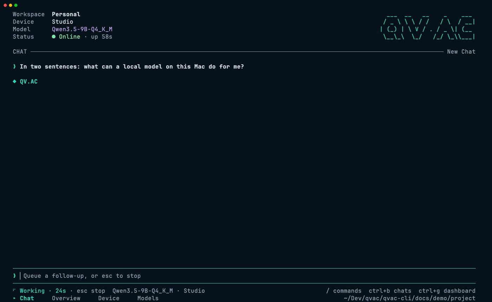
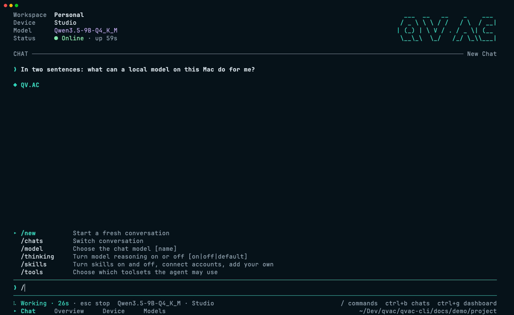
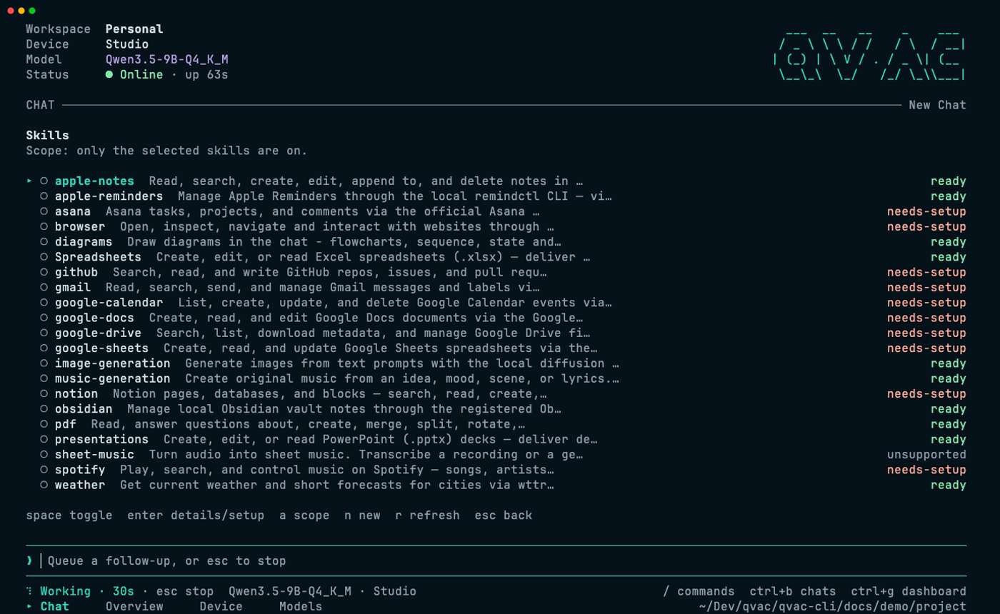
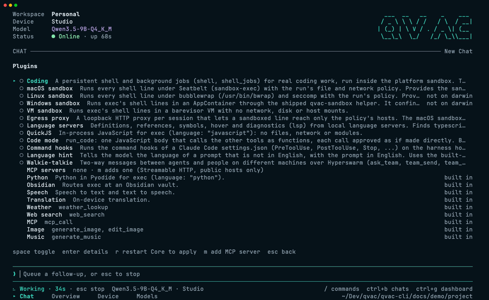
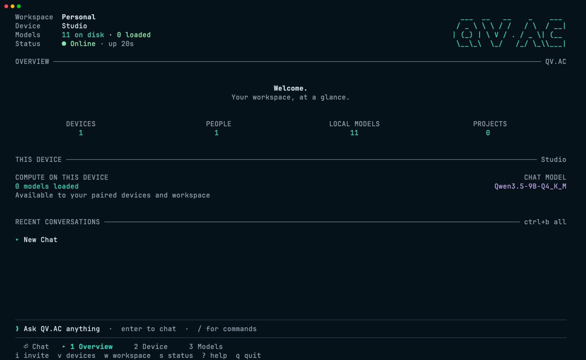
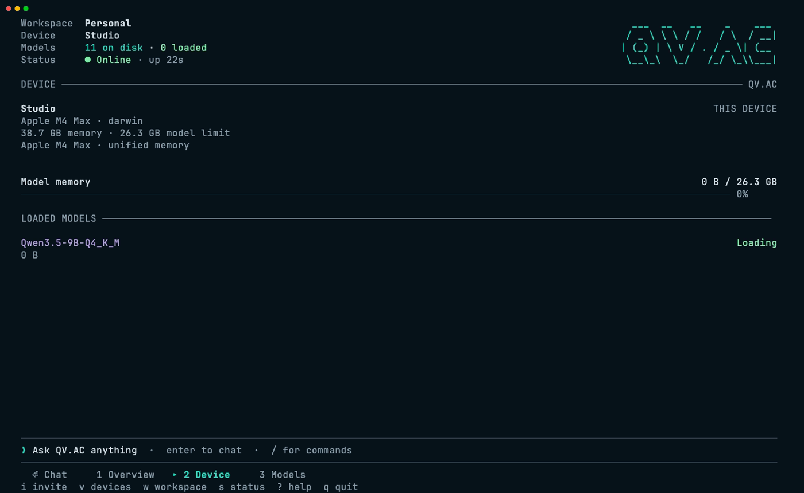
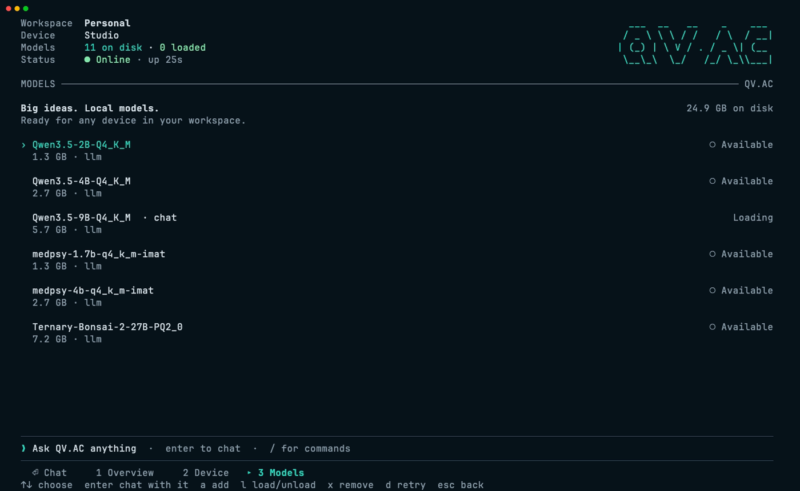

<p align="center">
  
</p>

<h1 align="center">QV.AC CLI</h1>

<p align="center">
  <b>Your most powerful device. Everywhere.</b>
  <br>
  Local AI in your terminal: chat, code and serve models across your devices, peer to peer
</p>

<p align="center">
  local models &middot; P2P workspaces &middot; borrow compute from your other devices &middot;
  every change approved with its diff &middot; harness plugins &middot; headless host
</p>

<p align="center">
  <a href="#quick-start">Quick start</a> &middot;
  <a href="#chat">Chat</a> &middot;
  <a href="#edits-you-can-see">Edits</a> &middot;
  <a href="#skills-and-plugins">Skills and plugins</a> &middot;
  <a href="#your-devices">Devices</a> &middot;
  <a href="#scripts-and-servers">Headless</a> &middot;
  <a href="#configuration">Configuration</a> &middot;
  <a href="#development">Development</a>
</p>

<p align="center">
  
</p>

`qvac` is one terminal app on top of [QV.AC Core](https://github.com/tetherto/qvac-core) and the
[QV.AC Harness](https://github.com/tetherto/qvac-harness). Core keeps your conversations, agents and
devices in a replicated mesh, so a chat started here is on your phone and laptop too. The harness
runs the model, the tools and the plugins on the device you choose. Nothing goes to a server.

## Quick start

```sh
# From the monorepo root, with its pinned pnpm version
pnpm install --frozen-lockfile
pnpm --filter @qvac/cli build
pnpm --filter @qvac/cli start             # chat; first run sets this device up
pnpm --filter @qvac/cli start --temp      # a throwaway store
```

`qvac` launches with Node and runs the app on its own pinned Bare runtime; you do not need Bare
installed. `qvac-bare` is the same CLI launched by Bare itself, with no Node past install (it needs
`bare` on your PATH). State lives in
`~/.qvac/cli` (`--storage <dir>` or `QVAC_STORAGE` for another), models in the shared
`~/.qvac/models`.

```sh
qvac                      # chat, resuming your last conversation
qvac "explain this repo"  # open chat and send a first message
qvac -r                   # pick a conversation first
qvac serve                # no UI: set up and serve this machine to your workspace
qvac -p "summarise" < notes.md
qvac --help               # every command; qvac help <command> for one
```

## Chat

<p align="center"></p>

The composer is always one key away: `Enter` from the dashboard, `Ctrl+G` back. Type `/` for
commands, `@` to reference a project file, `!cmd` to run a shell command and send its output
(`!!cmd` keeps it to yourself). `AGENTS.md` and `CLAUDE.md` from your project are given to every new
conversation, and `.qvac/prompts/*.md` become your own `/commands`.

<p align="center"></p>

| Key                   |                                                                      |
| --------------------- | -------------------------------------------------------------------- |
| `Enter` / `Alt+Enter` | send / new line; sending mid-run queues the message                  |
| `Esc`                 | stop the run, close a panel; twice to branch from an earlier message |
| `Ctrl+B` / `Ctrl+N`   | conversations / new conversation                                     |
| `Ctrl+L`, `Shift+Tab` | choose model, thinking on/off                                        |
| `Ctrl+O` / `Ctrl+T`   | tool output / thinking                                               |
| `Ctrl+F`              | search the conversation                                              |
| `Ctrl+X`, `/export`   | copy the last answer, save the conversation as HTML or Markdown      |
| `Alt+E`               | edit the draft in `$EDITOR`                                          |
| `Ctrl+V`              | attach the file whose path is on the clipboard                       |
| wheel, drag           | scroll; select and copy (`Shift`+drag for your terminal's own)       |

Editing is readline: word motion and deletion, `Ctrl+K`/`Ctrl+U`/`Ctrl+Y` kill and yank, undo,
history on `↑`/`↓`, and large pastes fold into one `[paste #1 +120 lines]` marker. `/help` lists
everything.

## Edits you can see

<p align="center"></p>

Every write waits for you, and you see what it would do before you answer: the diff of an edit, the
file a write replaces, the exact command. `y` allows once, `a` always (a rule for you, not for the
whole workspace), `n` denies. Finished calls stay as one line each (`Edit math.mjs +4 −0`,
`Run npm test exit 1`) and open with `Ctrl+O`.

## Skills and plugins

<p align="center">
  
  
</p>

- `/skills` — the agent's skills with live readiness: turn them on and off, add a token, write your
  own. With a 9B or larger model, the `qvac-plugins` skill writes a plugin or an extension for you
  when you ask: [docs/skills.md](docs/skills.md).
- `/plugins` — harness plugins beyond the built-ins: a persistent coding shell with background jobs
  (sandboxed on macOS and Linux), language servers, code mode, QuickJS, Claude Code command hooks,
  MCP servers. Dependencies come with them; `r` re-reads `qvac.config` and restarts Core, in place. Every
  plugin, how to turn it on and how to write your own, inline in `qvac.config` too:
  [docs/plugins.md](docs/plugins.md). Extensions add commands, footer notes, keys and colours to
  the app itself: [docs/extensions.md](docs/extensions.md).
- `/tools`, `/permissions`, `/agent`, `/usage`, `/knowledge`, `/folders` — toolsets, approval mode and
  saved rules, instructions and context size, what fills the context, files and web search, and
  which folders the agent may read or write.

## Your devices

<p align="center">
  
  
  
</p>

The dashboard is the workspace at a glance: devices, people, models and projects (`1`), this
machine's hardware and model memory (`2`), and its models to download, load and remove (`3`). `i`
pairs another device with a QR code. A paired machine's models serve the whole workspace, so a laptop
can chat on a desktop's GPU.

## Scripts and servers

`qvac serve` puts a machine with no screen into your workspace and serves its models. On first run
in a terminal it asks three plain questions (join or create, your name, this device's name) and
prints the invites with a QR code; after that a restart resumes without asking. Without a terminal
it takes everything from flags or `QVAC_*` env vars and exits 2 naming what is missing. It stays up
until Ctrl+C or SIGTERM (exit 0), stops with exit 0 when another device unpairs it, and exits 1 if
Core dies. `qvac host serve` is the same command; the SDK's API server is `qvac sdk serve`.

```sh
qvac serve --create --account-name Ada --device-name dgx-spark --non-interactive --json
QVAC_JOIN=qvac://workspace/… QVAC_DEVICE_NAME=gpu-1 qvac serve
```

With `--json` it prints one `{"status":"ready",…}` line (the device invite, and the workspace
invite when it can mint one), then one line per event: `download`, `peers`, `unpaired`, `stopped`.

| Command                      |                                                                    |
| ---------------------------- | ------------------------------------------------------------------ |
| `qvac serve`                 | set up and run this device, no UI                                  |
| `qvac workspace join <link>` | preview a `qvac://workspace/` or `qvac://device/` link, join, wait |
| `qvac workspace leave`       | unpair this device: it leaves your account and its workspaces      |
| `qvac models list`           | on disk, loaded, and the catalog that suits this device (`--json`) |
| `qvac models pull <model>`   | download, with percent, size, speed and time left                  |
| `qvac models remove <model>` | delete from disk; refused while loaded, asks unless `--yes`        |
| `qvac status`                | this device, workspace, peers, models loaded, storage (`--json`)   |
| `qvac logs [-f] [--tail N]`  | the end of `assistant.log` and `harness.log`; `-f` follows         |
| `qvac config`                | the merged configuration, each value with its source (`--json`)    |
| `qvac help [command]`, `-v`  | commands and options; the CLI, Core and harness versions           |

Flags: `--create`, `--account-name`, `--device-name` (`--name`), `--join`, `--device-join`,
`--data-dir` (`--storage`, `-s`), `--no-default-models`, `--json`, `--non-interactive`, `--yes`,
`--no-color`, `--temp`. Every flag also reads `QVAC_<FLAG_NAME>`: `QVAC_JOIN`, `QVAC_ACCOUNT_NAME`,
`QVAC_DATA_DIR`, `QVAC_NON_INTERACTIVE=1`, `QVAC_JSON=1`. A device's state has one writer, so
commands that need Core refuse to run beside another `qvac` on the same `--data-dir`; `qvac status`
beside a running `qvac serve` reads the copy serve keeps.

For scripts, `qvac -p "prompt"` prints the answer (stdin goes first), `--mode json` streams every
chunk as JSON lines, and `--mode rpc` takes JSON commands on stdin for editors and other tools. All
of them go through Core, so the conversation is saved and replicated like any other. The words
`serve`, `workspace`, `models`, `status`, `logs`, `help`, `sdk`, `host`, `chat` and `config` are commands,
never a first chat message; `qvac -- status of the build` sends one anyway.

## QVAC SDK commands

The existing SDK commands are integrated under `qvac sdk`. Update scripts from
`qvac doctor`, `qvac configure`, `qvac serve --openai`, `qvac bundle sdk` and
`qvac verify …` to their `qvac sdk …` equivalents. SDK flags and configuration
keys are preserved; see the [SDK command reference](docs/sdk-cli.md).

| Command                                                         |                                                                                                                        |
| --------------------------------------------------------------- | ---------------------------------------------------------------------------------------------------------------------- |
| `qvac sdk doctor [--deep] [--json] [--offline]`                 | can this machine run the SDK: Node, memory, GPU, disk, mobile toolchains, ffmpeg, Bare, `engines.bare`; exits 1 if not |
| `qvac sdk configure [--yes] [--modality chat]`                  | build `serve.models` in `qvac.config.json` by searching the SDK's models                                               |
| `qvac sdk serve --openai [--systemone]`                         | an HTTP API on local models: OpenAI-compatible `/v1/…`, System One decisions and `/qvac/v1/translate`                  |
| `qvac sdk openai coverage`, `qvac sdk openai spec`              | which OpenAI endpoints `serve --openai` covers, and its OpenAPI spec without starting it                               |
| `qvac sdk bundle sdk [--host darwin-arm64]`                     | a tree-shaken Bare worker bundle of the SDK plugins in `qvac.config`, plus `addons.manifest.json`                      |
| `qvac sdk verify deps --base <ref> --head <ref>`                | the native dependency changes between two git refs                                                                     |
| `qvac sdk verify bundle --addons-source <path> --host <target>` | a bundle's addons and Bare ABI checked for each host                                                                   |

`qvac sdk serve` listens on `127.0.0.1:11434` by default (`-p`, `-H`); a non-loopback host needs
`--api-key` or `--api-key-file`, and `--docs` mounts the API explorer at `/docs`. It is not `qvac serve`:
that one puts this device in your QV.AC workspace, this one is a local HTTP API for apps.

## Configuration

`qvac.config.json`, `.js`, `.mjs` or `.ts` in the current folder, or `--config <path>`; see
[docs/examples/qvac.config.mjs](docs/examples/qvac.config.mjs).

```js
export default {
  core: {
    model: 'Qwen3.5-9B-Q4_K_M',
    folders: [{ path: '.', write: true }]
  },
  harness: {
    plugins: [{ use: './my-plugin.mjs' }],
    delegation: { targets: [{ name: 'codex', protocol: 'codex', command: 'codex' }] }
  },
  tui: { theme: 'qvac', toolOutput: 'collapsed', mouse: true }
}
```

The SDK's own keys keep their meaning in the same file: top-level `plugins` (the SDK inference plugins
`qvac sdk bundle sdk` bundles) and `serve` (`serve.models`, `serve.cors`, `serve.openai` for
`qvac sdk serve`). QV.AC's keys live under `core`, `harness` and `tui`; every key and how the
layers merge is in [docs/config.md](docs/config.md).

Plugins turned on in `/plugins` are kept in `<storage>/plugins.json`. A custom plugin module exports
a factory that returns a harness plugin, or names a class with `export`. Delegation hands work to
local child agents or to Claude Code, Codex or ACP CLIs, within the run's folder and network grants.

## How it works

```
qvac (Bare, bare-tui) ── Client ──► Core sidecar ──► harness worker (models, tools, plugins)
                                     │
                                     └── mesh ◄──► your other devices and workspace
```

The UI is a client like any other: everything goes through Core's `Client`, and inference happens
only in the harness. Core and the harness are npm packages, `@qvac/core` and `@qvac/harness`,
pinned to exact versions in `package.json`.

## Development

The CLI lives in the monorepo's `packages/cli`. Sources are strict TypeScript:
`src/cli` owns command parsing and dispatch, `src/lib` holds reusable runtime,
configuration, client and SDK/server code, and `src/product` owns the terminal UI.

We retain the existing CLI's `tsc` + `tsc-alias` build. Modern Bare can run
TypeScript directly, but both launchers and the packaged application use the
same emitted `dist` JavaScript. Rebuild after source changes before running
integration tests or creating a package.

From `packages/cli`, after installing dependencies at the monorepo root:

```sh
pnpm build                # compile TypeScript and resolve import aliases
pnpm typecheck            # check source and SDK test types
pnpm format               # check formatting
pnpm lint                 # lunte
pnpm test:unit            # SDK, benchmark harness and workbench unit tests
pnpm test:e2e             # SDK command and HTTP API tests
pnpm test:integration     # boots real Core under Bare
pnpm test:pty             # real CLI in a pseudo-terminal
pnpm test:p2p             # devices on a private test DHT
pnpm test:delegation      # real local-model delegation through an external CLI
pnpm test:invite          # invitation encoding and QR smoke check
pnpm test:diagnostics     # spawned-server diagnostic checks
pnpm test:standalone      # copied binary smoke check after pnpm pear:build
pnpm capture              # render real frames from a running Core
pnpm demo:record          # re-record terminal videos (needs vhs)
pnpm build:splash         # regenerate boot ducks
```

Test programs live under `test`: Core, invitation and delegation smokes are in
`test/integration`, shared runners are in `test/helpers`, and server diagnostics
are in `test/e2e`. `scripts` contains build, publishing and dependency lifecycle
tooling. Screen capture and rendering tools live beside the videos in `docs/demo`.

Tests do not ship in the npm archive. To run a checkout smoke against a separately
installed package, select its root explicitly (the runner also uses its Bare runtime):

```sh
QVAC_CLI_TEST_PACKAGE=/absolute/consumer/node_modules/@qvac/cli pnpm test:integration
QVAC_CLI_TEST_PACKAGE=/absolute/consumer/node_modules/@qvac/cli pnpm test:delegation
```

`pnpm test:workbench` rebuilds before its focused unit suite. P2P checks support
`P2P_DEVICES=10`; `P2P_KEEP=1` keeps their logs. GPU/model checks also need the
appropriate model files and platform addons; rerun them on H100 when the hosts
are available.

Distribution: run `pnpm build && pnpm pack:local` for an npm archive, or
`pnpm pear:build` for a Pear payload. Both package the emitted code, scripts and
skills from this package, without the old standalone checkout. SDK commands run directly in the Node launcher, preserving server readiness
descriptors and process IDs. `qvac-bare sdk` starts the packaged Node runner and
requires the Node version in `package.json`. Explicit legacy HTTP launches
(`qvac serve --openai`, `qvac serve --no-default`, and `qvac serve openai`) remain
compatible with managed provider and editor integrations. Plain `qvac serve`
starts the peer host.

Workspace pnpm installs apply the patches declared in `pnpm-workspace.yaml`.
Standalone npm installs use `scripts/patch-dependencies.mjs` to apply the pinned
harness patches. If lifecycle scripts are disabled or awaiting approval, run that first-party
script explicitly before exercising Core or harness behavior.

The npm archive also includes a generated `npm-shrinkwrap.json` to preserve
Bare runtime versions. After changing dependencies, regenerate both the root
pnpm lock and this package's npm shrinkwrap (`npm install --package-lock-only
--ignore-scripts` from `packages/cli`), then rerun the clean consumer checks.
The publish check rejects mismatched direct dependency specifications.

npm only honors overrides in the consuming project's root manifest. The current
Core/harness manifests can therefore select older harness, LLM and translation
peers in a consumer install even with the shrinkwrap. To reproduce the tested
workspace graph in an npm project, copy this package's `overrides` into that
project's root manifest, replacing `$dependency` references with the exact
versions from this package's `dependencies`. Reinstall and apply the harness
patch script. Workspace and consumer dependency graphs are validated separately:
the Core smoke checks startup and persistence, while the delegation smoke uses a
real cached local model and an authenticated external CLI. Run both installed-package
commands above after dependency changes, then rerun the model API checks for the
native backends being shipped. The clean npm consumer has also passed real 2B-model
delegation and the chat, tool, Responses, embedding, ASR, translation and TTS API checks.

See [SDK development and CI](docs/sdk-cli.md#development) for the workspace and
published SDK test variants.
