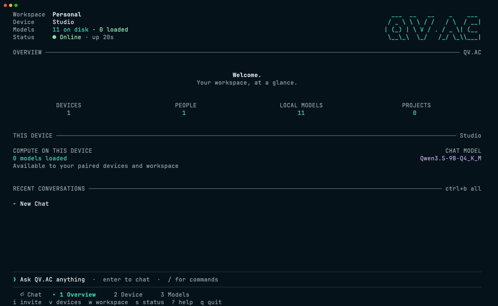
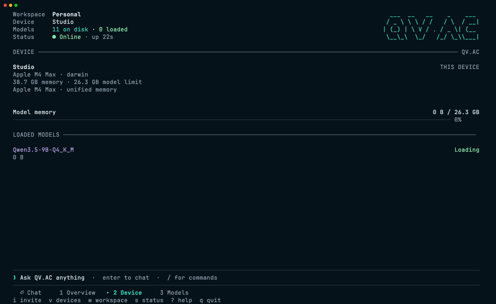
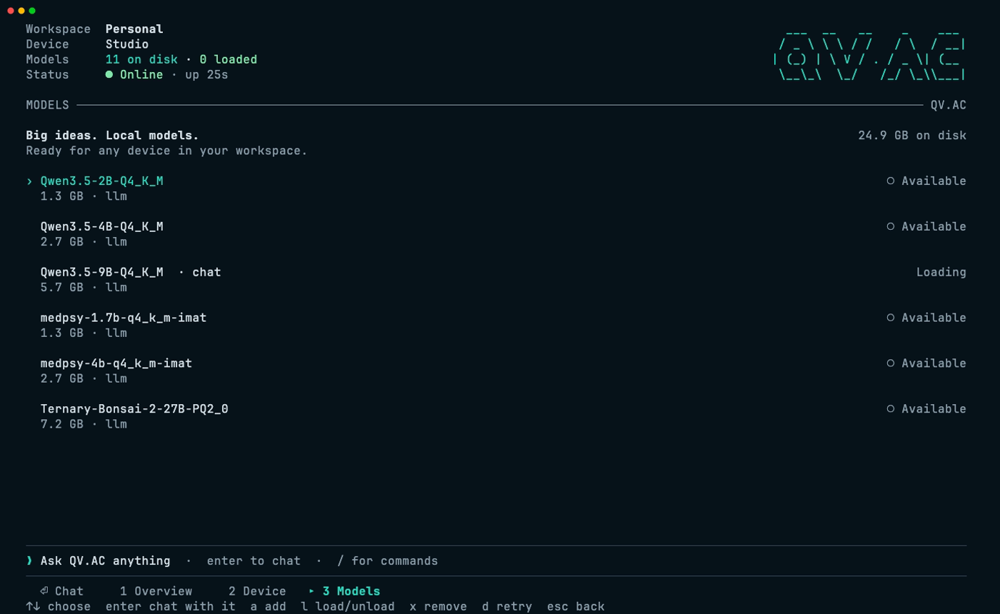

<p align="center">
  
</p>

<h1 align="center">QV.AC CLI</h1>

<p align="center">
  <b>Your most powerful device. Everywhere.</b>
  <br>
  Local AI across your devices: this machine serves its models to your workspace, peer to peer
</p>

<p align="center">
  local models &middot; P2P workspaces &middot; lend compute to your other devices &middot;
  a dashboard for every device &middot; headless host
</p>

<p align="center">
  <a href="#quick-start">Quick start</a> &middot;
  <a href="#your-devices">Devices</a> &middot;
  <a href="#scripts-and-servers">Headless</a> &middot;
  <a href="#qvac-sdk-commands">SDK</a> &middot;
  <a href="#configuration">Configuration</a> &middot;
  <a href="#development">Development</a>
</p>

<p align="center">
  
  
  
</p>

`qvac` is the host of your devices, on top of [QV.AC Core](https://github.com/tetherto/qvac-core)
and the [QV.AC Harness](https://github.com/tetherto/qvac-harness). Core keeps your agents and
devices in a replicated mesh; the harness runs the model, the tools and the plugins on the device
you choose. `qvac` serves this machine's models to the workspace and manages it: devices, models,
workspaces, invites. The chat is [`duck`](../duck), which talks to the agent on this device or on
any device paired with it. Nothing goes to a server.

## Quick start

```sh
# From the monorepo root, with its pinned pnpm version
pnpm install --frozen-lockfile
pnpm --filter @qvac/cli build
pnpm --filter @qvac/cli start             # the dashboard; first run sets this device up
pnpm --filter @qvac/cli start --temp      # a throwaway store
```

`qvac` launches with Node and runs the app on its own pinned Bare runtime; you do not need Bare
installed. `qvac-bare` is the same CLI launched by Bare itself, with no Node past install (it needs
`bare` on your PATH). State lives in
`~/.qvac/cli` (`--storage <dir>` or `QVAC_STORAGE` for another), models in the shared
`~/.qvac/models`.

```sh
qvac                      # the dashboard: this device, its models, your other devices
qvac serve                # no UI: set up and serve this machine to your workspace
qvac invite               # this device's link, to pair another device with it
qvac --help               # every command; qvac help <command> for one
duck "explain this repo"  # chat with the agent this device hosts
```

## Your devices

The dashboard is the workspace at a glance: devices, people, models and projects (`1`), this
machine's hardware and model memory (`2`), and its models to download, load and remove (`3`). `v`
lists every device, `w` the workspaces this one serves, `s` its status, `i` pairs another device
with a QR code, and `/` opens the command palette, every page and action by name. A paired
machine's models serve the whole workspace, so a laptop can chat on a desktop's GPU.

| Key          |                                                            |
| ------------ | ---------------------------------------------------------- |
| `1` `2` `3`  | overview, device, models; `Tab` goes round them            |
| `v` `w` `s`  | all devices, workspaces, status                            |
| `i`          | invite: pair a device, or a member link for the workspace  |
| `/`          | the command palette; type to filter, `Enter` runs          |
| `↑↓` `l` `x` | on Models: choose, load or unload, remove; `a` the catalog |
| `Esc`, `?`   | back to the overview, help                                 |
| wheel, drag  | scroll a list; select and copy                             |

## Scripts and servers

`qvac serve` puts a machine with no screen into your workspace and serves its models. On first run
in a terminal it asks three plain questions (join or create, your name, this device's name) and
prints the invites with a QR code; after that a restart resumes without asking. Without a terminal
it takes everything from flags or `QVAC_*` env vars and exits 2 naming what is missing. It stays up
until Ctrl+C or SIGTERM (exit 0), stops with exit 0 when another device unpairs it, and exits 1 if
Core dies. The SDK's API server is `qvac sdk serve`.

```sh
qvac serve --create --account-name Ada --device-name dgx-spark --non-interactive --json
QVAC_JOIN=qvac://workspace/… QVAC_DEVICE_NAME=gpu-1 qvac serve
```

With `--json` it prints one `{"status":"ready",…}` line (the device invite, and the workspace
invite when it can mint one), then one line per event: `download`, `peers`, `unpaired`, `stopped`.

| Command                      |                                                                    |
| ---------------------------- | ------------------------------------------------------------------ |
| `qvac serve`                 | set up and run this device, no UI                                  |
| `qvac invite`                | this device's link, to pair another device with it (`--json`)      |
| `qvac workspace join <link>` | preview a `qvac://workspace/` or `qvac://device/` link, join, wait |
| `qvac workspace leave`       | unpair this device: it leaves your account and its workspaces      |
| `qvac models list`           | on disk, loaded, and the catalog that suits this device (`--json`) |
| `qvac models pull <model>`   | download, with percent, size, speed and time left                  |
| `qvac models remove <model>` | delete from disk; refused while loaded, asks unless `--yes`        |
| `qvac status`                | this device, workspace, peers, models loaded, storage (`--json`)   |
| `qvac logs [-f] [--tail N]`  | the end of `assistant.log` and `harness.log`; `-f` follows         |
| `qvac config`                | the merged configuration, each value with its source (`--json`)    |
| `qvac help [command]`, `-v`  | commands and options; the CLI, Core and harness versions           |

Flags: `--create`, `--account-name`, `--device-name` (`--name`), `--join`, `--device-join`,
`--data-dir` (`--storage`, `-s`), `--no-default-models`, `--json`, `--non-interactive`, `--yes`,
`--no-color`, `--temp`. Every flag also reads `QVAC_<FLAG_NAME>`: `QVAC_JOIN`, `QVAC_ACCOUNT_NAME`,
`QVAC_DATA_DIR`, `QVAC_NON_INTERACTIVE=1`, `QVAC_JSON=1`. A device's state has one writer, so
commands that need Core refuse to run beside another `qvac` on the same `--data-dir`; `qvac status`
beside a running `qvac serve` reads the copy serve keeps.

For a chat from a script, `duck -p "prompt"` prints the answer; see [duck](../duck).

## QVAC SDK commands

The existing SDK commands are integrated under `qvac sdk`. Update scripts from
`qvac doctor`, `qvac configure`, `qvac serve --openai`, `qvac bundle sdk` and
`qvac verify …` to their `qvac sdk …` equivalents. SDK flags and configuration
keys are preserved; see the [SDK command reference](docs/sdk-cli.md).

| Command                                                         |                                                                                                                        |
| --------------------------------------------------------------- | ---------------------------------------------------------------------------------------------------------------------- |
| `qvac sdk doctor [--deep] [--json] [--offline]`                 | can this machine run the SDK: Node, memory, GPU, disk, mobile toolchains, ffmpeg, Bare, `engines.bare`; exits 1 if not |
| `qvac sdk configure [--yes] [--modality chat]`                  | build `serve.models` in `qvac.config.json` by searching the SDK's models                                               |
| `qvac sdk serve --openai [--systemone]`                         | an HTTP API on local models: OpenAI-compatible `/v1/…`, System One decisions and `/qvac/v1/translate`                  |
| `qvac sdk openai coverage`, `qvac sdk openai spec`              | which OpenAI endpoints `serve --openai` covers, and its OpenAPI spec without starting it                               |
| `qvac sdk bundle sdk [--host darwin-arm64]`                     | a tree-shaken Bare worker bundle of the SDK plugins in `qvac.config`, plus `addons.manifest.json`                      |
| `qvac sdk verify deps --base <ref> --head <ref>`                | the native dependency changes between two git refs                                                                     |
| `qvac sdk verify bundle --addons-source <path> --host <target>` | a bundle's addons and Bare ABI checked for each host                                                                   |

`qvac sdk serve` listens on `127.0.0.1:11434` by default (`-p`, `-H`); a non-loopback host needs
`--api-key` or `--api-key-file`, and `--docs` mounts the API explorer at `/docs`. It is not `qvac serve`:
that one puts this device in your QV.AC workspace, this one is a local HTTP API for apps.

## Configuration

`qvac.config.json`, `.js`, `.mjs` or `.ts` in the current folder, or `--config <path>`; see
[docs/examples/qvac.config.mjs](docs/examples/qvac.config.mjs). `duck` reads the same file.

```js
export default {
  core: {
    model: 'Qwen3.5-9B-Q4_K_M',
    folders: [{ path: '.', write: true }]
  },
  harness: {
    plugins: [{ use: './my-plugin.mjs' }],
    delegation: { targets: [{ name: 'codex', protocol: 'codex', command: 'codex' }] }
  },
  tui: { theme: 'qvac', toolOutput: 'collapsed', mouse: true }
}
```

The SDK's own keys keep their meaning in the same file: top-level `plugins` (the SDK inference plugins
`qvac sdk bundle sdk` bundles) and `serve` (`serve.models`, `serve.cors`, `serve.openai` for
`qvac sdk serve`). QV.AC's keys live under `core`, `harness` and `tui`; every key and how the
layers merge is in [docs/config.md](docs/config.md).

Harness plugins beyond the built-ins (a persistent coding shell with background jobs, language
servers, code mode, QuickJS, Claude Code command hooks, MCP servers), how to turn one on and how to
write your own, inline in `qvac.config` too: [docs/plugins.md](docs/plugins.md). Plugins turned on
in duck's `/plugins` screen are kept in `<storage>/plugins.json`. A custom plugin module exports
a factory that returns a harness plugin, or names a class with `export`. Delegation hands work to
local child agents or to Claude Code, Codex or ACP CLIs, within the run's folder and network grants.
The agent's skills, and the `qvac-plugins` skill that writes a plugin for you:
[docs/skills.md](docs/skills.md).

## How it works

```
qvac (Bare, bare-tui) ── Client ──► Core sidecar ──► harness worker (models, tools, plugins)
                                     │
                                     └── mesh ◄──► your other devices, duck and the workspace
```

The dashboard is a client like any other: everything goes through Core's `Client`, and inference
happens only in the harness. Core and the harness are npm packages, `@qvac/core` and
`@qvac/harness`, pinned to exact versions in `package.json`; the shell, branding, host and launcher
the two products share are [`@qvac/cli-kit`](../cli-kit).

## Development

The CLI lives in the monorepo's `packages/cli`. Sources are strict TypeScript:
`src/cli` owns command parsing and dispatch, `src/product` owns the dashboard, and
`src/lib` holds the SDK and server code behind `qvac sdk`. The shell, the Core and
harness host and the launcher are `@qvac/cli-kit`'s.

We retain the existing CLI's `tsc` + `tsc-alias` build. Modern Bare can run
TypeScript directly, but both launchers and the packaged application use the
same emitted `dist` JavaScript. Rebuild after source changes before running
integration tests or creating a package.

From `packages/cli`, after installing dependencies at the monorepo root:

```sh
pnpm build                # compile TypeScript and resolve import aliases
pnpm typecheck            # check source and SDK test types
pnpm format               # check formatting
pnpm lint                 # lunte
pnpm test:unit            # SDK, benchmark harness and workbench unit tests
pnpm test:e2e             # SDK command and HTTP API tests
pnpm test:integration     # boots real Core under Bare
pnpm test:pty             # real CLI in a pseudo-terminal
pnpm test:p2p             # devices on a private test DHT
pnpm test:invite          # invitation encoding and QR smoke check
pnpm test:diagnostics     # spawned-server diagnostic checks
pnpm test:standalone      # copied binary smoke check after pnpm pear:build
```

Test programs live under `test`: Core and invitation smokes are in
`test/integration`, shared runners are in `test/helpers`, and server diagnostics
are in `test/e2e`. `scripts` contains build, publishing and dependency lifecycle
tooling.

Tests do not ship in the npm archive. To run a checkout smoke against a separately
installed package, select its root explicitly (the runner also uses its Bare runtime):

```sh
QVAC_CLI_TEST_PACKAGE=/absolute/consumer/node_modules/@qvac/cli pnpm test:integration
```

`pnpm test:workbench` rebuilds before its focused unit suite. P2P checks support
`P2P_DEVICES=10`; `P2P_KEEP=1` keeps their logs. GPU/model checks also need the
appropriate model files and platform addons; rerun them on H100 when the hosts
are available.

Distribution: run `pnpm build && pnpm pack:local` for an npm archive, or
`pnpm pear:build` for a Pear payload. Both package the emitted code, scripts and
skills from this package, without the old standalone checkout. SDK commands run directly in the Node launcher, preserving server readiness
descriptors and process IDs. `qvac-bare sdk` starts the packaged Node runner and
requires the Node version in `package.json`. Explicit legacy HTTP launches
(`qvac serve --openai`, `qvac serve --no-default`, and `qvac serve openai`) remain
compatible with managed provider and editor integrations. Plain `qvac serve`
starts the peer host.

Python (Pyodide) and QuickJS are optional dependencies: a normal install includes them, and
`--omit=optional` leaves them out, in which case the `python`, `quickjs` and `code-mode` plugins
report the missing package instead of starting.

`pnpm pack:local` installs the committed npm shrinkwrap in an isolated directory, runs the publish
check, then packs it. This keeps a development SDK link from leaking into the archive. The publish
check confirms the shrinkwrap matches `package.json` and honours its overrides.

Fixes to published dependencies ship as `patches/<name>@<version>.patch`. The postinstall step
applies them, with the patches the harness ships, to an npm install; pnpm applies the copies under
the repository's `patchedDependencies`. YAML and QR artifacts are generated by
`scripts/vendor-libraries.mjs` from their library forks.

After changing dependencies, regenerate the root pnpm lock with the repository's
pinned pnpm version and the CLI npm shrinkwrap in an isolated install. Run the frozen-lock check,
`pnpm pack:local`, and the installed-package smoke commands above. Build and test tools remain development
dependencies.

See [SDK development and CI](docs/sdk-cli.md#development) for the workspace and
published SDK test variants.
