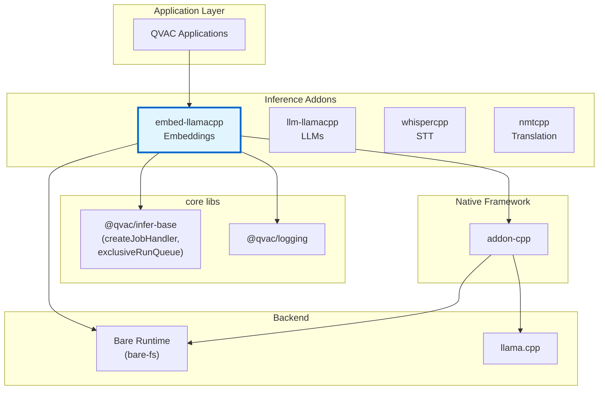
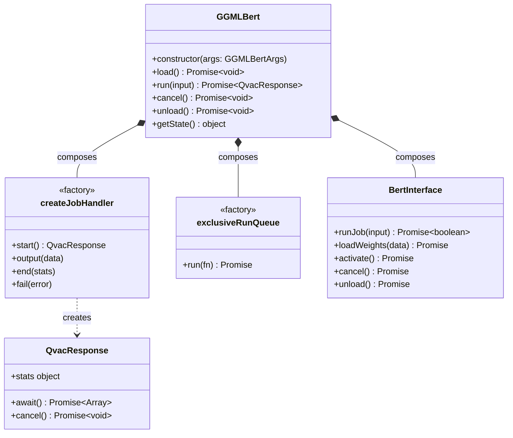
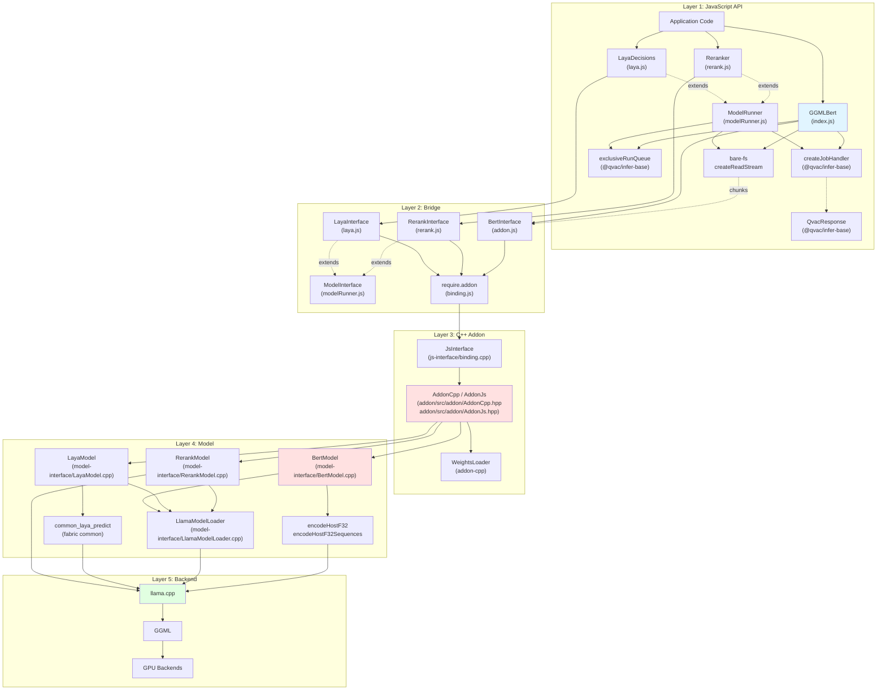
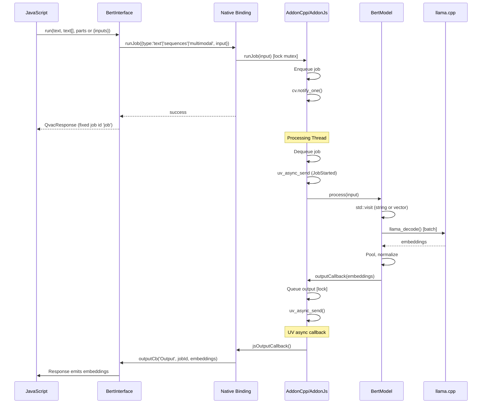

# Architecture Documentation

**Package:** `@qvac/embed-llamacpp` v0.15.0
**Stack:** JavaScript, C++20, llama.cpp, Bare Runtime, CMake, vcpkg  
**License:** Apache-2.0  
**Addon-cpp:** ≥1.1.5#1 (single job per run, `runJob(input)`, `cancel()` waits until job stopped, no transition callback)

---

## Table of Contents

### Overview
- [Purpose](#purpose)
- [Key Features](#key-features)
- [Target Platforms](#target-platforms)

### Core Architecture
- [Package Context](#package-context)
- [Public API](#public-api)
- [Internal Architecture](#internal-architecture)
- [Core Components](#core-components)
- [Bare Runtime Integration](#bare-runtime-integration)

### Architecture Decisions
- [Decision 1: llama.cpp as Inference Backend](#decision-1-llamacpp-as-inference-backend)
- [Decision 2: Bare Runtime over Node.js](#decision-2-bare-runtime-over-nodejs)
- [Decision 3: Caller-Provided File Paths](#decision-3-caller-provided-file-paths)
- [Decision 4: Incremental Buffer-Based Weight Loading](#decision-4-incremental-buffer-based-weight-loading)
- [Decision 5: Batch Processing as Primary Use Case](#decision-5-batch-processing-as-primary-use-case)
- [Decision 6: Exclusive Run Queue](#decision-6-exclusive-run-queue)
- [Decision 7: TypeScript Definitions](#decision-7-typescript-definitions)
- [Decision 8: Laya Decisions as a Separate Model Class](#decision-8-laya-decisions-as-a-separate-model-class)
- [Decision 9: Reranking in the Addon, Not in Fabric](#decision-9-reranking-in-the-addon-not-in-fabric)
- [Decision 10: Multimodal Embeddings in GGMLBert](#decision-10-multimodal-embeddings-in-ggmlbert)

### Technical Debt
- [Limited Error Context](#1-limited-error-context)

---

# Overview

## Purpose

`@qvac/embed-llamacpp` is a cross-platform npm package providing text embedding generation for Bare runtime applications. It wraps llama.cpp in a JavaScript-friendly API, enabling local embedding model execution on desktop and mobile with CPU/GPU acceleration.

**Core value:**
- High-level JavaScript API for embedding generation
- Direct file streaming from disk via `bare-fs` (no download/loader layer)
- Batch processing for high-throughput use cases
- Vector embeddings for semantic search and similarity

The package also runs Laya decision models (`LayaDecisions`): a ModernBERT or mmBERT encoder with a decision head that answers typed questions about a text (`choice`, `score`, `noul`) in one forward pass per question. They share the embedding path's runtime, loading and llama.cpp setup, and differ only in how the context is configured and read.

## Key Features

- **Cross-platform**: macOS, Linux, Windows, iOS, Android
- **Caller-supplied paths**: Application passes absolute file paths; addon streams them from disk
- **Batch processing**: Process multiple texts in a single forward pass
- **GPU acceleration**: Metal, Vulkan, OpenCL
- **Multi-GPU**: `split-mode`/`tensor-split` config for pipeline (`'layer'`) parallelism (see `examples/multiGpuBenchmark.js`). `split-mode: 'row'` is rejected at load: it needs split buffers, which none of the backends this addon admits provide, and fabric marks the mode deprecated. Use `'layer'`
- **Quantized models**: GGUF format (Q2-Q8, 1-bit variants)
- **Sharded loading**: Caller passes every shard + `.tensors.txt` companion; addon streams them in order
- **Encoder-only models**: Optimized for embedding generation
- **Laya decisions**: `choice` / `score` / `noul` answers as probabilities over the question's options, through fabric's `common_laya` request handling (see [Decision 8](#decision-8-laya-decisions-as-a-separate-model-class))

## Target Platforms

| Platform | Architecture | Min Version | Status | GPU Support |
|----------|-------------|-------------|--------|-------------|
| macOS | arm64, x64 | 14.0+ | ✅ Tier 1 | Metal |
| iOS | arm64 | 17.0+ | ✅ Tier 1 | Metal |
| Linux | arm64, x64 | Ubuntu-22+ | ✅ Tier 1 | Vulkan |
| Android | arm64 | 12+ | ✅ Tier 1 | Vulkan, OpenCL (Adreno 700+) |
| Windows | x64 | 10+ | ✅ Tier 1 | Vulkan |

Tier 1: Platform targets for which prebuilds are provided as defined by the .github/workflows/prebuilds-embed-llamacpp.yml workflow. Compilation and test failures for these targets will cause workflow runs to go red.

**Dependencies:**
- inference-addon-cpp (≥1.1.5#1): C++ addon framework
- @qvac/infer-base: Provides `createJobHandler` and `exclusiveRunQueue` helpers (composition, no base class)
- @qvac/logging: `QvacLogger` wrapper and native logging bridge
- @qvac/fabric (^0.22.0): Shared llama.cpp/ggml inference engine. The runtime and backends ship in a `@qvac/fabric-<host>` platform package: optional dependencies on desktop, a direct dependency of the app on mobile
- Bare Runtime (≥1.24.0): JavaScript runtime (provides `bare-fs` for direct file streaming)

---

# Core Architecture

## Package Context

### Ecosystem Position



<details>
<summary>📊 LLM-Friendly: Package Relationships</summary>

**Dependency Table:**

| Package | Type | Version | Purpose |
|---------|------|---------|---------|
| @qvac/infer-base | Framework | ^0.4.0 | `createJobHandler`, `exclusiveRunQueue`, `QvacResponse` helpers (composition, no base class) |
| @qvac/logging | Framework | ^0.1.0 | `QvacLogger` wrapper and C++ log routing |
| inference-addon-cpp | Native | ≥1.1.5#1 | C++ addon framework |
| @qvac/fabric | Native | ^0.22.0 | Shared llama.cpp/ggml inference engine, dynamically linked as `qvac__fabric-<host>@0.bare` from the `@qvac/fabric-<host>` platform package |
| Bare Runtime | Runtime | ≥1.24.0 | JavaScript execution, `bare-fs`, `bare-path` |

**Integration Points:**

| From | To | Mechanism | Data Format |
|------|-----|-----------|-------------|
| JavaScript | GGMLBert | Constructor | `{ files, config, logger, opts }` (single object) |
| GGMLBert | createJobHandler / exclusiveRunQueue | Composition | Function calls |
| GGMLBert | BertInterface | Composition | Method calls |
| GGMLBert | bare-fs | `bare-fs.createReadStream(path)` | Raw chunks per shard |
| BertInterface | C++ Addon | require.addon() | Native binding |
| Application | package exports | `.` / `./addonLogging` | Public API plus native log bridge |

</details>

---

## Public API

### Main Class: GGMLBert

`GGMLBert` is a standalone class (no base class). It composes helpers from `@qvac/infer-base` and talks to the native addon via `BertInterface`. The caller passes all file paths explicitly; there is no downloader, loader, or weights provider.



<details>
<summary>📊 LLM-Friendly: Class Responsibilities</summary>

**Component Roles:**

| Class / Helper | Responsibility | Lifecycle | Dependencies |
|----------------|----------------|-----------|--------------|
| GGMLBert | Standalone class. Orchestrate model lifecycle, stream files from disk, dispatch inference | Created by user, persistent | `createJobHandler`, `exclusiveRunQueue`, `BertInterface`, `bare-fs` |
| createJobHandler | Factory producing a job handler with `start/output/end/fail` semantics; returns a `QvacResponse` | Created once per GGMLBert | None |
| exclusiveRunQueue | Factory producing a promise queue that serialises `load()` / `run()` / `unload()` calls | Created once per GGMLBert | None |
| QvacResponse | Return embedding results and expose `await()`/`cancel()`/`stats` | Created per `run()` call, short-lived | None |
| BertInterface | JS wrapper around the native addon (`require.addon`) | Created in `_load()`, lives for model lifetime | Native addon |

**Key Relationships:**

| From | To | Type | Purpose |
|------|-----|------|---------|
| GGMLBert | createJobHandler | Composition | Job state machine + response emission |
| GGMLBert | exclusiveRunQueue | Composition | Serialise concurrent callers |
| GGMLBert | BertInterface | Composition | Native addon calls |
| GGMLBert | bare-fs | Direct use | Stream each caller-supplied path into the addon |

</details>

---

### Second Class: LayaDecisions

`LayaDecisions` (`laya.js`) has the same lifecycle as `GGMLBert` — `load()`, `run()`, `cancel()`, `unload()`, one request at a time — over its own native instance (`createLayaInstance`, wrapped by `LayaInterface`). `run(request)` takes laya's request JSON (`{ state | states, questions }`) and resolves to laya's response, typed as `LayaResult` for `state` and `LayaResult[]` for `states`. `config` is an allowlist of load options with `device` required; see the README's Laya section for the request, response and options.

### Third Class: Reranker

`Reranker` (`rerank.js`) has the same lifecycle over its own native instance (`createRerankInstance`, wrapped by `RerankInterface`). `run({ query, documents })` resolves to `RerankScores`: one number per document, in the order given, higher meaning more relevant. `config` is an allowlist of load options with `device` required; see the README's Rerankers section.

## Internal Architecture

### Architectural Pattern

The package follows a **layered architecture** with clear separation of concerns:



<details>
<summary>📊 LLM-Friendly: Layer Responsibilities</summary>

**Layer Breakdown:**

| Layer | Components | Responsibility | Language | Why This Layer |
|-------|------------|----------------|----------|----------------|
| 1. JavaScript API | GGMLBert (standalone), LayaDecisions and Reranker (on ModelRunner), `createJobHandler`, `exclusiveRunQueue`, `bare-fs` | High-level API, file streaming, job/queue composition | JS | Ergonomic API for npm consumers |
| 2. Bridge | BertInterface, LayaInterface and RerankInterface (on ModelInterface), binding.js | JS↔C++ communication | JS wrapper | Lifecycle management, handle safety |
| 3. C++ Addon | JsInterface, AddonCpp/AddonJs | Single-job runner, threading, callbacks | C++ | Performance, native integration |
| 4. Model | BertModel, LayaModel, RerankModel, LlamaModelLoader | Inference logic, batch processing; shared model loading | C++ | Direct llama.cpp integration |
| 5. Backend | llama.cpp, GGML | Tensor ops, GPU kernels | C++ | Optimized inference |

**Data Flow Through Layers:**

| Direction | Path | Data Format | Transform |
|-----------|------|-------------|-----------|
| Input → | JS → Bridge → Addon | runJob({ type, input }) | Single call, no job ID |
| Input → | Addon → Model | variant<string, vector<string>> | Parse input type |
| Input → | Model → llama.cpp | tokens | Tokenize, batch |
| Output ← | llama.cpp → Model | embedding vectors | Pool, normalize |
| Output ← | Model → Addon | BertEmbeddings | Convert to Float32Array |
| Output ← | Addon → Bridge | ArrayBuffer[] | Queue output |
| Output ← | Bridge → JS | Float32Array[] | Emit via callback |

</details>

---

## Core Components

### JavaScript Components

#### **GGMLBert (index.js)**

**Responsibility:** Main API class. Standalone (no base class) — uses composition with `createJobHandler` and `exclusiveRunQueue` from `@qvac/infer-base`. Orchestrates the model lifecycle, streams each caller-supplied file path directly from disk via `bare-fs`, and dispatches inference jobs.

**Constructor:** `new GGMLBert({ files, config, logger, opts })` — a single options object.
- `files.model` — ordered array of absolute paths. Caller is responsible for passing every file the model needs (for sharded GGUF: the `.tensors.txt` companion first, then all `.gguf` shards in numerical order).
- `config` — llama.cpp hyper-parameters (all string values).
- `logger` — wrapped in a `QvacLogger`.
- `opts.stats` — emit runtime stats on the response.
- `pickPrimaryGgufPath()` is exported for callers that need to apply the same primary-shard selection logic outside the class.

**`load()`** takes no arguments. For single-file models it just activates the addon using the provided path. For sharded models it opens `bare-fs.createReadStream(path)` on each file in order, pipes chunks into `addon.loadWeights({ filename, chunk, completed: false })`, and sends a final `completed: true` marker for each file before calling `addon.activate()`.

**Why JavaScript:**
- High-level API ergonomics for npm consumers
- Promise/async-await integration
- Configuration parsing
- Batch input detection and routing

#### **BertInterface (addon.js)**

**Responsibility:** JavaScript wrapper around native addon, manages handle lifecycle

**Why JavaScript:**
- Clean JavaScript API over raw C++ bindings
- Native handle lifecycle management
- Type conversion between JS and native

**Addon surface (addon-cpp ≥1.1.5#1):** Constructor `(binding, configurationParams, outputCb)` only (no transition callback). Single job per instance: `runJob({ type, input })` (no job ID returned), `cancel()` (waits until job stopped), `unload()` → `destroyInstance` to release resources. `addonLogging.js` exposes the package's native log bridge as a secondary export.

#### **ModelRunner / ModelInterface (modelRunner.js)**

**Responsibility:** The lifecycle `LayaDecisions` and `Reranker` share, as base classes: path checks, loading with shard streaming, one request at a time over `createJobHandler` and `exclusiveRunQueue`, output-event dispatch, cancel and unload, and the native handle's `activate` / `loadWeights` / `cancel` / `unload`. A subclass supplies how its native instance is created, how a request becomes the job's input and how its events map to outputs.

#### **LayaDecisions / LayaInterface (laya.js)**

**Responsibility:** The Laya counterpart of `GGMLBert` / `BertInterface`, on `ModelRunner` / `ModelInterface`, over the `createLayaInstance` binding. Sends the request as JSON (`runJob({ type: 'text', input })`) and parses the response JSON in `mapLayaEvent`, which recognizes the output event by its `LayaDecisionResult` type name.

#### **Reranker / RerankInterface (rerank.js)**

**Responsibility:** The rerank counterpart of `GGMLBert` / `BertInterface`, on `ModelRunner` / `ModelInterface`, over the `createRerankInstance` binding. Checks the request shape, sends the query then the documents as one `sequences` input (`runJob({ type: 'sequences', input: [query, ...documents] })`), and turns the scores' `Float32Array` into numbers in `mapRerankEvent`, which recognizes the output event by its `RerankScores` type name.

### C++ Components

#### **BertModel (model-interface/BertModel.cpp)**

**Responsibility:** Core embedding implementation wrapping llama.cpp

**Why C++:**
- Direct integration with llama.cpp C API
- Performance-critical batch processing
- Memory-efficient token processing
- Native GPU backend access

**Key Methods:**
- `encodeHostF32(string)`: Single text embedding
- `encodeHostF32Sequences(vector<string>)`: Batch embedding generation
- `process(Input)`: Unified processing via std::visit
- `configureParams`: rejects RANK pooling (`UnsupportedEmbeddings`) before the weights load, from `pooling: "rank"` or, with pooling unset, a GGUF that defaults to it: RANK yields `n_cls_out` classifier scores per sequence, not an `n_embd` vector. `onLoaded` rejects a RANK context as a backstop. Rerankers load through `RerankModel`

#### **LlamaModelLoader (model-interface/LlamaModelLoader.cpp)**

**Responsibility:** Everything a load needs that does not depend on what the model is used for, shared by `BertModel` and `LayaModel`: config to `common_params` with backend and split-device selection, GGUF shards and metadata, streamed weights, `initFromConfig`, the backends handle and the deferred `InitLoader` initialization.

Each model owns a loader (composition, no base class) and customizes the load through two hooks: `configureParams(params, metadata, ctxSizeConfigured)` before the model is created, and `onLoaded(model, ctx)` once it exists, which rejects a model by throwing. The loader is the model's last member, so the llama context it owns is freed before the members its hooks write.

#### **LayaModel (model-interface/LayaModel.cpp)**

**Responsibility:** Laya decisions over fabric's `common_laya` library.

- `checkConfig` (constructor): accepts only the Laya load options, and thread counts that are whole numbers up to the CPU count
- `configureParams`: rejects a non-`laya` architecture from metadata, then sets the single-pass context of `llama-laya`: RANK pooling, `n_ctx = n_ubatch = n_batch`, up to `min(256, n_batch)` sequences in a unified KV cache, no generic warmup
- `onLoaded`: `common_laya_init` (tokenizer and decision config), the abort callback, `common_laya_warmup`
- `process(std::string)`: `common_laya_predict` on the request JSON; returns `LayaDecisionResult{json}`. Invalid JSON and `invalid_argument` map to `InvalidRequest`, `runtime_error` to `DecodeFailed`, a cancelled pass to `Job cancelled`. Job errors reach JS through addon-cpp's error event as a message only, so `InvalidRequest` and `DecodeFailed` appear in the message, not as an error `code`; load errors keep theirs

#### **RerankModel (model-interface/RerankModel.cpp)**

**Responsibility:** Relevance scores from reranker (cross-encoder) GGUFs, as llama-server's `/rerank`.

- `checkConfig` (constructor): accepts only the rerank load options, with thread counts checked as for Laya
- `configureParams`: before the weights load, rejects a GGUF whose `<arch>.pooling_type` is anything but RANK (an embedding model; many converted rerankers omit the key), and one without a classifier head (`cls.weight` or `cls.output.weight`, read from the GGUF headers with fabric's `gguf` API; a streamed model is not checked). Then sets RANK pooling and a single-pass context: `n_ctx = n_ubatch = n_batch`, up to `min(256, n_batch)` sequences in a unified KV cache
- `onLoaded`: allocates the batch and sets the abort callback
- `process(vector<string>)`: the query, then the documents. Each pair is tokenized as llama-server's `format_prompt_rerank` does: the model's `rerank` chat template when it has one, filled in one pass and tokenized with special tokens parsed (in the query and document too, as llama-server does), `[BOS]query[EOS][SEP]document[EOS]` otherwise. Whole pairs are packed into passes of up to `batch_size` tokens and the sequence limit; a pair longer than either `batch_size` (`InputTokensExceedBatchSize`) or the trained context (`ContextOverflow`) is rejected before any pass. The score is the first of the pair's `n_cls_out` outputs, unnormalized; returns `RerankScores{scores}`

#### **AddonCpp / AddonJs (addon/src/addon/AddonCpp.hpp, addon/src/addon/AddonJs.hpp)**

**Responsibility:** Package-specific integration with the addon-cpp framework.

**Why C++:**
- Provides single-job execution and cancellation via addon-cpp
- Dedicated processing thread
- Thread-safe state machine
- Output dispatching via uv_async

**Specialization:** Handles variant input (string or vector<string>), merges batch inputs

#### **@qvac/infer-base helpers**

**Responsibility:** Provide composition primitives used by `GGMLBert`.

- `createJobHandler({ cancel })` — returns a job handler exposing `start()` (creates a `QvacResponse`), `output(data)`, `end(stats)`, and `fail(error)`. `GGMLBert` wires the addon's output callback into it.
- `exclusiveRunQueue()` — returns a function that serialises async callers so at most one `load()` / `run()` / `unload()` body is in flight at a time.
- `QvacResponse` — the response object returned by `start()`; exposes `await()`, `cancel()`, and `stats`.

There is no `BaseInference` class, no `WeightsProvider`, and no `downloadWeights` method. `GGMLBert` composes these helpers directly; it does not inherit from anything.

#### **BackendSelection (model-interface/BackendSelection.cpp)**

**Responsibility:** GPU backend selection at runtime (Android)

- Selects between CPU, Vulkan, and OpenCL backends at runtime
- Prefers OpenCL for Adreno 700+ GPUs, Vulkan otherwise
- Supports `main-gpu` config for integrated vs dedicated GPU selection
- Metal is compiled statically into macOS/iOS binaries (no runtime selection)
- Dynamic loading currently enabled on Android only

#### **LlamaLazyInitializeBackend (model-interface/LlamaLazyInitializeBackend.cpp)**

**Responsibility:** Deferred backend initialization and dynamic library loading

- Loads GPU backend libraries (`.so`/`.dylib`) at runtime from `backendsDir`
- Enables single binary distribution with optional GPU acceleration

---

## Bare Runtime Integration

### Communication Pattern



**Cancel:** `model.cancel()` or `response.cancel()` signals the current job to stop. The Promise resolves when the job has actually stopped (future-based in C++; model is not destroyed).

<details>
<summary>📊 LLM-Friendly: Thread Communication</summary>

**Thread Responsibilities:**

| Thread | Runs | Blocks On | Can Call |
|--------|------|-----------|----------|
| JavaScript | App code, callbacks | Nothing (event loop) | All JS, addon methods |
| Processing | Inference | model.process() | model.*, uv_async_send() |

**Synchronization Primitives:**

| Primitive | Purpose | Held Duration | Risk |
|-----------|---------|---------------|------|
| std::mutex | Protect job queue | <1ms | Low (brief) |
| std::condition_variable | Wake processing thread | N/A | None |
| uv_async_t | Wake JS thread | N/A | None |

**Thread Safety Rules:**

1. ✅ Call addon methods from any thread
2. ✅ Processing thread calls model methods
3. ❌ Don't call JS functions from C++ thread (use uv_async_send)
4. ❌ Don't call model methods from JS thread

</details>

---

# Architecture Decisions

## Decision 1: llama.cpp as Inference Backend

<details>
<summary>⚡ TL;DR</summary>

**Chose:** llama.cpp over MLC-LLM and other alternatives  
**Why:** Simpler integration, broader model support, mature ecosystem  
**Cost:** Large binary size, C++ build complexity, API instability

</details>

### Context

Need high-performance, cross-platform embedding generation for resource-constrained environments (laptops, mobile devices) with support for:
- Various embedding model architectures (BERT, GTE, E5, etc.)
- Quantization for reduced memory footprint
- GPU acceleration on diverse hardware
- Batch processing for high-throughput use cases

### Decision

Use llama.cpp (via vcpkg) as the core inference engine instead of MLC-LLM, ONNX Runtime, or custom implementation.

### Rationale

**Performance:**
- Industry-leading inference speed through highly optimized C++ and platform-specific SIMD
- Supports 1-8 bit quantization reducing memory by 2-8x with minimal accuracy loss
- GPU acceleration via Metal (Apple) and Vulkan (cross-platform)
- Efficient batch processing for multiple texts

**Model Support:**
- Supports all major embedding models (GTE, E5, BGE, etc.) and finetuned variants
- Active community adding new model support rapidly
- GGUF format is becoming de facto standard for quantized models

**Development Velocity:**
- Very active development with daily improvements
- Large community identifying and fixing issues quickly
- Comprehensive examples and documentation

### Trade-offs
- ✅ Broadest platform support (desktop + mobile, all major OSes)
- ✅ Most extensive model ecosystem (GGUF is de facto standard)
- ✅ Best balance of performance and memory efficiency across platforms
- ❌ Large binary size
- ❌ C++ build complexity
- ❌ API instability (frequent breaking changes)

---

## Decision 2: Bare Runtime over Node.js

See [inference-addon-cpp Decision 4: Why Bare Runtime](https://github.com/tetherto/inference-addon-cpp/blob/main/docs/architecture.md#decision-4-why-bare-runtime) for rationale.

**Summary:** Mobile support (iOS/Android), lightweight, modern addon API. Core business logic remains runtime-agnostic.

---

## Decision 3: Caller-Provided File Paths

<details>
<summary>⚡ TL;DR</summary>

**Chose:** Caller passes absolute paths to every required file; addon streams them from disk via `bare-fs`
**Why:** Remove the download/loader abstraction, push distribution concerns up to the application
**Cost:** Callers must discover and order shard files themselves; no built-in P2P or HTTP loader

</details>

### Context

Earlier versions of this package bundled a `WeightsProvider` abstraction and a `downloadWeights()` entry point that delegated to pluggable data loaders (Hyperdrive, filesystem, etc.). In practice this added an extra abstraction layer, coupled the addon to a specific loader ecosystem, and made sharded model handling implicit.

The SDK and higher-level applications already have their own download, cache, and catalog pipelines. Embedding the loader into the addon was redundant and obscured the real contract between the addon and the model files on disk.

### Decision

Remove the data loader / `WeightsProvider` / `downloadWeights` surface entirely. The addon now takes an explicit list of absolute file paths at construction time and streams them from disk via `bare-fs.createReadStream` when `load()` is called. Distribution (P2P, HTTP, bundled asset, cache, etc.) is entirely the caller's responsibility.

```js
const model = new GGMLBert({
  files: { model: [tensorsTxtPath, shard1, shard2, ...] },
  config,
  logger,
  opts: { stats: true }
})
await model.load()
```

### Rationale

**Simplicity:**
- One less abstraction layer inside the addon
- No runtime dependency on any specific data loader
- The contract is explicit: "give me the exact file list, in order"

**Separation of Concerns:**
- Inference engine only cares about bytes on disk
- Distribution strategy lives where it belongs (SDK / application)
- Easier to test and reason about model loading

**Predictability:**
- Sharded models require the caller to pass every shard and the `.tensors.txt` companion file in numerical order — no hidden discovery
- No partial loading states caused by implicit shard expansion

### Trade-offs
- ✅ Smaller, more focused addon surface
- ✅ No loader coupling — works with any distribution mechanism
- ❌ Caller must discover and order sharded files themselves
- ❌ No built-in progress reporting during the disk-stream phase

---

## Decision 4: Incremental Buffer-Based Weight Loading

<details>
<summary>⚡ TL;DR</summary>

**Chose:** Buffer-based weight loader using custom std::streambuf over JavaScript ArrayBuffers
**Why:** Zero-copy bridge between `bare-fs` chunks and llama.cpp, supports incremental shard-by-shard loading
**Cost:** Complex streambuf implementation, JavaScript reference lifecycle management

</details>

### Context

ML models can be gigabytes in size. llama.cpp expects either:
1. A file descriptor (simple but requires file on disk)
2. A buffer (via `std::streambuf` interface)

**Problem:** JavaScript reads files chunk-by-chunk via `bare-fs.createReadStream`. We want to feed those chunks into llama.cpp without first materialising the entire model in a single contiguous buffer (which would double RAM usage for multi-GB models).

### Decision

Use the custom `std::streambuf` over JavaScript-owned ArrayBuffers provided by `inference-addon-cpp`. `GGMLBert._streamShards()` opens `bare-fs.createReadStream(path)` on each caller-supplied file, forwards each chunk into `addon.loadWeights({ filename, chunk, completed: false })`, and sends a final `{ completed: true }` marker per file. The addon appends each chunk as a blob in the streambuf; llama.cpp then reads across blobs without allocating a contiguous buffer.

### Rationale

**Memory Efficiency:**
- No need to buffer the entire model in JS before handing it to llama.cpp
- C++ reads directly from JavaScript ArrayBuffer memory — no memcpy of multi-GB model files
- Works naturally with the chunked output of `bare-fs.createReadStream`

**Sharded Loading:**
- Each file is delivered as a sequence of `{ filename, chunk, completed }` messages
- llama.cpp parses the GGUF index and loads tensors lazily across all shards

**Uniform Path:**
- The same streambuf path is used whether the caller has one file or many
- The addon does not care where the bytes came from — it only sees chunks and filenames

### Trade-offs
- ✅ No contiguous multi-GB buffers in JS or C++
- ✅ Same path for single-file and sharded models
- ❌ Complex streambuf implementation with seeking across blobs
- ❌ Must keep JS buffers alive during load, defer cleanup to correct thread
- ❌ Seeking overhead O(N) across N blobs (acceptable, rarely needed)

---

## Decision 5: Batch Processing as Primary Use Case

<details>
<summary>⚡ TL;DR</summary>

**Chose:** Native batch processing support with array input and optimized batching  
**Why:** High-throughput requirements for vector databases and semantic search  
**Cost:** More complex input handling, memory management for large batches

</details>

### Context

Embedding generation is often used in high-throughput scenarios:
- Vector database indexing (thousands of documents)
- Batch similarity computation
- Semantic search preprocessing
- RAG pipeline document processing

Processing texts one-by-one is too slow for these use cases. Need efficient batch processing.

### Decision

Support batch processing natively by accepting both single strings and arrays of strings, with automatic batching optimization in C++.

**Input Types:**
- `string`: Single text → single embedding
- `string[]`: Multiple texts → multiple embeddings (batched)

**Batching Strategy:**
- Accumulate sequences token-by-token until `batch_size` is reached
- Process accumulated sequences in single forward pass
- Larger `batch_size` = more sequences per batch (better throughput, more memory)

### Rationale

**Performance:**
- Single forward pass processes multiple texts efficiently
- GPU utilization improved with larger batches
- Reduces per-text overhead (model loading, context setup)
- Critical for high-throughput use cases

**API Simplicity:**
- Single API handles both single and batch cases
- Automatic detection of input type
- No need for separate batch API

**Memory Efficiency:**
- Configurable batch size balances throughput vs memory
- Unified KV cache when `n_parallel = 1` supports up to `min(256, n_batch, n_ctx)` sequences per batch; a batch is split when it reaches that limit
- Token-based batching prevents context overflow

### Trade-offs
- ✅ High throughput for vector database indexing
- ✅ Simple API (same method for single/batch)
- ✅ GPU utilization optimized for batches
- ❌ More complex input handling (variant types)
- ❌ Memory usage scales with batch size
- ❌ Context overflow protection needed per sequence

---

## Decision 6: Exclusive Run Queue

<details>
<summary>⚡ TL;DR</summary>

**Chose:** Compose `exclusiveRunQueue()` from `@qvac/infer-base` to serialize public API entrypoints
**Why:** Ensure atomic multi-step operations complete without interruption
**Cost:** One inference request at a time per model instance

</details>

### Context

With addon-cpp ≥1.1.5#1, a single inference request is one `runJob({ type, input })` call (full input in one shot). The addon allows only one job at a time. Without coordination, a second `run()` could call `runJob()` while the first job is still processing, which the addon rejects.

### Decision

Use the `exclusiveRunQueue()` helper from `@qvac/infer-base@^0.4.0`. The constructor stores the queue as `this._run`, and `load()`, `run()`, and `unload()` wrap their bodies with `this._run(() => …)`. This replaces the previous inheritance-based template-method approach with a small composable utility, in line with the loader-removal refactor that dropped base-class inheritance.

**Note:** C++ level thread safety (mutex-protected job queue) and single-job semantics (runJob, cancel waits until stopped) are handled by the addon-cpp (≥1.1.5#1) framework.

### Rationale

**Atomicity:**
- Only one `runJob()` is issued at a time per model instance
- Prevents “a job is already set or being processed” from overlapping calls
- Each request gets exclusive access until the response is returned

**Message Integrity:**
- Model receives one coherent input per job
- No interleaving of concurrent requests

### Trade-offs
- ✅ Simple promise-based queue (no complex locking)
- ✅ Predictable sequential execution order
- ❌ One request at a time per model instance
- ❌ Head-of-line blocking (long request delays subsequent ones)

**Mitigation:** Create multiple model instances for parallel requests

---

## Decision 7: TypeScript Definitions

<details>
<summary>⚡ TL;DR</summary>

**Chose:** Hand-written TypeScript definitions (index.d.ts)  
**Why:** Type safety, IDE support, API documentation  
**Cost:** Manual maintenance, must keep in sync with implementation

</details>

### Context

Many developers use TypeScript. Need to provide type information for better developer experience, IDE autocomplete, and compile-time error checking.

### Decision

Provide hand-written TypeScript definitions in `index.d.ts` alongside JavaScript implementation.

### Rationale

**Developer Experience:**
- IDE autocomplete for methods and parameters
- Compile-time error checking
- Inline documentation in tooltips
- Type inference for response objects

**Documentation:**
- Types serve as living API documentation
- Clear contracts for all public methods
- Parameter descriptions and constraints

### Trade-offs
- ✅ Catch errors at compile time
- ✅ Refactor/rename symbols safely with IDE support
- ❌ Maintenance burden (must keep .d.ts in sync with .js)
- ❌ Some dynamic behaviors hard to type (partial coverage)

**Mitigation:** Test with `npm run test:dts` (runs `tsc --noEmit`)

---

## Decision 8: Laya Decisions as a Separate Model Class

<details>
<summary>⚡ TL;DR</summary>

**Chose:** A separate `LayaModel` / `LayaDecisions` pair in this package, running fabric's `common_laya_predict`, sharing `LlamaModelLoader` with `BertModel`
**Why:** Laya runs the same encoder loop as embeddings; fabric's request handling is already checked against the PyTorch reference
**Cost:** C++ types (`nlohmann::json`, exceptions) cross the fabric boundary; a second JS class and native entry point

</details>

### Context

Laya checkpoints are encoders read out through RANK pooling: packed sequences, one `llama_decode` per pass, per-sequence outputs. That is this package's embedding loop, not the LLM addon's generation loop. Fabric (qvac-fabric-llm.cpp #323, in 10549.5.1) ships the request handling as `common/laya.h`: validation, tokenization, sequence layout, batching, calibration and answer decoding.

### Decision

- **Separate class and native entry:** `LayaDecisions` over `createLayaInstance`, as diffusion-cpp exposes separate models. `GGMLBert` stays embeddings-only.
- **Fabric does the Laya work:** `LayaModel` calls `common_laya_init` / `common_laya_predict` / `common_laya_warmup` rather than reimplementing them.
- **laya's JSON unchanged:** the request and response are laya's own format, typed in TypeScript, so they compare one to one with `llama-laya` and laya's documentation.
- **Shared loader by composition:** `LlamaModelLoader` with `configureParams` / `onLoaded` hooks, following the repo's pattern of composed helpers rather than a model base class.
- **Allowlisted config:** only options that leave the single-pass context intact are accepted.

### Rationale

- The answers are identical to `llama-laya` at the same fabric version (measured on CPU and Metal), because the addon runs the same code with the same context.
- Fabric fixes to Laya reach the addon through a fabric bump, with no second copy to keep in sync.
- Rejecting other options fails loudly instead of letting a setting such as `pooling` or `ctx_size` silently break the decision head.

### Trade-offs
- ✅ One implementation of Laya's request handling, already checked against the reference
- ✅ `BertModel` and `LayaModel` share the load path instead of duplicating it
- ❌ The addon must compile against fabric's own `nlohmann/json.hpp`: `common_laya_predict`'s signature carries its ABI tag, so a different version fails at link time
- ❌ laya's Python-only features (`Router`, `predict_long`, `decide`, hooks) are not available
- ❌ Laya needs a fabric runtime with Laya (10549.5.1 or later). On an older one a Laya model fails at load with `UnableToLoadModel`, because llama.cpp does not know the architecture; embeddings keep working (measured on macOS)

---

## Decision 9: Reranking in the Addon, Not in Fabric

<details>
<summary>⚡ TL;DR</summary>

**Chose:** A `RerankModel` / `Reranker` pair in this package that pairs the query with each document itself, over fabric's public llama API
**Why:** Fabric already scores pairs (RANK pooling and the classifier heads are in the library); only llama-server's pair formatting is missing from it, and it is about 30 lines
**Cost:** A second copy of `format_prompt_rerank` to keep in step with llama-server

</details>

### Context

`pooling: "rank"` reached `BertModel`, which read `n_embd` floats from each sequence's `n_cls_out`-float output: a heap over-read that returned different garbage on every run and could crash. RANK pooling yields classifier scores, so the fix for embeddings is to reject it, and rerankers need their own path: a query paired with each document, raw scores, and a scores result.

In fabric, the scoring is part of the library (`llama_get_embeddings_seq` returns `n_cls_out` floats per sequence under RANK pooling), but the pairing lives in llama-server (`format_prompt_rerank`) and the `llama-embedding` example, which the addon does not link.

### Decision

- **Pairing in the addon:** `RerankModel::tokenizePair` follows `format_prompt_rerank`, text only, with `llama_model_chat_template(model, "rerank")` and the vocab's BOS, EOS and SEP tokens.
- **No fabric change:** reranking is a feature upstream llama.cpp already has, so moving the helper into fabric's `common` would add divergence from upstream for no capability upstream lacks. If several packages need it, the place for a shared helper is upstream llama.cpp's `common`.
- **Separate class:** `GGMLBert` stays embeddings-only and rejects RANK pooling; `Reranker` takes `{ query, documents }` and resolves to scores.

### Rationale

- Works on the fabric runtime already pinned, with no fabric release or consumer bump.
- The scores match fabric's `llama-embedding --pooling rank` for the same model (measured with jina-reranker-v1-tiny-en).

### Trade-offs
- ✅ Reranking ships with the addon, without waiting on a fabric release
- ✅ `BertModel` and `RerankModel` share the load path
- ❌ A change to llama-server's pair formatting has to be mirrored by hand
- ❌ A streamed model is not checked for a classifier head, since its tensor table is not on disk
- ❌ Special-token text in a query or document is parsed as special tokens in a templated pair, as in llama-server

---

## Decision 10: Multimodal Embeddings in GGMLBert

<details>
<summary>⚡ TL;DR</summary>

**Chose:** An optional `files.projectionModel` on `GGMLBert`, with inputs given as ordered text and media parts, embedded by a `MultimodalEmbedder` that `BertModel` owns. Each input is decoded as one mixed batch of text tokens and media embeddings.
**Why:** A multimodal embedding model has the same output as a text one, and a model without memory only embeds a mixed input correctly when all of it goes through one decode
**Cost:** Each multimodal input is one decode, so it is not packed with other inputs.

</details>

### Context

EmbeddingGemma 2 (upstream llama.cpp #30054) embeds text, images and audio into one vector space. It loads its image and audio towers from a projection model (mmproj) through llama.cpp's mtmd library, which fabric already ships and exports. The model keeps no memory between batches. Upstream #29622 lets one batch carry both token IDs and embeddings, and llama-server's `add_prompt_mixed()` uses that for memory-less models.

### Decision

- **Same class, optional file:** `files.projectionModel` on `GGMLBert`, the name `@qvac/llm-llamacpp` uses. Without it, nothing changes.
- **Ordered parts, only in `{ inputs }`:** a multimodal input is an array of strings and `{ media: Uint8Array }` parts, inside `{ inputs: [...] }`. The addon passes them to `mtmd_tokenize_from_parts()`, so callers never write mtmd's media marker. A bare array keeps its one meaning, one embedding per string, and an array holding media is rejected. An input without media takes the text path.
- **Projector options need a projection model:** the options are taken out of the config and validated by one function, used by both load and `assessFit`. Set without `files.projectionModel`, they fail the load with `InvalidConfiguration`, as llama.cpp's argument parser rejected them before, and `assessFit` refuses them, so load and fit agree.
- **A component, not a model class:** `BertModel` creates a `MultimodalEmbedder` in `onLoaded` when a projection model is given. A model loaded with one still embeds plain text through the text path, and load, stats and cancel stay in one place.
- **One mixed batch per input:** each media chunk is encoded and its embedding rows are added next to the text tokens, in prompt order and with llama-server's positions, to one `llama_batch_ext` (which copies them), for one `llama_process()`.

### Rationale

- The output and the job flow are those of text embeddings, so a second class would duplicate them.
- Ordered parts keep media placement exact, and keep mtmd's marker out of the public API.
- Following `add_prompt_mixed()` keeps the result equal to llama-server's for the same input.

### Trade-offs
- ✅ One embedding API for text, images and audio
- ✅ Text-only use and models without a projection model are unaffected
- ✅ The projector options of `@qvac/llm-llamacpp` (`image-max-tokens`, `image-min-tokens`, `mmproj-no-audio`, `mmproj-use-gpu` with its Android default, `image-max-megapixels`), with the same keys. The addon takes them out of the config itself, because llama.cpp's argument parser rejects them for an embedding load. Unlike llm, audio loads by default and the image budget is the projector's own (1120 tokens for EmbeddingGemma 2, not llm's 280), so results match llama-server.
- ❌ A multimodal input must fit in one ubatch (`batch_size`); a larger one is rejected before decoding with `InputTokensExceedBatchSize`. The image-token budget is not capped to the batch automatically, as upstream llama-server does, because fabric has no API to read the projector's default budget (`image-max-tokens` replaces that default rather than capping it); callers lower it with `image-max-tokens`.
- ❌ Multimodal inputs are decoded one at a time, not packed into one batch
- ❌ No video input. mtmd reads video only through ffmpeg.

---

# Technical Debt

### 1. Limited Error Context
**Status:** C++ exceptions lose stack traces crossing JS boundary  
**Issue:** Generic error messages make debugging difficult  
**Root Cause:** Bare's `js.h` doesn't support error stacks  
**Plan:** Implement structured error objects with error codes and context

---

**Related Document:**
- [data-flows-detailed.md](data-flows-detailed.md) - Detailed data flow diagrams and sequences

**Last Updated:** 2026-10-20
