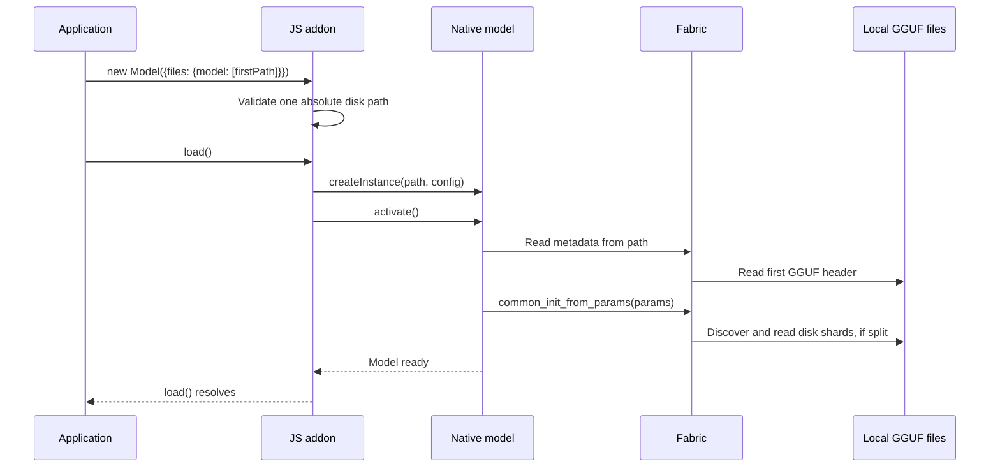
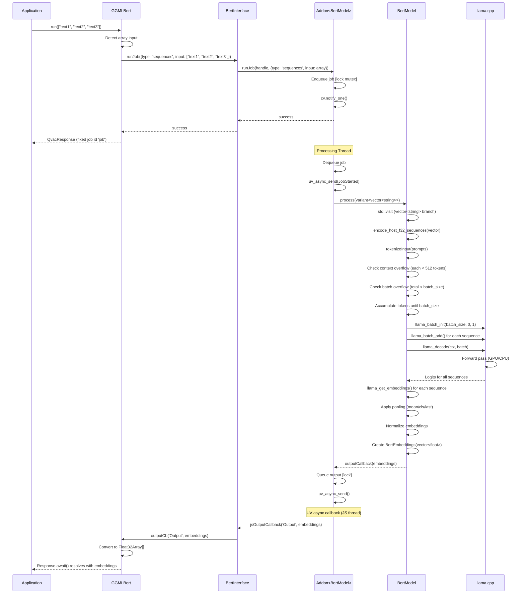
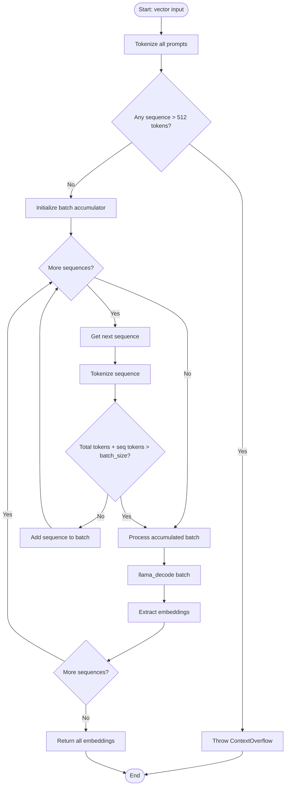
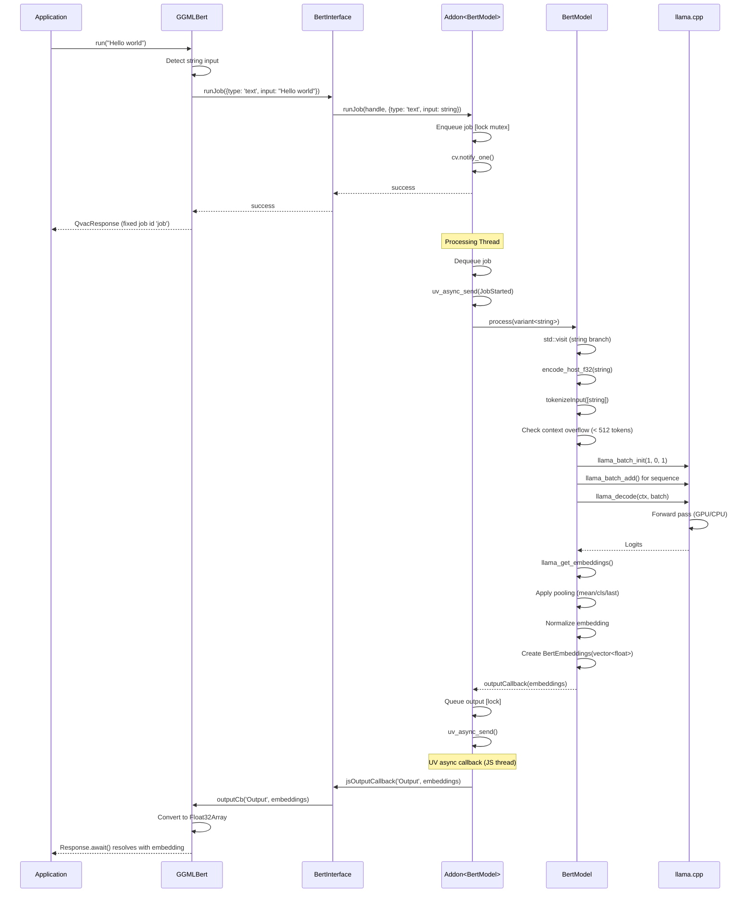
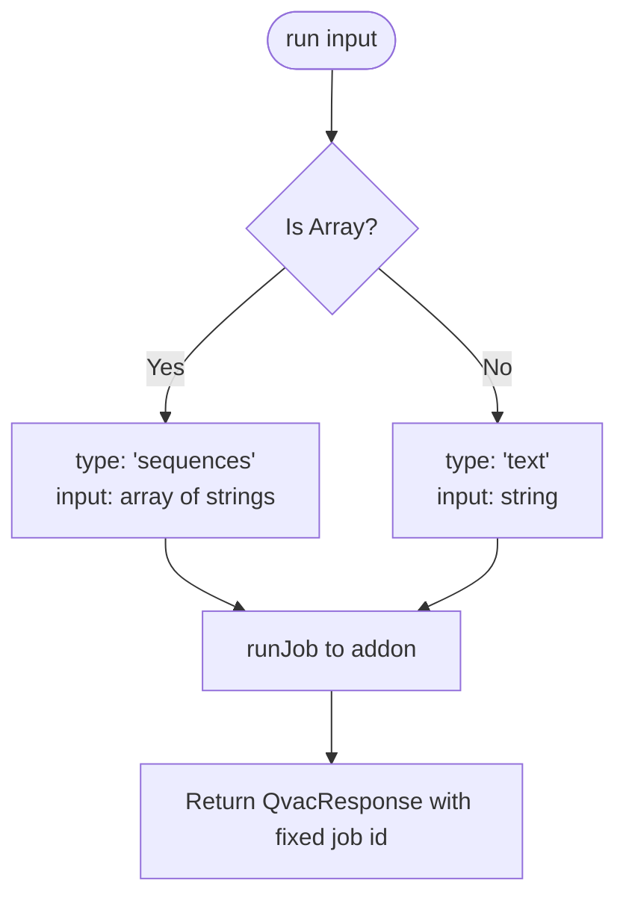
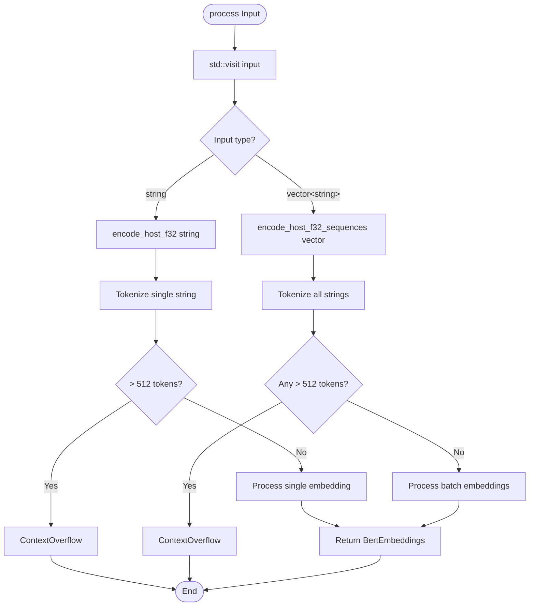

# Detailed Flow Diagrams

**⚠️ Warning:** These diagrams may become outdated as the codebase evolves. For debugging, regenerate diagrams from the actual code paths.

**Recommendation:** When investigating issues, trace through the code directly rather than relying solely on these diagrams.

---

## Table of Contents

- [Model Loading Flow](#model-loading-flow)
- [Batch Embedding Generation Flow](#batch-embedding-generation-flow)
- [Removed Weight Streaming](#removed-weight-streaming)
- [Single Text Embedding Flow](#single-text-embedding-flow)

---

## Model Loading Flow

Models load from disk only. Pass exactly one absolute path in `files.model`:
the single GGUF file, or the first shard (`*-00001-of-000NN.gguf`). All shards
must already be in the same directory with their original names. Fabric reads
the GGUF metadata, discovers the remaining shards and reads their weights.
No JavaScript weight buffers or `.tensors.txt` file are needed.

Passing multiple paths or weight buffers is rejected. Migrate an old all-files
list to `[firstShardPath]`. The `loadWeights()` API has been removed.
This removes model-weight streaming, while generated output still streams as before.

This path is shared by `GGMLBert`, `LayaDecisions` and `Reranker`.
The reranker also checks shard headers for its classifier tensors; the shard
count comes from the bounded GGUF header, never from the filename.

## Batch Embedding Generation Flow

### Complete Batch Processing Sequence

### Batch Token Accumulation Detail

---

## Removed Weight Streaming

Models load from disk only. Pass exactly one absolute path in `files.model`:
the single GGUF file, or the first shard (`*-00001-of-000NN.gguf`). All shards
must already be in the same directory with their original names. Fabric reads
the GGUF metadata, discovers the remaining shards and reads their weights.
No JavaScript weight buffers or `.tensors.txt` file are needed.

Passing multiple paths or weight buffers is rejected. Migrate an old all-files
list to `[firstShardPath]`. The `loadWeights()` API has been removed.
This removes model-weight streaming, while generated output still streams as before.

## Single Text Embedding Flow

### Single Text Processing Sequence

---

## Input Type Detection and Routing

### JavaScript Input Detection

### C++ Input Routing

---

**Last Updated:** 2026-04-16
