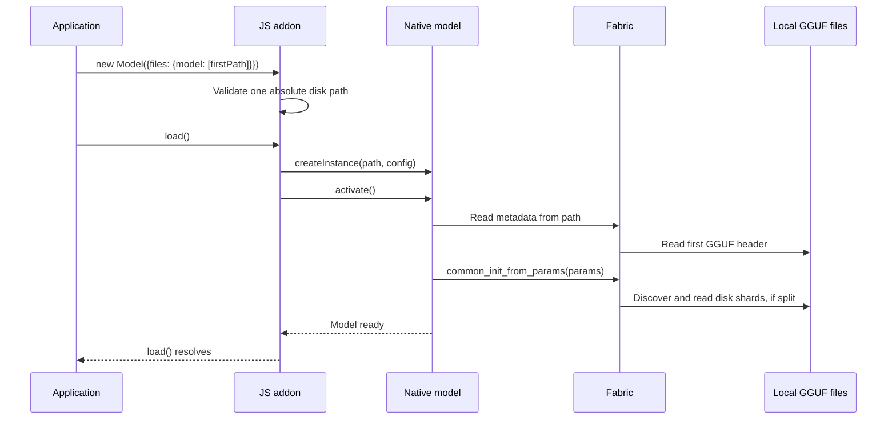
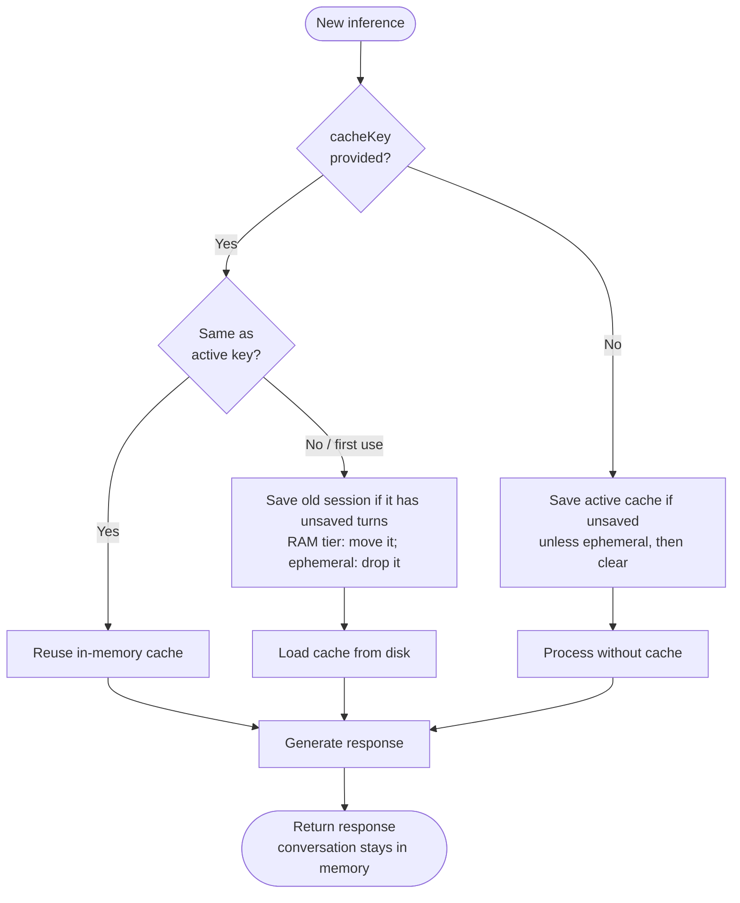

# Detailed Data Flows

This document contains detailed diagrams showing how data moves through the `@qvac/llm-llamacpp` system.

**Audience:** Developers debugging complex behavior, contributors understanding system interactions.

> **⚠️ Note:** These detailed diagrams are intended for initial reference and can quickly become outdated as the codebase evolves. For exact debugging and deep understanding, regenerate diagrams from the actual code or trace through the implementation directly.

⚡ TL;DR: Data Flow Overview

**Communication Pattern:**
- Multi-thread architecture: JavaScript thread + C++ scheduler worker threads (`parallel` lanes)
- Synchronization via mutex and condition variables
- Cross-thread flow: JS → submit job via `runJob(inputs)` → scheduler admits/queues → worker processes job → output → uv_async_send → JS callback

**Inference Path:**
- JS calls `run(messages)` → returns QvacResponse after admission (non-blocking)
- JS builds inputs array (media items + text), calls `addon.runJob(inputs)` once; resolves an AdmissionResult (`accepted` plus the scheduler-minted job id used to route output and targeted cancels)
- A C++ scheduler worker takes the job, calls `model.process(std::any, jobId)` → generates tokens; with `parallel >= 2` several jobs decode together (continuous batching)
- Queues output events (tagged by job id) → triggers JS callback asynchronously
- Emits: Output (streaming), JobEnded, Error — there is no start event; admission is signalled by `runJob` resolving its `AdmissionResult`

**Weight Loading:**

Models load from disk only. Pass exactly one absolute path in `files.model`:
the single GGUF file, or the first shard (`*-00001-of-000NN.gguf`). All shards
must already be in the same directory with their original names. Fabric reads
the GGUF metadata, discovers the remaining shards and reads their weights.
No JavaScript weight buffers or `.tensors.txt` file are needed.

Passing multiple paths or weight buffers is rejected. Migrate an old all-files
list to `[firstShardPath]`. The `loadWeights()` API has been removed.
This removes model-weight streaming, while generated output still streams as before.

**Session Cache:**
- Optional KV cache persistence to disk via `CacheManager`
- Controlled via `runOptions` fields (`cacheKey`, `ephemeral`) and `saveCache(cacheKey)`
- Context overflow only affects RAM; disk cache preserved until explicit save

## Table of Contents

- [Primary Inference Flow](#primary-inference-flow)
- [Weight Loading Flow](#weight-loading-flow)
- [Metadata Extraction Flow](#metadata-extraction-flow)
- [Multimodal Inference Flow](#multimodal-inference-flow)
- [Session Cache Flow](#session-cache-flow)

---

## Primary Inference Flow

### High-Level Flow

```mermaid
flowchart TD
    Start([JS: model.run]) --> ParseMsg[Parse messages array]
    ParseMsg --> CheckMedia{Has media?}
    
    CheckMedia -->|Yes| BuildMedia[Build media items<br/>type: 'media', content]
    CheckMedia -->|No| SerializeJSON[Serialize to JSON]
    BuildMedia --> SerializeJSON
    
    SerializeJSON --> BuildInputs[Build inputs array:<br/>media items + text]
    BuildInputs --> RunJob[addon.runJob&#40;inputs&#41;]
    RunJob --> CreateResp[Create QvacResponse]
    CreateResp --> ReturnJS([Return to JavaScript])
    
    RunJob -.->|Enters C++| LockMutex[Lock mutex]
    LockMutex --> SetJob[Enqueue job - scheduler admission]
    SetJob --> NotifyCV[Notify condition variable]
    NotifyCV --> UnlockMutex[Unlock mutex]
    
    NotifyCV -.->|Wakes| ProcThread[Processing Thread]
    
    ProcThread --> WaitWork{Has work?}
    WaitWork -->|No| SleepCV[cv.wait]
    SleepCV --> WaitWork
    
    WaitWork -->|Yes| LockProc[Lock mutex]
    LockProc --> TakeJob[Take job input]
    TakeJob --> UnlockProc[Unlock mutex]
    UnlockProc --> GetInput[Get next input piece]
    GetInput --> CheckType{Input type?}
    
    CheckType -->|Text| ParseChat[Parse JSON to chat_msg]
    CheckType -->|Media| LoadImage[Load image data]
    
    ParseChat --> FormatPrompt[Format with chat template]
    LoadImage --> FormatPrompt
    
    FormatPrompt --> Tokenize[Tokenize prompt]
    Tokenize --> LlamaDecode[llama_decode<br/>Process prompt]
    
    LlamaDecode --> GenLoop{Generate tokens}
    GenLoop -->|Continue| Sample[llama_sampler_sample]
    Sample --> CheckEOS{EOS token?}
    CheckEOS -->|No| DecodeToken[Decode token to UTF-8]
    DecodeToken --> LockOut[Lock output mutex]
    LockOut --> QueueOutput[Queue Output event]
    QueueOutput --> UnlockOut[Unlock mutex]
    UnlockOut --> SendAsync2[uv_async_send]
    SendAsync2 --> GenLoop
    
    CheckEOS -->|Yes| GetStats[Collect runtime stats]
    GetStats --> QueueJobEnd[Queue JobEnded event]
    QueueJobEnd --> SendAsync3[uv_async_send]
    SendAsync3 --> ProcThread
    
    GenLoop -->|Error| QueueError[Queue Error event]
    QueueError --> ResetModel[model.reset]
    ResetModel --> SendAsync3
    
    SendAsync2 -.->|Triggers| UVCallback[UV async callback]
    UVCallback --> LockCB[Lock output mutex]
    LockCB --> DequeueOutputs[Dequeue all outputs]
    DequeueOutputs --> UnlockCB[Unlock mutex]
    UnlockCB --> ForEach[For each output event]
    
    ForEach --> InvokeJS[Call JavaScript outputCb]
    InvokeJS --> UpdateResponse[QvacResponse emits]
    UpdateResponse --> IterYield([Async iterator yields token])
```

📊 LLM-Friendly: Inference Flow Breakdown

**Phase 1: Job Submission (JavaScript → C++)**

| Step | Thread | Duration | Operation | Blocking? |
|------|--------|----------|-----------|-----------|
| 1 | JS | <0.1ms | Parse messages | No |
| 2 | JS | <0.1ms | Serialize to JSON | No |
| 3 | JS | <1ms | Call addon.runJob(inputs) | No |
| 4 | JS | <0.1ms | Lock mutex | No |
| 5 | JS | <0.1ms | Set job input | No |
| 6 | JS | <0.1ms | Signal CV | No |
| 7 | JS | <0.1ms | Unlock mutex | No |
| 8 | JS | <0.1ms | Return AdmissionResult (accepted + job id) | No |
| 9 | C++ | - | Wake from cv.wait() | - |

**Phase 2: Processing (C++ Background Thread)**

| Step | Thread | Duration | Operation | Blocks JS? |
|------|--------|----------|-----------|------------|
| 10 | C++ | <0.1ms | Lock mutex | No |
| 11 | C++ | <0.1ms | Take job input | No |
| 12 | C++ | <0.1ms | Unlock mutex | No |
| 13 | C++ | <1ms | Parse JSON | No |
| 14 | C++ | 1-10ms | Format chat template | No |
| 15 | C++ | 10-100ms | Tokenize | No |
| 16 | C++ | 100ms-10s | llama_decode (prompt) | No |
| 17 | C++ | 10-100ms per token | Sample & decode token | No |

**Phase 3: Output Delivery (C++ → JavaScript)**

| Step | Thread | Duration | Operation | Details |
|------|--------|----------|-----------|---------|
| 18 | C++ | <0.1ms | Lock output mutex | Per token |
| 19 | C++ | <0.1ms | Queue output | Per token |
| 20 | C++ | <0.1ms | Unlock mutex | Per token |
| 21 | C++ | <0.1ms | uv_async_send() | May coalesce |
| 22 | JS | - | UV schedules callback | Next tick |
| 23 | JS | <0.1ms | Lock mutex | Batch |
| 24 | JS | <0.1ms | Drain outputs | Batch |
| 25 | JS | <0.1ms | Unlock mutex | Batch |
| 26 | JS | Varies | Invoke outputCb | User code |

**Event Types:**

| Event | When | Data | Purpose |
|-------|------|------|---------|
| Output | Each token generated | token string, tagged with the job id | Stream text |
| BatchOutput | Each token of a batch sequence | {id, output} — `id` is the JS-facing per-prompt id | Stream text per sequence |
| BatchResult | All sequences of a batch group finished | ordered per-sequence outputs | Resolve `await()` |
| JobEnded | All input processed | RuntimeStats, tagged with the job id | Track completion |
| Error | Processing fails | error, tagged with the job id | Error handling |

The job id is a separate callback argument, not a payload field: the output
callback is invoked as `(handle, eventType, data, error, jobId)`.

**Performance Characteristics:**

- Job queueing: <1ms total
- Prompt processing: 100ms-10s (prompt length dependent)
- Token generation: 10-100ms per token (model dependent)
- Output callback: <1ms overhead + user callback time
- Coalescing: Multiple tokens may arrive in single callback

---

## Weight Loading Flow

Models load from disk only. Pass exactly one absolute path in `files.model`:
the single GGUF file, or the first shard (`*-00001-of-000NN.gguf`). All shards
must already be in the same directory with their original names. Fabric reads
the GGUF metadata, discovers the remaining shards and reads their weights.
No JavaScript weight buffers or `.tensors.txt` file are needed.

Passing multiple paths or weight buffers is rejected. Migrate an old all-files
list to `[firstShardPath]`. The `loadWeights()` API has been removed.
This removes model-weight streaming, while generated output still streams as before.

## Metadata Extraction Flow

The native addon calls `llama_model_meta_from_file()` with the supplied disk
path before configuring the context. For a split model, the first shard holds
the model metadata. No streamed buffer is borrowed or consumed.

## Multimodal Inference Flow

For vision + text models (e.g., LLaVA, Qwen2.5-Omni):

```mermaid
flowchart LR
    Start([JS: run with media]) --> CheckMsg{Message has<br/>type: 'media'?}
    
    CheckMsg -->|Yes| BuildMedia[Build media items<br/>type: 'media', content: Uint8Array]
    CheckMsg -->|No| BuildText
    
    BuildMedia --> ModifyMsg[Modify message<br/>content: empty string]
    ModifyMsg --> BuildText[Build text item<br/>type: 'text', input: JSON]
    
    BuildText --> RunJob[addon.runJob&#40;&#91;media..., text&#93;&#41;]
    RunJob --> ProcessMedia{Has media?}
    ProcessMedia -->|Yes| LoadImage[LlamaModel.LoadMedia<br/>load image via llava]
    ProcessMedia -->|No| SkipMedia
    
    LoadImage --> EmbedImage[Generate image embeddings<br/>via projection model]
    EmbedImage --> SkipMedia[Continue to text]
    
    SkipMedia --> FormatPrompt[Format chat template<br/>with image placeholder]
    FormatPrompt --> Tokenize[Tokenize text]
    Tokenize --> Decode[llama_decode<br/>text + image embeddings]
    Decode --> Generate[Generate tokens]
    Generate --> Output([Stream output])
```

📊 LLM-Friendly: Multimodal Flow

**Message Processing:**

| Message | Role | Type | Content | Processing |
|---------|------|------|---------|-------------|
| 1 | user | media | Uint8Array (image) | Add to inputs array as `{ type: 'media', content }`, clear content in chat |
| 2 | user | text | "What do you see?" | Add to inputs array as `{ type: 'text', input: JSON }` |

**Image Loading Methods:**

Images can be provided in two ways:
1. **As Uint8Array**: Image data loaded into memory in JavaScript and passed as binary buffer
2. **As filesystem path**: String path to image file, loaded directly by C++ layer

**Image Processing:**

| Step | Component | Operation | Output |
|------|-----------|-----------|--------|
| 1 | JavaScript | Read image file or pass path | Uint8Array or string |
| 2 | LlamaModel | Load via llava | Image handle |
| 3 | Projection model | Encode image | Embeddings tensor |
| 4 | LlamaModel | Concatenate with text | Combined input |
| 5 | llama.cpp | Process | Text output |

---

## Session Cache Flow

`CacheManager` persists KV cache state between inference calls for multi-turn conversations. Cache is controlled via `runOptions` fields (`cacheKey`, `ephemeral`) and the `saveCache(cacheKey)` method.

**Cache Control:**
- Disk cache only modified by `saveCache(cacheKey)`, a session switch, an eviction, a reload or an unload; never for ephemeral conversations except by `saveCache`
- Context overflow discards tokens from RAM only; disk cache preserves state before overflow
- No automatic cache invalidation in the addon

---

**Related Documents:**
- [architecture.md](architecture.md) - Complete architecture documentation

**Last Updated:** 2026-04-16

